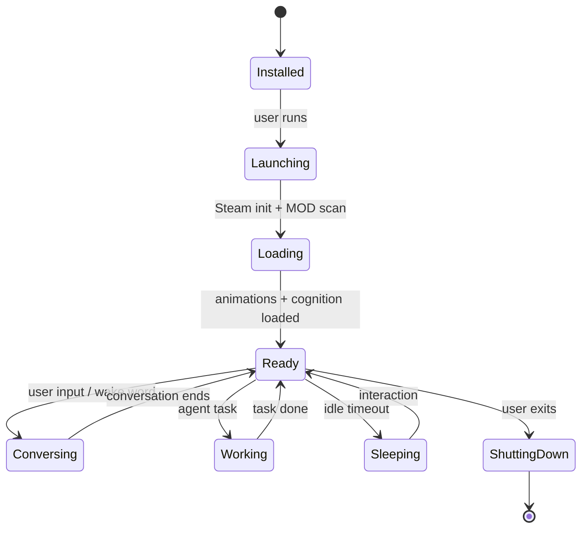
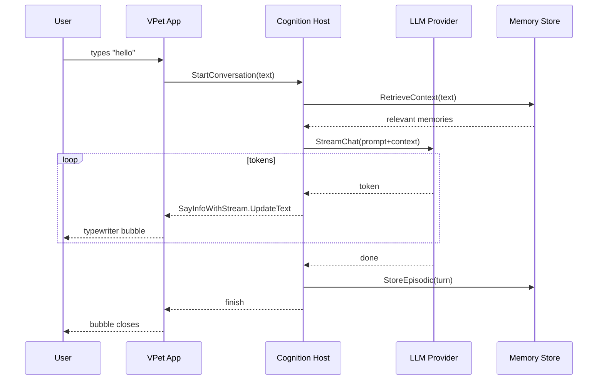
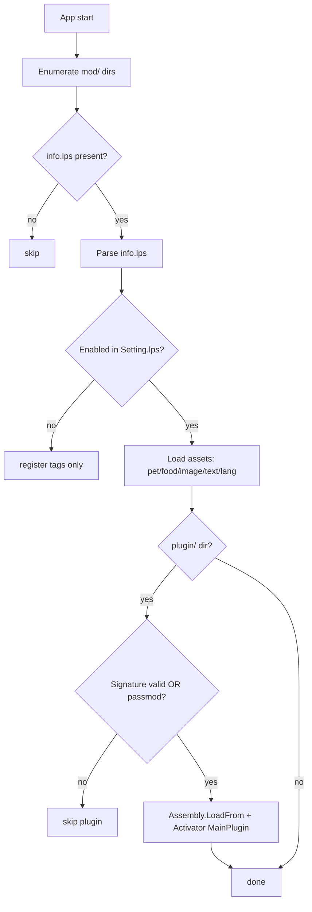

# 01 — Project Overview

## Purpose
Establish a shared understanding of what VPet is today, what it must become, who cares about it, and the vocabulary used across the rest of the specification.

## Business Goal
Deliver an offline-first AI desktop companion that retains VPet's existing user base (Steam Workshop creators, modders, end users) while adding long-term memory, evolving personality, emotional intelligence, autonomous agency, secure tool usage, and natural voice conversation — without breaking the existing MOD ecosystem or forcing a cloud dependency.

## Technical Goal
Define the product boundary, stakeholders, success metrics, and glossary so every subsequent document can reference them without redefinition.

## Functional Requirements

| ID | Requirement |
|---|---|
| FR-OV-01 | The product is a Windows desktop application (WPF/.NET 8) that renders an animated pet on the desktop. |
| FR-OV-02 | The product supports a MOD/workshop ecosystem for animations, items, foods, text, themes, and code plugins. |
| FR-OV-03 | The product, after transformation, converses with the user via text and voice. |
| FR-OV-04 | The product remembers the user across sessions. |
| FR-OV-05 | The product evolves a personality over time. |
| FR-OV-06 | The product exhibits emotions that influence animation and voice. |
| FR-OV-07 | The product can execute tools (shell, files, clipboard, browser, Win32) only with explicit permission. |
| FR-OV-08 | The product runs fully offline with local AI models; cloud providers are optional. |

## Non Functional Requirements

| ID | Requirement |
|---|---|
| NFR-OV-01 | Cold start to first conversation < 10 s on a machine meeting the local-model minimum spec. |
| NFR-OV-02 | Memory persistence survives app restarts and crashes. |
| NFR-OV-03 | No telemetry or user data leaves the machine without explicit consent. |
| NFR-OV-04 | Existing MODs load and run unchanged. |
| NFR-OV-05 | The app is deterministic given the same inputs and seed. |

## Architecture
See `02_current_architecture.md` (existing) and `03_target_architecture.md` (target). This document defines the product context only.

## Module Design
Not applicable at this level — see the per-domain documents.

## Folder Structure (repository root, current)
```
VPet/
├── VPet.sln
├── VPet-Simulator.Core/          # rendering + game engine library
├── VPet-Simulator.Windows/       # main desktop app (WinExe)
├── VPet-Simulator.Windows.Interface/  # plugin API contract library
├── VPet.Solution/               # standalone settings/save/mod editor
├── VPet-Simulator.Tool/         # net48 console MOD authoring tool
├── mod/                          # shipped MOD assets (excluded from build)
├── README.md  README_en.md  README_zht.md  README_ja.md
└── docs/                         # this specification project
```

## Interfaces
Product-level interfaces (the contracts that define the product boundary):
- `VPet_Simulator.Core.IController` — host window control (existing).
- `VPet_Simulator.Core.IGameSave` — save model (existing).
- `VPet_Simulator.Windows.Interface.IMainWindow` — plugin↔host API (existing).
- `VPet_Simulator.Windows.Interface.MainPlugin` — plugin base class (existing).
- `VPet.Cognition.Domain.*` — new cognitive contracts (target, see `03_target_architecture.md`).

## Classes
Not applicable at this level.

## State Machine
Product lifecycle (high level):



## Sequence Diagram (Mermaid)
First conversation after install:



## Flow Diagram (Mermaid)
MOD loading flow (existing, preserved):



## Database Schema
Current: none (LPS files only). Target: SQLite for memory — see `05_memory_system.md`.

## Data Models
Current save model (`GameSave_VPet`): Name, HostName, Money, Exp, Level, LevelMax, Strength, StrengthFood, StrengthDrink, Feeling, Health, Likability, Mode, Store buffers, Change deltas. See `02_current_architecture.md` for full detail.

## APIs
Product exposes no external API. It consumes: Steam (workshop, cloud saves, RichPresence), optional LLM/STT/TTS provider endpoints.

## Configuration
Current: `Setting_*.lps` (LinePutScript). Target: `appsettings.json` + LPS bridge — see `14_configuration.md`.

## Logging
Current: `ConsoleRedirectWriter` to a debug log file. Target: Serilog structured logging — see `14_configuration.md`.

## Telemetry
Current: `Statistics` (in-save counters). Target: local-only OpenTelemetry-style metrics for cognitive latency — see `14_configuration.md`.

## Performance Targets
| Metric | Target |
|---|---|
| Cold start to ready | < 10 s |
| First token latency (local LLM) | < 1.5 s |
| STT latency (wake to text) | < 800 ms |
| TTS first audio latency | < 500 ms |
| Memory retrieval (top-10) | < 200 ms |
| Animation frame budget | 60 FPS (existing) |

## Security
See `15_security.md`. Key concerns: plugin code execution (existing, signature-gated), tool execution (new, permission-gated), memory privacy (new, encryption-at-rest option).

## Error Handling
Domain errors use `Result<T, Error>`; provider errors are caught, logged with correlation id, and surfaced as a friendly message in the conversation UI. The app never crashes from a provider failure — it falls back to the next provider or to a no-op.

## Edge Cases
- No AI provider configured → companion is silent but still animated (existing behavior).
- Local model missing → prompt user to install or switch to cloud provider.
- Memory DB locked → degrade to in-context-only memory; warn user.
- Tool permission denied → agent reflects and retries with a different plan.
- Voice hardware missing → fall back to text conversation.

## Acceptance Criteria
1. A new user can install, enable a local LLM provider, and have a text conversation within 5 minutes.
2. An existing MOD author's plugins compile and load unchanged.
3. The product runs with zero internet for 24 hours with no degradation beyond model quality.

## Unit Tests
See `16_testing.md`.

## Integration Tests
See `16_testing.md`.

## Future Expansion
See `19_future_features.md`.

## Refactoring Notes
The transformation is additive. Existing projects are refactored only to expose new extension points (e.g., `Main` raising a `CognitionTick` event). No existing public API is removed without a deprecation cycle.

## Migration Strategy
- Save format: `GameSave_v2` is extended with a `cognition` Sub line; old saves load without cognition data (fresh memory).
- Settings: `Setting.lps` gains `cognition` lines; old settings load with defaults.
- MODs: no migration; existing MOD API unchanged.

## Implementation Steps
See Development Order in `task.md` §14.

## Agent Instructions
Read this document first, then `02_current_architecture.md`, then your phase's document.

## Developer Notes
- VPet ships on Steam (AppID 1920960) and as a NuGet library (`VPet-Simulator.Core`).
- The animation copyright is held by the VUP-Simulator team; commercial use has specific attribution requirements (see README).
- The `mod/0000_core` directory is the always-on core MOD; `OnModDefList = {"Core","PCat"}`.