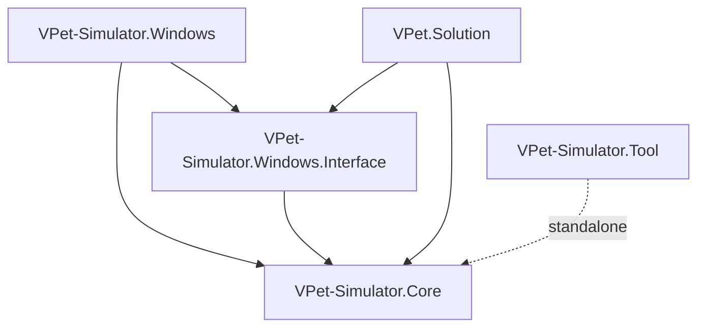
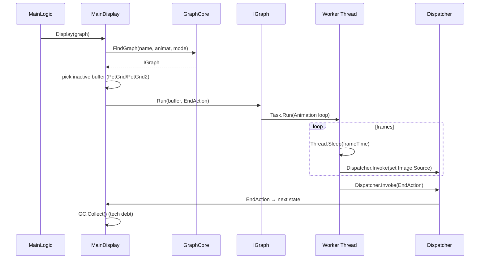
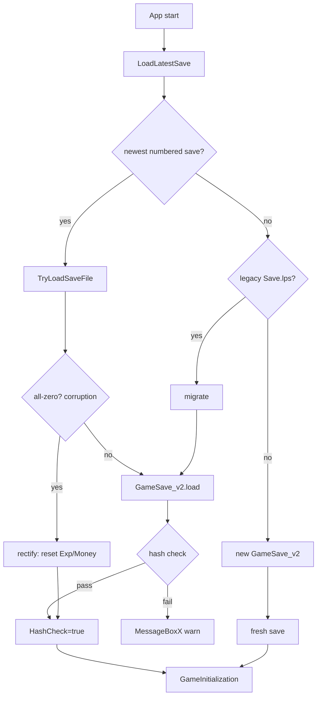

# 02 — Current Architecture

## Purpose
Document the existing VPet solution architecture in enough detail that the target architecture (`03_target_architecture.md`) can be designed without breaking it, and that autonomous agents know exactly what exists, where, and how it behaves.

## Business Goal
Preserve the working MOD ecosystem, animation engine, save format, and Steam integration while adding cognition.

## Technical Goal
Provide a precise map of the 5 existing projects, their dependencies, key types, event system, threading model, configuration, persistence, and technical debt.

## Functional Requirements
This document is descriptive, not prescriptive.

## Non Functional Requirements
N/A (descriptive).

## Architecture

### Solution topology

`VPet.sln` contains 5 projects:

| Project | Type | Target | Role |
|---|---|---|---|
| `VPet-Simulator.Core` | Library | net8.0-windows (WPF+WinForms) | Rendering/animation engine + game simulation. Embeddable in any WPF app. |
| `VPet-Simulator.Windows.Interface` | Library | net8.0-windows (WPF) | Plugin API contract. Interfaces + abstract base + Mod data models. No app logic. |
| `VPet-Simulator.Windows` | WinExe | net8.0-windows (WPF+WinForms, x86/x64) | Main desktop pet application. Plugin loader, Steam, all dialogs. |
| `VPet.Solution` | WinExe | net8.0-windows (WPF) | Standalone settings/save/mod editor. |
| `VPet-Simulator.Tool` | Exe | net48 | Console MOD authoring tool (image frames, .lps generation). |

### Dependency direction



Plugins (compiled DLLs in `mod/<name>/plugin/`) reference **Interface + Core only** — never the Windows app. `IMainWindow` is the boundary they program against.

### Key NuGet dependencies

| Package | Used by | Purpose |
|---|---|---|
| `LinePutScript` 1.11.9 | Core, Interface, Windows, Solution | Custom `.lps` serialization format — backbone of all config, saves, MOD info, graph metadata. |
| `LinePutScript.Localization.WPF` 1.0.7 | all | i18n via `LocalizeCore.Translate` / `{ll:Str}` XAML. |
| `Panuon.WPF` 1.1.3 / `Panuon.WPF.UI` 1.2.4.10 | all | UI controls: `WindowX`, `MessageBoxX`, `ContentControlX`, theming. |
| `SkiaSharp` 3.116.1 | Core | Off-screen raster composition for PNG/APNG sprite-sheet building. |
| `Facepunch.Steamworks` 2.3.3 | Windows | Steam: init, RichPresence, lobbies/P2P, workshop, cloud saves. Per-platform (x64/win32). |
| `NAudio` 2.2.1 | Windows | Audio meter detection (music sensing). Only `MMDeviceEnumerator` actually used. |
| `WpfAnimatedGif` 2.0.2 | Windows | Animated GIF in Gallery. |
| `FastMember` 1.5.0 | Solution | Reflection-based property copy (`SettingModel`↔`Setting`). |

## Module Design

### VPet-Simulator.Core — the engine library

**Display layer** — `Main : ContentControlX, IDisposable` split across 3 partial files:
- `Main.xaml(.cs)` — XAML composition (Viewbox→Grid with `MediaElement VoicePlayer`, `PetGrid`/`PetGrid2` double-buffer decorators, `UIGrid`, `LabelDisplay`), lifecycle (`Load_0_BaseConsole` → `Load_2_WaitGraph` → `Load_3_BindingTimer` → `Load_4_Start`), mouse/touch input, voice playback, `IDisposable`.
- `MainDisplay.cs` — animation state machine: `DisplayType`, all `DisplayXxx` methods, `Display(...)` overload cascade, double-buffer swap.
- `MainLogic.cs` — simulation tick: `EventTimer_Elapsed`, `FunctionSpend`, sleep/work/move logic, `Say*` family, `WorkingState` enum.

**Sub-controls** (added to `UIGrid`):
- `ToolBar` — context menu + hover panel (Level/Exp/Money/Strength/Feeling/Food/Drink bars). `AddMenuButton(MenuType, name, Action)` for host injection.
- `MessageBar : IMassageBar` — speech bubble with typewriter effect. **Streaming seam**: `SayInfoWithStream` with `Event_Update`/`Event_Finish` events — this is the integration point for LLM streaming.
- `WorkTimer` — work/study/play overlay. `FinishWorkInfo` struct, `StopReason` enum.

**Graph/Animation system**:
- `IGraph` interface — `Run(Decorator, Action)`, `IsLoop`, `IsReady`, `IsFail`, `GraphInfo`, `TaskControl`, `Stop`, `SetContinue`. `IGraph.IRunImage` adds `Run(Image, Action)`.
- `TaskControl` — mutable control-traffic enum `{Status_Quo, Stop, Continue, Status_Stoped}`. **Not thread-safe** (no volatile/lock); relies on eventual visibility between worker and dispatcher threads.
- `GraphInfo` — metadata: `GraphType` (28 values), `AnimatType` (Single/A_Start/B_Loop/C_End), `ModeType` (Happy/Nomal/PoorCondition/Ill, ordered 0..3 for fallback). Inferred from filesystem path + .lps line.
- `GraphCore` — registry + cache: 3 dictionaries (`GraphsName`, `GraphsList`, `GraphsALL`), `CommUIElements` (shared Image pools), `CleanTimer` (30 s idle eviction), `FindGraph(name, animat, mode)` with mode fallback (exact → +1 → −1 → any non-Ill).
- Renderers: `Picture` (static PNG), `PNGAnimation` (folder of PNGs → sprite-sheet via SkiaSharp, `Parallel.For` decode, disk cache, `CroppedBitmap` with 2-frame lookahead), `APNGAnimation` (hand-rolled APNG chunk parser, CRC table, `DisposeOp`/`BlendOp`), `FoodAnimation` (3-layer front/food/back with `ISub a0…aN` animation timeline).
- `PetLoader.LoadGraph` — recursive walk; `info.lps` line names map through static `IGraphConvert` dict (`pnganimation`/`apnganimation`/`picture`/`foodanimation`). **Public extension point** for new graph types.

**Handle/Game layer**:
- `GameCore` — DI root POCO: `IController Controller`, `List<TouchArea> TouchEvent`, `GraphCore Graph`, `IGameSave Save`.
- `IController` — host-implemented window control: `MoveWindows`, `GetWindowsDistance*`, `ZoomRatio`, `PressLength`, `ShowPanel`, `ResetPosition`, `CheckPosition`, `EnableFunction`, `InteractionCycle`, `RePositionActive`, `AutoChangeWindow`. Has default interface methods.
- `IGameSave` — save model interface: Money/Exp/Level, vitals (Strength/StrengthFood/StrengthDrink/Feeling/Health/Likability), Store buffers, Change deltas, `EatFood(IFood)`, `CalMode()`, `ToLine()`.
- `GameSave` — reference impl; every property `[Line]`-annotated for LPS serialization; overflow rolls into Health/Likability penalties.
- `IFood` — stat deltas.
- `Function` — static helpers: `Random Rnd` (shared, concurrency smell), color/brush utils, memory metrics, `ComCheck` (sentence counter for MessageBar timing).
- `SayInfo` — abstract base; `SayInfoWithOutStream` (fixed text) and `SayInfoWithStream` (StringBuilder + `Event_Update`/`Event_Finish` — the LLM streaming seam).

### VPet-Simulator.Windows.Interface — the plugin contract

- `IMainWindow` (297 lines) — the entire plugin↔host API: identity (`PrefixSave`, `Args`, `IsSteamUser`, `SteamID`, `version`), subsystems (`Set`, `Pets`, `Core`, `Main`, `GameSavesData`, `ScheduleTask`), mod data (`Foods`, `ClickTexts`, `SelectTexts`, `LowFoodText`/`LowDrinkText`, `Photos`, `ModInfo`), resources (`ImageSources`, `FileSources`, `DynamicResources`), UI (`MGHost`, `PetGrid`, `Dispatcher`), action surface (`SetZoomLevel`, `Save`, `ShowSetting`, `ShowBetterBuy`, `DisplayFoodAnimation`, `TakeItem`, `ItemsAdd`, `GenerateAuthKey`), events (`MutiPlayerHandle`, `Event_TakeItem`, `Event_NewDay`, `Event_TakeItemHandle`), items (`Items`, `ActivityLogs`).
- `MainPlugin` — abstract base: ctor takes `IMainWindow`, virtual `LoadPlugin`/`GameLoaded`/`EndGame`/`Save`/`Setting`/`LoadDIY`.
- `ISetting` — settings interface.
- `GameSave_VPet : IGameSave` — the live save model: Level/LevelMax (rebirth tiers), Exp level-up loop, stat clamping with overflow→Health/Likability, `CalMode()`, `[Line]` serialization.
- `GameSave_v2 : IGetOBJ<ILine>` — wrapper: `GameSave_VPet GameSave` + `Statistics` + `LPS_D Data` (plugin extension bag). Hash verification (per-vpet weighted MD5 + global `Sub.GetHashCode`). `HashCheck` flag = "legit player".
- `Statistics` — in-save counters.
- `ScheduleTask` — scheduled work packages.
- `ActivityLog` — UI-bound activity feed.
- `Mod/*` — `Food : Item, IFood` (FoodType enum, `RealPrice` formula, `IsOverLoad`), `Item : NotifyPropertyChangedBase` (extensible item system with `Creators`/`UseAction` dicts), `ClickText : ICheckText, IFood` (random chatter with state predicates), `SelectText : ICheckText, IFood` (dialog choices), `LowText` (low-stat barks), `Photo`, `IModInfo`.
- `MutiPlayer/*` — `IMPFriend`, `IMPWindows`, `MPMessage` (multiplayer contracts).
- `ExtensionFunction` — `ExtensionValue` with `DllReferenceDescriptions` (attribution registry).

### VPet-Simulator.Windows — the main app

- `MainWindow` split across 4 partial files (`MainWindow.xaml.cs` 928 lines, `MainWindow.cs` 3049 lines, `MainWindow_Property.cs` 132 lines, `MainWindow.xaml`). Implements `IMainWindow` directly.
- Two constructors: default (Steam init + workshop + full load) and multi-open (prefix save, inherits workshop/resolution).
- `MWController : IController` — adapter to WPF MainWindow; screen-border distance, DPI-aware, snap-back.
- `CoreMOD` — MOD loader: reads `info.lps`, loads `theme/pet/food/image/file/photo/text/lang/plugin` dirs. **Plugin code execution**: `Assembly.LoadFrom` + X509 signature validation (two hard-coded LB Game trust roots; foreign-signed only if `Set.IsPassMOD`). `OnModDefList={"Core","PCat"}` always-on.
- `Setting : LPS_D, ISetting` — all settings in LPS. Some stored inverted (`TopMost`, `StartUPBootSteam`, `AllowMove`).
- `WinDesign/*` — dialogs: `winGameSetting`, `winBetterBuy` (shop), `winConsole`, `winCharacterPanel`, `winGallery`, `winInventory`, `winWorkMenu`, `winSaveManager`, `winReport`, `winInputBox`, `TalkSelect`, `DIYViewer`.
- `MutiPlayer/*` — `MPController`, `MPFriends`, `MPMOD`, `winMutiPlayer`, `winMPBetterBuy` — lobby/P2P multiplayer.
- `PetHelper` — quick-switch tray icon.
- Steam: `Facepunch.Steamworks` — RichPresence (`RichPresence.vdf`), workshop upload/download, cloud saves (`VPetCloud/`), lobbies.
- Audio: `NAudio` `MMDeviceEnumerator.MasterPeakValue` for music detection.
- Win32 P/Invoke: `WS_EX_LAYERED`/`WS_EX_TRANSPARENT`/`WS_EX_TOOLWINDOW` for click-through and taskbar hiding.

### VPet.Solution — the editor app

- Standalone WPF settings/save/mod editor. Reads/writes the same LPS files as the running app.
- **Custom MVVM framework** `SimpleObservable` (namespace `HKW.HKWUtils.Observable`): `ObservableClass<TObject>` (CRTP), `INotifyPropertyChangingX`/`INotifyPropertyChangedX` (carry OldValue/NewValue + typed sender; `PropertyChangingX` is `CancelEventArgs` so subscribers can **cancel** a change), `ObservableCommand`/`ObservableCommand<T>` (sync + async handlers, `IsCanExecute` + `CurrentCanExecute`).
- VMs: `MainWindowVM`, `SettingWindowVM` (static singleton), 6 SettingEditor page VMs, 3 SaveViewer VMs. All derive `ObservableClass<TSelfVM>`. No DI — `SetViewModel<T>()` extension lazily creates.
- Models: `Setting : LPS_D` (clone of Windows `Setting`), `SettingModel` (aggregates 6 sub-models, dirty-tracks via `MergePropertyChangedNotify` using FastMember), per-category `*SettingModel` (`[ReflectionProperty]` + `[ReflectionPropertyConverter]` for type bridging), `ModModel`/`ModLoader`, `SaveModel`/`StatisticDataModel`.
- `ReflectionUtils.SetValue` — bidirectional reflection copy with converter chain (drives `SettingModel`↔`Setting` and `GameSave`↔`SaveModel`).
- Utils: `HKWUtils` (image loading, bool parsing, shell open), `ObservablePoint/Rect/Range/EnumFlags`, `CompareUtils`, `Expansions` (WPF helpers, `SetViewModel`, `WindowCloseState`).

### VPet-Simulator.Tool — net48 console

- `Program.cs` — MOD authoring: image frame generation, `.lps` enum generation (`laenum.txt` resource). Targets net48 (legacy) — likely for compatibility with older toolchains; flagged for upgrade.

## Folder Structure
See `01_project_overview.md`.

## Interfaces
All public interfaces listed above. Key extension seams:
- `PetLoader.IGraphConvert` (static dict) — new graph renderers.
- `Main` public delegates (`DisplayNomal`, `DisplayMove`, etc.) — custom idle/touch behavior.
- `Main.RandomInteractionAction` (`List<Func<bool>>`) — random idle actions.
- `Main.SayProcess` (`List<Action<SayInfo>>`) — `SayInfo` pipeline (TTS, logging).
- `ToolBar.AddMenuButton` — menu injection.
- `Item.Creators` / `Item.UseAction` — new item types.

## Classes
See Module Design. Key classes: `Main`, `GraphCore`, `GameSave`/`GameSave_VPet`/`GameSave_v2`, `MainWindow`, `CoreMOD`, `MWController`, `Setting`, `MainPlugin`, `ObservableClass<T>`, `SettingModel`, `ReflectionUtils`.

## State Machine
Animation state machine (Core, `MainDisplay.cs`):

```mermaid
stateDiagram-v2
    [*] --> Default
    Default --> Idel: EventTimer random
    Idel --> Idel_StateONE: random
    Idel_StateONE --> Idel_StateTWO
    Idel_StateTWO --> Idel
    Default --> Move: random
    Move --> Default: arrived
    Default --> Touch_Head: click head
    Default --> Touch_Body: click body
    Touch_Head --> Default: anim done
    Touch_Body --> Default: anim done
    Default --> Raised: drag
    Raised --> Default: release
    Default --> SideHide: at edge
    SideHide --> Default: mouse enter
    Default --> Sleep: idle long
    Sleep --> Default: interaction
    Default --> Work: start work
    Work --> Default: stop work
    Default --> Say: Say()
    Say --> Default: bubble close
    Default --> Switch_Up: mode up
    Default --> Switch_Down: mode down
```

`WorkingState` enum gates the tick: `Nomal/Work/Sleep/Travel/Empty`.

## Sequence Diagram (Mermaid)
Animation playback with double-buffer:



## Flow Diagram (Mermaid)
Save load flow (Windows):



## Database Schema
None. All persistence is LPS files:
- `Setting{prefix}.lps` — settings (+ `.bkp` backup).
- `Saves/Save{prefix}_{n}.lps` — rolling saves (capped at `BackupSaveMaxNum`, default 50).
- `Saves_BKP/Save{prefix}_{hash}.lps` — hash-named backup.
- `VPetCloud/Save{prefix}_{ticks}.lps` — Steam cloud saves.
- `mod/<name>/info.lps` — MOD metadata.
- Per-animation `info.lps` — graph metadata.

## Data Models
`GameSave_VPet` fields (all `[Line]`-serialized):
- Identity: `Name`, `HostName`.
- Economy: `Money` (float), `Exp` (int), `Level` (int, computed), `LevelMax` (int, rebirth tier).
- Vitals (double, clamped 0..Max): `Strength`, `StrengthFood`, `StrengthDrink`, `Feeling`, `Health`, `Likability`.
- Capacity: `StrengthMax = 100 + (int)(Pow(Level*(1+LevelMax), 0.75)*4)`, `FeelingMax = 100 + (int)(Pow(Level*(1+LevelMax), 0.75)*2)`, `LikabilityMax = 90 + Level*10`.
- Store buffers: `StoreStrength`, `StoreStrengthFood`, `StoreStrengthDrink`.
- Change deltas: `ChangeStrength`, `ChangeStrengthFood`, `ChangeStrengthDrink`, `ChangeFeeling`.
- `Mode` (`ModeType`, default `Nomal`).

## APIs
No external API. Consumes Steam SDK + optional AI provider endpoints.

## Configuration
`Setting : LPS_D` properties (partial list): `ZoomLevel`, `VoiceVolume`, `Diagnosis`, `CalFunState` (ModeType), `AutoSaveInterval`, `PetGraph`, `MoveArea`/`MoveAreaDefault` (System.Drawing.Rectangle), `HideFromTaskControl`, `TopMost` (inverted), `StartUPBoot`, `StartUPBootSteam` (inverted), `StartRecordLast` (inverted), `AllowMove` (inverted), `PressLength`, `InteractionCycle`, `LogicInterval`, `SmartMove`/`SmartMoveInterval`, `MusicCatch`/`MusicMax`, `AutoBuy`, `AutoGift`, `BackupSaveMaxNum`, `Resolution`, `IsBiggerScreen`, `HitThrough`, `Language`, `Font`, `Theme`, `PetHelper`, `MessageBarOutside`, `MoveArea`.

## Logging
`ConsoleRedirectWriter` redirects `Console.Out` to a debug log file. No structured logging. No correlation ids. No log levels.

## Telemetry
`Statistics` class — in-save counters (play time, item counts, work counts, etc.). No external telemetry.

## Performance Targets
Current: 60 FPS animation (sprite-sheet rendering). `EventTimer` 15 s tick. `PNGAnimation.MaxLoadMemory` capped to half available RAM. No AI latency targets (no AI yet).

## Security
- **Plugin code execution**: `Assembly.LoadFrom` with X509 signature validation. Two hard-coded LB Game trust roots. Foreign-signed DLLs require explicit `passmod` user consent. Unsigned → skipped. **Risk**: trust root list is hard-coded; no revocation; no sandboxing (full-trust in-process).
- **Win32 P/Invoke**: `SetWindowLong`, `SetWindowPos`, `GetWindowLong` — used for click-through/taskbar. No user input in P/Invoke calls.
- **Save hash**: weighted MD5 + `Sub.GetHashCode`; `HashCheck` flag. Tamper detection but not tamper prevention.
- **No secret management**: Steam ID and any API keys stored in LPS settings (plaintext).

## Error Handling
- MOD load errors: per-MOD try/catch; failed MODs marked `SuccessLoad=false` and skipped.
- Plugin load errors: per-plugin try/catch; `NowLoading` attribution for error messages.
- Animation missing: `nodisplayLoop` counter; after 20 → fallback to Default; after 100 → disable pet module with label.
- Save corruption: all-zero detection, overflow rectification, backup fallback.
- No global error boundary beyond `App.DispatcherUnhandledException`.

## Edge Cases
- Missing core MOD → "缺少模组Core,无法启动桌宠" error.
- `mklink.bat` required to link `mod/` into build output for dev.
- Multi-monitor: `AutoChangeWindow` (default false) for auto-switch.
- Multi-open: `PrefixSave` allows multiple pet instances with separate saves.
- Steam not running → `IsSteamUser=false`, workshop disabled, cloud saves skipped.

## Acceptance Criteria
This document is descriptive. The acceptance criteria for the transformation are in `task.md` §11.

## Unit Tests
**None.** The existing codebase has no test projects. This is a critical gap — see `16_testing.md`.

## Integration Tests
None.

## Future Expansion
See `03_target_architecture.md` and `19_future_features.md`.

## Refactoring Notes
Key technical debt to avoid propagating:
1. `GC.Collect()` after every animation swap (`MainDisplay.cs:596,640,653`) — remove in new code.
2. `Function.Random Rnd` shared single instance — not thread-safe.
3. `TaskControl` mutable shared state without volatile/lock.
4. `Thread.Sleep` on worker threads for frame timing — bespoke scheduler.
5. `System.Timers.Timer` (ThreadPool) with heavy `Dispatcher.Invoke` — consider `DispatcherTimer` for UI-bound work in new code.
6. No DI container — manual wiring in `MainWindow`.
7. No structured logging.
8. No tests.
9. `Setting.cs` duplicated between Windows and Solution.
10. `VPet-Simulator.Tool` targets net48.
11. Plugin full-trust in-process execution (no sandboxing).
12. `NoWarn CS1591` suppresses XML doc warnings.
13. `using static System.Windows.Forms.VisualStyles...` accidental import in `Picture.cs`.
14. Dead NAudio imports in gallery windows.

## Migration Strategy
The transformation is additive — see `03_target_architecture.md`. Existing projects gain new extension points but keep their public API.

## Implementation Steps
See Development Order in `task.md` §14.

## Agent Instructions
Before modifying any existing project, read this document and confirm the change is listed as an allowed extension point. If not, add an ADR explaining why the existing API must change.

## Developer Notes
- The `Main` control's fields are `public` (`x:FieldModifier="public"`) so host apps can reach in. Preserve this.
- `IMassageBar` is the swappable bubble interface — `Main.MsgBar` is typed as `IMassageBar`.
- `SayInfoWithStream` is the LLM streaming seam — it already has `Event_Update`/`Event_Finish`.
- `Main.SayProcess` is a `List<Action<SayInfo>>` pipeline — TTS/logging hooks already exist.
- `Main.TimeHandle`/`TimeUIHandle` events fire every tick — the cognition tick hooks here.
- `Main.GraphDisplayHandler` fires on every animation change — emotion→animation hooks here.
- `PetLoader.IGraphConvert` is a public static dict — new graph types register here.
- `Item.Creators`/`Item.UseAction` are public static dicts — new item types register here.