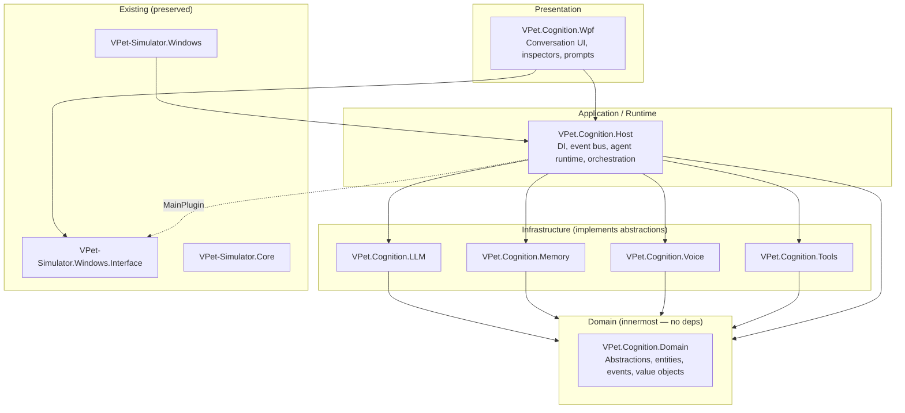
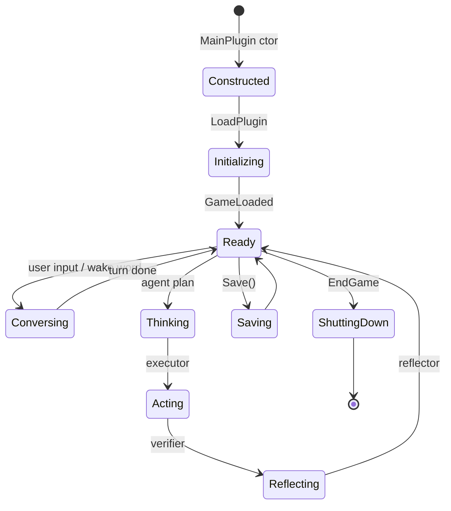
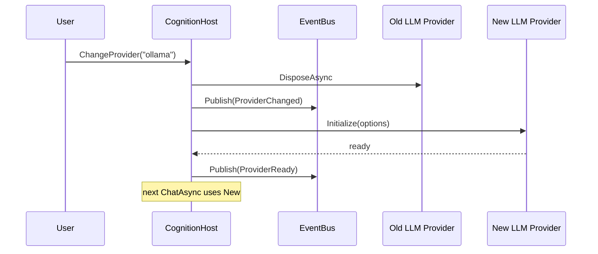
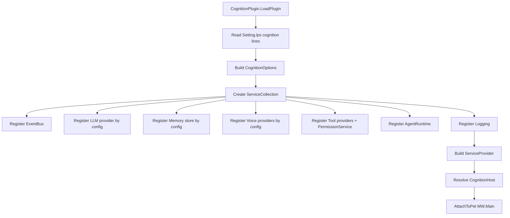

# 03 — Target Architecture

## Purpose
Define the target architecture for the AI-transformed VPet: the new projects, their boundaries, dependency direction, integration with the existing solution, and the contracts that every other document references.

## Business Goal
Add cognition (memory, personality, emotion, agent, voice, tools) to VPet without breaking the existing MOD ecosystem, animation engine, save format, or Steam integration.

## Technical Goal
Specify a Clean Architecture + DDD + Event-Driven + Plugin-based target with interchangeable AI providers, a typed in-process event bus, DI composition, and a human-like cognitive architecture — all in **new additive projects** that load as a `MainPlugin` into the existing `MainWindow`.

## Functional Requirements

| ID | Requirement |
|---|---|
| FR-TA-01 | New code lives in new `VPet.Cognition.*` projects; existing projects are modified only to expose new extension points. |
| FR-TA-02 | The cognition host loads as a `MainPlugin` via the existing plugin loader (no fork of `MainWindow`). |
| FR-TA-03 | Dependencies point inward toward `VPet.Cognition.Domain`; domain has no dependency on infrastructure or UI. |
| FR-TA-04 | Every AI capability is an interface in Domain with ≥1 fake (tests) and ≥1 real (provider) implementation. |
| FR-TA-05 | Provider selection is a configuration switch; runtime swaps providers without recompile. |
| FR-TA-06 | Cross-module communication uses a typed in-process event bus. |
| FR-TA-07 | All I/O is async with `CancellationToken`; UI thread never blocks. |

## Non Functional Requirements

| ID | Requirement |
|---|---|
| NFR-TA-01 | New projects target `net8.0` (headless libs) or `net8.0-windows` (WPF libs). |
| NFR-TA-02 | `<Nullable>enable</Nullable>`, `<TreatWarningsAsErrors>true</TreatWarningsAsErrors>` in new projects. |
| NFR-TA-03 | `<GenerateDocumentationFile>true</GenerateDocumentationFile>` with no `NoWarn CS1591`. |
| NFR-TA-04 | All public APIs XML-documented. |
| NFR-TA-05 | No `GC.Collect()`, no `Thread.Sleep` on UI thread, no `.Result`/`.Wait()` in new code. |

## Architecture

### Clean Architecture layers



Dependency rule: **arrows point inward**. Domain depends on nothing. Infrastructure depends on Domain. Host depends on Domain + Infrastructure. Wpf depends on Host + Interface (for `IMainWindow` access). The existing `Windows` app depends on `Host` (via plugin discovery) — but `Host` never depends on `Windows`.

### New projects

| Project | Target | Depends on | Role |
|---|---|---|---|
| `VPet.Cognition.Domain` | net8.0 | (none) | Pure abstractions: `ILLMProvider`, `IMemoryStore`, `IPersonalityEngine`, `IEmotionEngine`, `IVoiceProvider` (STT/TTS/WakeWord), `IToolProvider`, `IAgentRuntime`, `IPermissionService`, domain entities (`Memory`, `Personality`, `Emotion`, `Goal`, `ToolInvocation`), events (`CognitionEvent` base), value objects (`MemoryId`, `PersonalityTraitId`, `EmotionVector`), `Result<T,Error>`. |
| `VPet.Cognition.LLM` | net8.0 | Domain | `ILLMProvider` implementations: `OpenAICompatibleLlmProvider` (covers Qwen/GLM/DeepSeek/Llama via OpenAI-compatible endpoints), `OllamaLlmProvider` (local), `LlamaCppLlmProvider` (local). Prompt templates, token counting, streaming adapter to `SayInfoWithStream`. |
| `VPet.Cognition.Memory` | net8.0 | Domain | `IMemoryStore` implementations: `SqliteMemoryStore` (`Microsoft.Data.Sqlite` + `sqlite-vec`), `FaissMemoryStore` (FAISS abstraction), `QdrantMemoryStore` (future). Consolidation, importance scoring, forgetting, compression, retrieval. |
| `VPet.Cognition.Voice` | net8.0-windows | Domain | `ISttProvider` (Faster Whisper, whisper.cpp), `ITtsProvider` (Piper, Kokoro, XTTS v2), `IWakeWordProvider` (OpenWakeWord via ONNX). Streaming audio, lip-sync hints. |
| `VPet.Cognition.Tools` | net8.0-windows | Domain | `IToolProvider` implementations: `ProcessTool` (apps/PowerShell/CMD), `FileSystemTool` (files/folders), `ClipboardTool`, `BrowserTool`, `Win32Tool`. `PermissionService`, `SafetyLayer`, `ToolAuditLog`. |
| `VPet.Cognition.Host` | net8.0-windows | Domain + LLM + Memory + Voice + Tools + Interface | DI composition root (`Microsoft.Extensions.DependencyInjection`), typed event bus (`IEventBus`), `AgentRuntime` (planner/executor/verifier/reflector/scheduler), `CognitionPlugin : MainPlugin` (the entry point loaded by the existing app), `CognitionOptions` binding. |
| `VPet.Cognition.Wpf` | net8.0-windows | Host + Interface | Conversation UI, memory inspector, personality settings, emotion dashboard, permission prompts. Uses `CommunityToolkit.Mvvm` for new VMs. |
| `VPet.Cognition.Tests` | net8.0 | Domain + all providers | xUnit + FluentAssertions + Moq + Verify. Fakes for every interface. |

### Bounded contexts (DDD)

| Context | Aggregates | Key events |
|---|---|---|
| **Cognition** | `Memory`, `Personality`, `Emotion`, `Goal`, `Conversation` | `MemoryStored`, `MemoryConsolidated`, `PersonalityEvolved`, `EmotionChanged`, `GoalSet`, `GoalAchieved` |
| **Voice** | `VoiceSession`, `Transcript`, `Utterance` | `WakeWordDetected`, `TranscriptReceived`, `TtsChunkReady`, `InterruptionDetected` |
| **Tools** | `ToolInvocation`, `PermissionGrant` | `ToolRequested`, `PermissionPrompted`, `PermissionGranted`, `PermissionDenied`, `ToolExecuted`, `ToolFailed` |
| **Agent** | `Plan`, `Task`, `Decision` | `PlanCreated`, `TaskStarted`, `TaskVerified`, `TaskReflected`, `DecisionMade` |
| **Animation** (existing, integrated) | `Main` (existing) | `GraphDisplayChanged` (existing `GraphDisplayHandler`), `CognitionTick` (new, raised from `TimeHandle`) |

### Integration with existing app

The cognition host is a `MainPlugin`:

```csharp
// VPet.Cognition.Host/CognitionPlugin.cs
public class CognitionPlugin : MainPlugin
{
    public CognitionPlugin(IMainWindow mainwin) : base(mainwin) { }

    public override void LoadPlugin()
    {
        // Build DI container, bind config, register providers, wire events
        var host = CognitionHostBuilder.Build(MW);
        host.AttachToPet(MW.Main); // subscribe to TimeHandle, GraphDisplayHandler, SayProcess
    }

    public override void GameLoaded() { /* load memory DB, personality, emotion */ }
    public override void Save() { /* persist memory, personality, emotion */ }
    public override void EndGame() { /* graceful shutdown of providers */ }
    public override void Setting() { /* open CognitionSettingsWindow */ }
    public override void LoadDIY() { /* add conversation button to toolbar */ }
}
```

This mirrors `VPet.Plugin.Demo` — the existing plugin loader discovers `CognitionPlugin` via `Assembly.LoadFrom` (after signature validation), instantiates it with `IMainWindow`, and calls the lifecycle methods. **No change to `MainWindow` or `CoreMOD` is required.**

### Extension points added to existing code (minimal, additive)

| Existing type | New member | Purpose |
|---|---|---|
| `Main` (Core) | `event Action<Main> CognitionTick` (raised from `TimeHandle`) | Cognition tick hook. **Alternative**: subscribe to existing `TimeHandle` — no Core change needed. |
| `Main` (Core) | none required | `GraphDisplayHandler` and `SayProcess` already exist. |
| `IMainWindow` (Interface) | none required | `Main`, `Dispatcher`, `Set`, `GameSavesData` already exposed. |
| `MainPlugin` (Interface) | none required | lifecycle hooks already exist. |

**Conclusion: zero changes to existing projects are required for Phase 0–1.** The cognition host subscribes to existing events (`TimeHandle`, `GraphDisplayHandler`, `SayProcess`) and uses existing APIs (`Main.Say(SayInfoWithStream)`, `MW.Set`, `MW.GameSavesData`). Later phases may add optional extension points (e.g., a `CognitionGraphResolver` hook in `GraphCore` for emotion-driven animation selection) — these are documented in `12_animation_system.md` and require an ADR.

## Module Design

### VPet.Cognition.Domain

```
VPet.Cognition.Domain/
├── Abstractions/
│   ├── ILLMProvider.cs          # ChatAsync, StreamChatAsync, CountTokens, ModelInfo
│   ├── IMemoryStore.cs          # Store, Retrieve, Search, Consolidate, Forget, Compress
│   ├── IPersonalityEngine.cs    # GetTraits, Evolve, Reflect, Evaluate
│   ├── IEmotionEngine.cs        # GetState, Apply, Blend, Decay, MapToAnimation, MapToVoice
│   ├── IVoiceProvider.cs        # ISttProvider, ITtsProvider, IWakeWordProvider
│   ├── IToolProvider.cs         # Execute, Describe, Schema
│   ├── IAgentRuntime.cs        # Plan, Execute, Verify, Reflect, Schedule
│   ├── IPermissionService.cs    # Request, Grant, Deny, Revoke, Check
│   └── IEventBus.cs             # Publish<T>, Subscribe<T>
├── Entities/
│   ├── Memory.cs                # MemoryId, Type, Content, Embedding, Importance, Timestamps
│   ├── Personality.cs           # CoreTraits, AdaptiveTraits, Identity
│   ├── Emotion.cs               # EmotionVector (10 dims), Persistence, DecayRate
│   ├── Goal.cs                  # GoalId, Description, Priority, Status
│   ├── Conversation.cs          # ConversationId, Turns, StartedAt, EndedAt
│   └── ToolInvocation.cs        # InvocationId, Tool, Args, Result, Permission, Timestamp
├── ValueObjects/
│   ├── MemoryId.cs              # readonly struct Guid
│   ├── PersonalityTraitId.cs    # readonly struct enum
│   ├── EmotionVector.cs         # readonly struct (10 doubles)
│   ├── Embedding.cs             # readonly struct float[]
│   └── Importance.cs            # readonly struct double 0..1
├── Events/
│   ├── CognitionEvent.cs       # base
│   ├── MemoryEvents.cs          # MemoryStored, MemoryRetrieved, MemoryConsolidated, MemoryForgotten
│   ├── PersonalityEvents.cs    # PersonalityEvolved, PersonalityReflected
│   ├── EmotionEvents.cs         # EmotionChanged, EmotionDecayed
│   ├── AgentEvents.cs           # PlanCreated, TaskStarted, TaskCompleted, DecisionMade
│   ├── VoiceEvents.cs           # WakeWordDetected, TranscriptReceived, TtsChunkReady
│   └── ToolEvents.cs            # ToolRequested, PermissionGranted, ToolExecuted
├── Errors/
│   ├── Error.cs                 # abstract record
│   ├── ProviderError.cs         # LLM/STT/TTS failure
│   ├── MemoryError.cs           # DB/encoding failure
│   ├── PermissionError.cs       # denied/revoked
│   └── Result.cs                # Result<T, Error>
└── Enums/
    ├── MemoryType.cs            # Working, ShortTerm, LongTerm, Semantic, Episodic, Relationship, Workspace, Emotional, Reflection, Goal, Identity
    ├── EmotionType.cs            # Joy, Sadness, Anger, Curiosity, Stress, Excitement, Fear, Calmness, Surprise, Frustration
    ├── ToolClass.cs              # Application, PowerShell, CMD, File, Folder, Clipboard, Browser, Win32
    └── PermissionState.cs        # NotRequested, Prompted, Granted, Denied, Revoked
```

### VPet.Cognition.Host

```
VPet.Cognition.Host/
├── CognitionPlugin.cs           # MainPlugin entry point
├── CognitionHostBuilder.cs      # DI composition root
├── CognitionHost.cs              # orchestrator: attaches to Main, runs agent loop
├── EventBus.cs                   # typed in-process IEventBus impl
├── Options/
│   ├── CognitionOptions.cs       # root options
│   ├── LlmOptions.cs             # provider, endpoint, model, apiKey(ref), timeout
│   ├── MemoryOptions.cs          # dbPath, vectorDim, consolidationInterval
│   ├── VoiceOptions.cs           # wakeWordModel, sttModel, ttsModel, devices
│   ├── ToolOptions.cs            # enabledTools, permissionPolicy
│   └── PersonalityOptions.cs     # seed traits, evolutionRate
├── Agent/
│   ├── AgentRuntime.cs           # IAgentRuntime impl
│   ├── Planner.cs
│   ├── Executor.cs
│   ├── Verifier.cs
│   ├── Reflector.cs
│   ├── Scheduler.cs
│   ├── GoalManager.cs
│   └── TaskManager.cs
├── Lps/
│   └── LpsSettingsProvider.cs    # bridges Setting.lps → IOptions<CognitionOptions>
└── Logging/
    └── SerilogConfig.cs          # ILogger wiring, correlation ids
```

## Folder Structure (new)
See Module Design above. All new projects live in the repo root alongside existing ones and are added to `VPet.sln`.

## Interfaces
All abstractions are in `VPet.Cognition.Domain/Abstractions/`. Each is documented in its domain document:
- `ILLMProvider` → `04_ai_pipeline.md`
- `IMemoryStore` → `05_memory_system.md`
- `IPersonalityEngine` → `06_personality_engine.md`
- `IEmotionEngine` → `07_emotion_engine.md`
- `ISttProvider`/`ITtsProvider`/`IWakeWordProvider` → `08_voice_pipeline.md`
- `IToolProvider`/`IPermissionService` → `09_tool_calling.md`
- `IAgentRuntime` → `10_agent_system.md`
- `IEventBus` → this document.

### IEventBus contract

```csharp
public interface IEventBus
{
    void Publish<TEvent>(TEvent @event, CancellationToken ct = default) where TEvent : CognitionEvent;
    IDisposable Subscribe<TEvent>(Func<TEvent, CancellationToken, Task> handler) where TEvent : CognitionEvent;
}
```

In-process, typed, async. Handlers are awaited sequentially per event type. Errors in one handler do not block others (logged, continued).

## Classes
Key classes listed in Module Design. Full detail in each domain document.

## State Machine
Cognition host lifecycle:



## Sequence Diagram (Mermaid)
Provider-swap at runtime (config change):



## Flow Diagram (Mermaid)
DI composition root:



## Database Schema
SQLite (memory) — full schema in `05_memory_system.md`. Tables: `memories`, `embeddings`, `memory_relations`, `consolidation_log`, `importance_scores`, `personality_state`, `personality_history`, `emotion_state`, `emotion_history`, `goals`, `tool_invocations`, `permission_grants`.

## Data Models
Domain entities in `VPet.Cognition.Domain/Entities/` — see each domain document.

## APIs
No external API exposed. Internal: `IEventBus`, `IAgentRuntime`, all provider interfaces.

## Configuration
`CognitionOptions` bound from `appsettings.json` + `Setting.lps` `cognition` lines. See `14_configuration.md`.

## Logging
Serilog with `ILogger<T>`. Sinks: console (debug), rolling file (`logs/cognition-.log`), debug. Every cognitive operation carries a `CorrelationId`. See `14_configuration.md`.

## Telemetry
Local-only metrics: LLM token/s, STT latency, TTS latency, memory retrieval count, agent decisions/hour. Exposed via `IMetricsCollector` (in-process, no external OTLP export by default). See `14_configuration.md`.

## Performance Targets
See `01_project_overview.md`. Per-domain targets in each domain document.

## Security
See `15_security.md`. Key: plugin sandboxing (cognition plugins are still full-trust via existing loader — documented risk), secret management (config + OS credential store), tool permissions (deny-by-default), memory privacy (optional SQLCipher encryption).

## Error Handling
`Result<T, Error>` for domain errors. Provider errors caught, logged with `CorrelationId`, surfaced as friendly message in conversation UI. Fallback chain: configured provider → alternate provider → no-op with user message. App never crashes from provider failure.

## Edge Cases
- No provider configured → silent companion (existing behavior preserved).
- Provider init failure → log + user toast + fall back.
- Memory DB locked → in-context-only memory + warning.
- Event bus handler throws → log + continue (do not poison other handlers).
- Cancellation token cancelled → graceful stop of current operation.

## Acceptance Criteria
1. `VPet.Cognition.Domain` has zero project references (only BCL).
2. `VPet.Cognition.Host` loads as `MainPlugin` with no modification to `MainWindow.cs` or `CoreMOD.cs`.
3. Switching `llm:provider` in config changes the runtime provider without recompile.
4. Removing all `VPet.Cognition.*` projects (uninstalling the plugin) returns the app to exact existing behavior.
5. `dotnet build` of the full solution succeeds with `TreatWarningsAsErrors` on new projects.

## Unit Tests
Every Domain interface has a fake in `VPet.Cognition.Tests`. Every provider has at least one happy-path and one error-path test. See `16_testing.md`.

## Integration Tests
`CognitionPlugin` loads into a test `IMainWindow` mock, attaches to a mock `Main`, and completes a conversation turn end-to-end. See `16_testing.md`.

## Future Expansion
- Qdrant memory provider (future).
- Remote OTLP telemetry export (opt-in).
- Additional LLM providers (Mistral, Phi, Gemma).
- Cross-pet memory sharing (multiplayer).

## Refactoring Notes
- The existing `Setting.cs` duplication (Windows vs Solution) is not fixed by this architecture; a future refactor extracts a shared `VPet.Settings` library. Out of scope for initial phases.
- The existing `SimpleObservable` in `VPet.Solution` is preserved; new VMs in `VPet.Cognition.Wpf` use `CommunityToolkit.Mvvm` (source-generated `[ObservableProperty]`/`[RelayCommand]`) to avoid hand-written boilerplate.

## Migration Strategy
- New projects added to `VPet.sln`.
- `Setting.lps` gains `cognition` lines (additive; old settings load with defaults).
- `GameSavesData.Data` gains a `cognition` Sub (additive; old saves load with empty memory).
- No existing file format changes.

## Implementation Steps
1. Create `VPet.Cognition.Domain` with all abstractions + entities + events + errors.
2. Create `VPet.Cognition.Tests` with fakes for every interface.
3. Create `VPet.Cognition.Host` with DI, event bus, `CognitionPlugin`, options binding.
4. Add `CognitionPlugin` to a dev MOD folder; verify it loads via existing plugin loader.
5. Implement providers per phase (see `task.md` §14).

## Agent Instructions
- Create projects in the order: Domain → Tests → Host → provider projects → Wpf.
- Every interface in Domain must have a fake committed in the same PR.
- Never reference `VPet-Simulator.Windows` from any `VPet.Cognition.*` project except `Host` (which references `Interface` only).
- Use `Microsoft.Extensions.DependencyInjection` (not a custom DI).
- Use `CommunityToolkit.Mvvm` for new VMs.
- Use `Serilog` for logging.

## Developer Notes
- The `CognitionPlugin` DLL must be signed (the existing loader validates X509 signatures; unsigned requires `passmod`). For dev, run with `passmod` enabled; for release, sign with the project's code-signing cert.
- The `CognitionPlugin` constructor must be `public` with signature `(IMainWindow mainwin)` — the loader uses `Activator.CreateInstance(type, mw)`.
- `MW.Main` is the `VPet_Simulator.Core.Main` instance; `MW.Dispatcher` is the UI thread.
- `MW.Set` is the `ISetting`; bridge to `CognitionOptions` via `LpsSettingsProvider`.
- `MW.GameSavesData` is `GameSave_v2`; use `Data[(gstr)"cognition"]` for plugin storage.