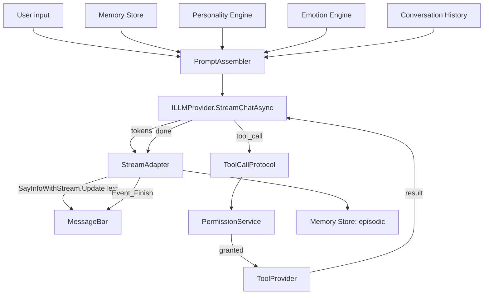
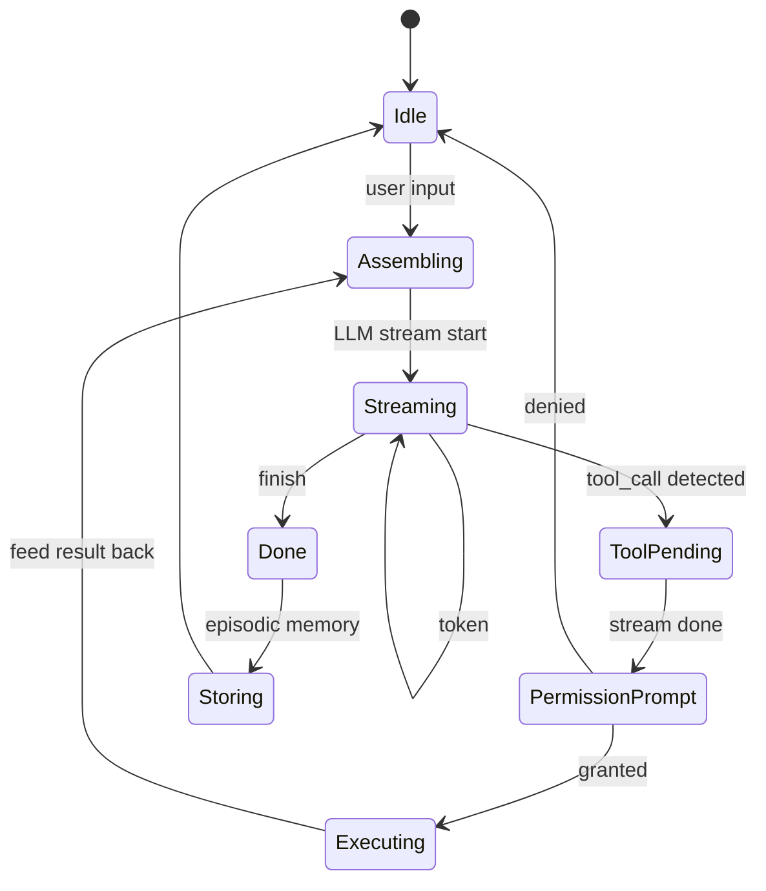
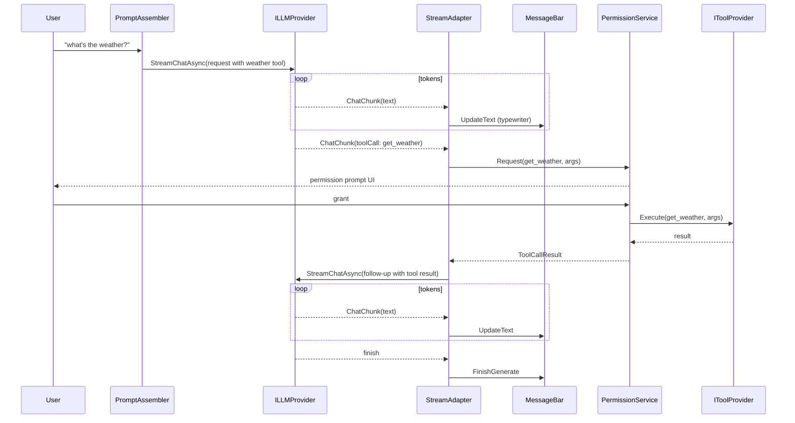
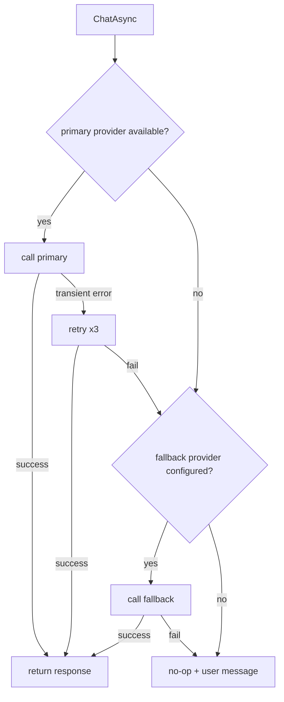

# 04 — AI Pipeline

## Purpose
Define the LLM provider abstraction, prompt engineering, streaming, tool-call protocol, and the integration with the existing `MessageBar` streaming seam. This is the foundation of all conversation.

## Business Goal
Enable natural, streaming, cancellable, provider-agnostic conversation between the user and the companion, with memory context injection, personality/emotion conditioning, and tool-call support.

## Technical Goal
Specify `ILLMProvider` and its implementations, the prompt assembly pipeline, the streaming adapter to `SayInfoWithStream`, the tool-call protocol, and the provider-swap mechanism.

## Functional Requirements

| ID | Requirement |
|---|---|
| FR-AI-01 | The companion converses via text with streaming output. |
| FR-AI-02 | At least one local LLM provider (Ollama or llama.cpp) and one cloud-compatible provider (OpenAI-compatible endpoint) ship. |
| FR-AI-03 | Provider selection is a config switch; runtime swap without recompile. |
| FR-AI-04 | Every chat call accepts a `CancellationToken` and a timeout. |
| FR-AI-05 | Prompts are assembled from: system prompt (personality + emotion + identity), retrieved memories, conversation history, and user input. |
| FR-AI-06 | The LLM can request tool calls via a documented protocol; tools execute only after permission. |
| FR-AI-07 | Token usage is counted and logged. |
| FR-AI-08 | Provider failures fall back to an alternate provider or a no-op with a user message. |

## Non Functional Requirements

| ID | Requirement |
|---|---|
| NFR-AI-01 | First token latency (local LLM) < 1.5 s on min-spec hardware. |
| NFR-AI-02 | Streaming tokens surface to `MessageBar` within 50 ms of receipt. |
| NFR-AI-03 | No UI thread blocking during chat. |
| NFR-AI-04 | All prompts and responses logged with `CorrelationId` (content loggable; secrets never). |

## Architecture



## Module Design

### ILLMProvider (Domain)

```csharp
public interface ILLMProvider : IAsyncDisposable
{
    string ProviderId { get; }
    IReadOnlyList<ModelInfo> AvailableModels { get; }

    Task<ChatResponse> ChatAsync(ChatRequest request, CancellationToken ct = default);
    IAsyncEnumerable<ChatChunk> StreamChatAsync(ChatRequest request, CancellationToken ct = default);
    Task<int> CountTokensAsync(string text, CancellationToken ct = default);
    Task<bool> IsAvailableAsync(CancellationToken ct = default);
}
```

- `ChatRequest`: `SystemPrompt`, `Messages` (list of `ChatMessage { Role, Content, ToolCalls }`), `Tools` (list of `ToolSchema`), `MaxTokens`, `Temperature`, `TopP`, `Seed`, `Stop`, `Model`, `ResponseFormat` (text/json).
- `ChatResponse`: `Content`, `ToolCalls`, `Usage` (`PromptTokens`, `CompletionTokens`), `FinishReason`, `Model`.
- `ChatChunk`: `Delta` (text or tool-call fragment), `Usage` (optional, on last chunk).
- `ModelInfo`: `Id`, `ContextWindow`, `SupportsTools`, `SupportsStreaming`, `SupportsJson`.

### PromptAssembler

Assembles the `ChatRequest` from:
1. **System prompt** — personality traits, current emotion vector, identity, communication style, humor, relationship state. Templated via `PersonalityPromptTemplate` (see `06_personality_engine.md`).
2. **Memory context** — top-K retrieved memories (semantic + episodic + relationship) injected as a `# Context` block. See `05_memory_system.md`.
3. **Conversation history** — last N turns (within token budget).
4. **User input** — the current user message.
5. **Tools** — the schemas of tools the LLM may call (see `09_tool_calling.md`).

Token budget management: `CountTokensAsync` is called on each section; if total exceeds `ModelInfo.ContextWindow - MaxTokens`, history is truncated oldest-first, then memory context is truncated lowest-importance-first.

### StreamAdapter

Bridges `IAsyncEnumerable<ChatChunk>` to the existing `SayInfoWithStream`:

```csharp
public async Task StreamToMessageBarAsync(IAsyncEnumerable<ChatChunk> stream, SayInfoWithStream say, CancellationToken ct)
{
    var sb = new StringBuilder();
    await foreach (var chunk in stream.WithCancellation(ct))
    {
        if (chunk.Delta.Text is { } text)
        {
            sb.Append(text);
            say.UpdateText(text); // raises Event_Update → MessageBar typewriter
        }
        if (chunk.Delta.ToolCall is { } tc)
            _pendingToolCalls.Append(tc);
    }
    if (_pendingToolCalls.Count > 0)
        await ExecuteToolCallsAsync(_pendingToolCalls, say, ct);
    say.FinishGenerate(); // raises Event_Finish → MessageBar closes
}
```

The existing `Main.Say(SayInfoWithStream)` already wires `Event_Update`/`Event_Finish` to `MessageBar`. **No Core change needed.**

### Tool-call protocol

The LLM emits tool calls in the provider's native format (OpenAI function-calling or XML-tagged for local models that lack native support). `ToolCallProtocol` normalizes to:

```csharp
public sealed record ToolCallRequest(string Id, string ToolName, JsonElement Arguments);
public sealed record ToolCallResult(string Id, bool Success, string Output, string? Error);
```

If the LLM does not support native tool-calling, a `XmlToolCallParser` extracts `<tool name="..." args='...'/>` tags from the text stream. This is the fallback for local models.

Tool calls are **not** executed inline in the stream. They are collected, then after the stream completes (or on a stop reason of `tool_calls`), `ExecuteToolCallsAsync` runs each through the permission system (see `09_tool_calling.md`). Results are fed back to the LLM as a follow-up `ChatRequest` with `Role=Tool` messages.

### Provider implementations

| Provider | Class | Endpoint | Notes |
|---|---|---|---|
| OpenAI-compatible | `OpenAICompatibleLlmProvider` | configurable base URL | Covers Qwen (DashScope), GLM (Zhipu), DeepSeek, Llama (via Together/Groq/localhost), OpenAI. Uses `System.Net.Http.HttpClient`. |
| Ollama | `OllamaLlmProvider` | `http://localhost:11434` | Local; no API key. Default for offline-first. |
| llama.cpp | `LlamaCppLlmProvider` | `http://localhost:8080` | Local; llama.cpp server. |

All providers use `HttpClient` with a named client per provider (`IHttpClientFactory`). Timeout from `LlmOptions.Timeout`. Retry with exponential backoff (3 attempts) on transient errors (5xx, timeout).

## Folder Structure
```
VPet.Cognition.LLM/
├── ILLMProvider.cs              # re-export from Domain
├── OpenAICompatible/
│   ├── OpenAICompatibleLlmProvider.cs
│   ├── OpenAIChatRequest.cs     # wire DTO
│   ├── OpenAIChatResponse.cs
│   └── OpenAIStreamParser.cs
├── Ollama/
│   ├── OllamaLlmProvider.cs
│   └── OllamaStreamParser.cs
├── LlamaCpp/
│   └── LlamaCppLlmProvider.cs
├── ToolCall/
│   ├── ToolCallProtocol.cs
│   ├── ToolCallRequest.cs
│   ├── ToolCallResult.cs
│   └── XmlToolCallParser.cs     # fallback for non-native tool models
├── PromptAssembler.cs
├── StreamAdapter.cs
├── TokenCounter.cs              # approx token counter (BPE fallback)
└── LlmOptions.cs               # re-export
```

## Interfaces
`ILLMProvider` (above). Plus internal: `IPromptAssembler`, `IStreamAdapter`, `IToolCallProtocol`.

## Classes
`OpenAICompatibleLlmProvider`, `OllamaLlmProvider`, `LlamaCppLlmProvider`, `PromptAssembler`, `StreamAdapter`, `ToolCallProtocol`, `XmlToolCallParser`, `TokenCounter`.

## State Machine
Conversation turn FSM:



## Sequence Diagram (Mermaid)
Streaming conversation with tool call:



## Flow Diagram (Mermaid)
Provider fallback chain:



## Database Schema
None (LLM is stateless). Conversation history persisted in memory store — see `05_memory_system.md`.

## Data Models
`ChatRequest`, `ChatResponse`, `ChatChunk`, `ChatMessage`, `ToolSchema`, `ModelInfo`, `Usage`.

## APIs
Consumes provider HTTP endpoints (OpenAI-compatible `/v1/chat/completions`, Ollama `/api/chat`, llama.cpp `/completion`).

## Configuration
`LlmOptions`:
```json
{
  "cognition": {
    "llm": {
      "provider": "ollama",
      "endpoint": "http://localhost:11434",
      "model": "qwen2.5:7b",
      "apiKey": "",
      "timeout": "00:01:00",
      "maxTokens": 1024,
      "temperature": 0.7,
      "fallbackProvider": "openai-compatible",
      "fallbackEndpoint": "https://api.deepseek.com",
      "fallbackModel": "deepseek-chat",
      "fallbackApiKey": "${DEEPSEEK_API_KEY}"
    }
  }
}
```
API keys support env-var expansion (`${VAR}`) — resolved from environment, never logged. See `15_security.md`.

## Logging
Every `ChatAsync`/`StreamChatAsync` logs: `CorrelationId`, `ProviderId`, `Model`, `PromptTokens`, `CompletionTokens`, `LatencyMs`, `FinishReason`. Prompt/response content logged at `Debug` level (toggleable; off by default for privacy).

## Telemetry
`llm.tokens_per_second`, `llm.first_token_latency_ms`, `llm.total_latency_ms`, `llm.tool_calls_per_conversation`. In-process counters.

## Performance Targets
| Metric | Target |
|---|---|
| First token (local) | < 1.5 s |
| First token (cloud) | < 800 ms |
| Tokens/s (local 7B) | > 20 t/s |
| Token-to-UI latency | < 50 ms |

## Security
- API keys from config/env, never in code/git. `${VAR}` expansion. See `15_security.md`.
- No prompt injection of user data into system prompt without sanitization.
- Tool-call arguments are validated against the tool schema before execution.
- Provider responses are treated as untrusted; tool-call args parsed defensively.

## Error Handling
- `ProviderError` (timeout, 5xx, network) → retry x3 → fallback provider → no-op + user message.
- `DeserializationError` (malformed stream chunk) → skip chunk, log, continue.
- `TokenLimitExceeded` → truncate history/memory, retry once.
- `ContentFilterError` (cloud) → log, surface message, no retry.

## Edge Cases
- Empty user input → no LLM call; companion idles.
- LLM returns empty stream → `MessageBar` shows nothing; log warning.
- LLM returns tool call with invalid args → `ToolCallResult` with `Error="invalid args"`; fed back to LLM.
- LLM loops tool calls > 5 times → agent reflector intervenes (see `10_agent_system.md`).
- Provider returns mid-stream disconnect → treat as finish; log partial.

## Acceptance Criteria
1. `OllamaLlmProvider` completes a streaming conversation with a local Ollama model.
2. `OpenAICompatibleLlmProvider` completes a streaming conversation with a DeepSeek endpoint.
3. Switching `llm:provider` in config changes the provider at next conversation without restart.
4. Cancelling a conversation (user clicks cancel) stops the stream within 200 ms.
5. A tool call from the LLM triggers the permission prompt before execution.
6. All tests in `VPet.Cognition.Tests` pass.

## Unit Tests
- `OpenAICompatibleLlmProvider` with a `HttpMessageHandler` mock: happy path, streaming, tool call, error, timeout.
- `OllamaLlmProvider` with a `HttpMessageHandler` mock.
- `PromptAssembler`: token budget truncation, memory injection, personality injection.
- `StreamAdapter`: token-to-`SayInfoWithStream` mapping, tool-call collection, finish.
- `XmlToolCallParser`: valid/invalid XML, nested args, missing fields.
- `TokenCounter`: approx count within ±20% of real BPE.
- Fallback chain: primary fail → fallback → no-op.

## Integration Tests
- End-to-end conversation with a mock LLM server (WireMock.Net) returning a streamed response.
- Tool-call round-trip: mock LLM emits tool call → mock permission grants → mock tool returns → mock LLM finalizes.

## Future Expansion
- Vision providers (multimodal) for screenshot understanding.
- Function-calling fine-tuned local models.
- Prompt caching for repeated system prompts.
- Speculative decoding for local providers.

## Refactoring Notes
- The existing `SayInfoWithStream` already supports streaming — no Core change.
- `Main.SayProcess` (`List<Action<SayInfo>>`) can be used to hook TTS — see `08_voice_pipeline.md`.

## Migration Strategy
Additive. No existing API changes.

## Implementation Steps
1. Define `ILLMProvider`, `ChatRequest`/`Response`/`Chunk` in Domain.
2. Implement `OpenAICompatibleLlmProvider` with `HttpClient` + streaming parser.
3. Implement `OllamaLlmProvider`.
4. Implement `PromptAssembler` with token budget.
5. Implement `StreamAdapter` to `SayInfoWithStream`.
6. Implement `ToolCallProtocol` + `XmlToolCallParser`.
7. Wire provider selection in `CognitionHostBuilder`.
8. Add tests (fake LLM + WireMock).

## Agent Instructions
- Use `IHttpClientFactory` — never `new HttpClient()`.
- All HTTP calls must have a timeout (from options) and cancellation token.
- Never log API keys or full prompts at `Information` level; use `Debug` with a config toggle.
- Tool-call args must be parsed with `JsonDocument` defensively; never `JsonSerializer.Deserialize` without try/catch.

## Developer Notes
- OpenAI-compatible streaming uses SSE (`data: {...}\n\n`); parse line-by-line.
- Ollama streaming returns newline-delimited JSON objects.
- For local models without native tool-calling, the `XmlToolCallParser` extracts `<tool>` tags; instruct the model via the system prompt to use this format.
- `Temperature` and `Seed` are exposed for determinism: same seed + same input → same output (provider-dependent).