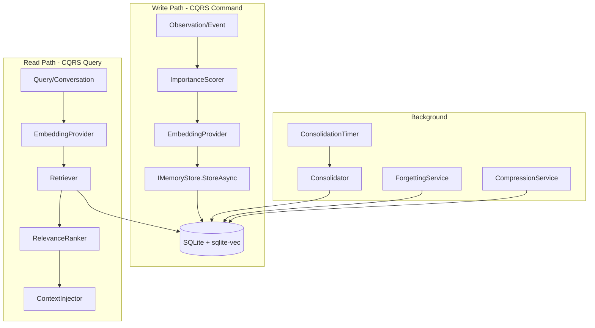
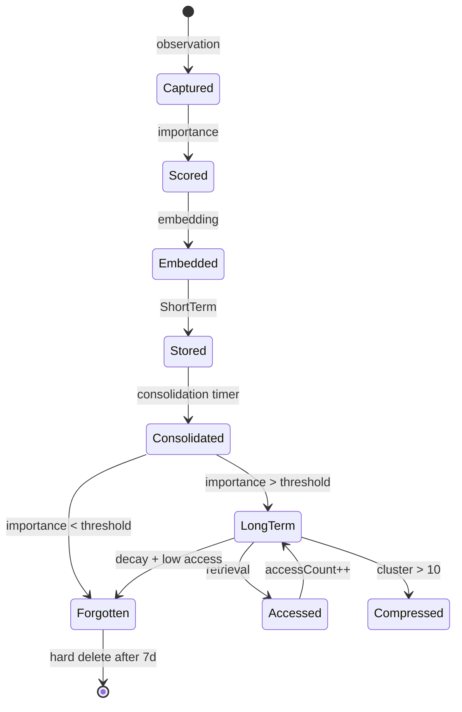
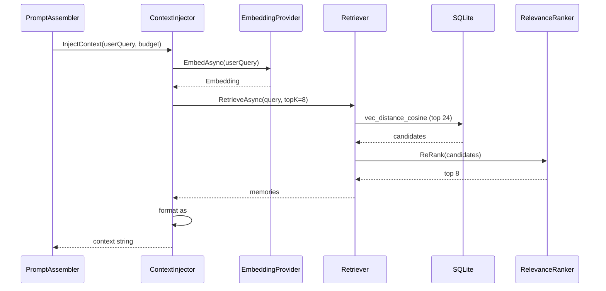
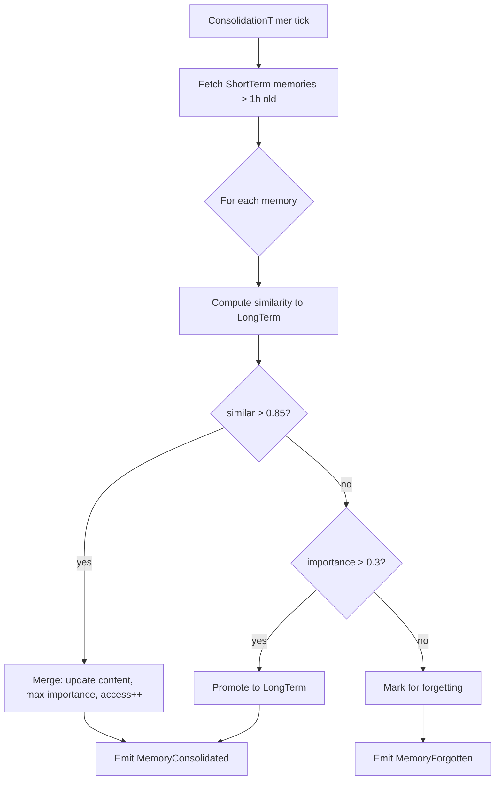

# 05 — Memory System

## Purpose
Define a human-like cognitive memory architecture with persistence, vector retrieval, consolidation, importance scoring, forgetting, compression, and privacy — backed by SQLite + sqlite-vec with a FAISS abstraction and future Qdrant support.

## Business Goal
The companion remembers the user across sessions: facts, events, preferences, relationships, emotions, goals, and its own identity — and retrieves the right memories at the right time to feel alive.

## Technical Goal
Specify `IMemoryStore`, the SQLite schema, the embedding pipeline, the consolidation/forgetting algorithms, and the retrieval injection into LLM prompts.

## Functional Requirements

| ID | Requirement |
|---|---|
| FR-MEM-01 | Persist memories across app restarts in SQLite. |
| FR-MEM-02 | Support 11 memory types: Working, Short-term, Long-term, Semantic, Episodic, Relationship, Workspace, Emotional, Reflection, Goal, Identity. |
| FR-MEM-03 | Vector similarity search via sqlite-vec; FAISS abstraction interface; future Qdrant. |
| FR-MEM-04 | Memory consolidation: short-term → long-term on schedule. |
| FR-MEM-05 | Importance scoring (0..1) per memory; influences retention and retrieval. |
| FR-MEM-06 | Forgetting algorithm: decay low-importance, low-recall memories. |
| FR-MEM-07 | Memory compression: summarize clusters of related memories. |
| FR-MEM-08 | Context retrieval: top-K relevant memories injected into LLM prompt. |
| FR-MEM-09 | Memory search: keyword + semantic hybrid. |
| FR-MEM-10 | Memory privacy: optional encryption-at-rest (SQLCipher); user can delete/export all memories. |

## Non Functional Requirements

| ID | Requirement |
|---|---|
| NFR-MEM-01 | Retrieval (top-10) < 200 ms on 100k memories. |
| NFR-MEM-02 | Consolidation runs as a background task; never blocks conversation. |
| NFR-MEM-03 | Memory DB size capped (configurable); oldest low-importance memories evicted. |
| NFR-MEM-04 | All memory operations async with `CancellationToken`. |

## Architecture



## Module Design

### IMemoryStore (Domain)

```csharp
public interface IMemoryStore : IAsyncDisposable
{
    Task<MemoryId> StoreAsync(Memory memory, CancellationToken ct = default);
    Task<Memory?> GetAsync(MemoryId id, CancellationToken ct = default);
    Task<IReadOnlyList<Memory>> RetrieveAsync(MemoryQuery query, CancellationToken ct = default);
    Task<IReadOnlyList<Memory>> SearchAsync(string keyword, int limit = 10, CancellationToken ct = default);
    Task ConsolidateAsync(CancellationToken ct = default);
    Task ForgetAsync(CancellationToken ct = default);
    Task CompressAsync(CancellationToken ct = default);
    Task<int> CountAsync(MemoryType? type = null, CancellationToken ct = default);
    Task DeleteAsync(MemoryId id, CancellationToken ct = default);
    Task DeleteAllAsync(CancellationToken ct = default);   // privacy: wipe
    Task ExportAsync(string path, CancellationToken ct = default); // privacy: export
}
```

`Memory` entity:
```csharp
public sealed record Memory
{
    public MemoryId Id { get; init; }
    public MemoryType Type { get; init; }
    public string Content { get; init; }          // raw text
    public string? Summary { get; set; }          // compressed form
    public Embedding? Embedding { get; set; }
    public Importance Importance { get; set; }     // 0..1
    public DateTime CreatedAt { get; init; }
    public DateTime LastAccessedAt { get; set; }
    public int AccessCount { get; set; }
    public Dictionary<string, string> Metadata { get; init; } = new();
    public List<MemoryId> RelatedIds { get; init; } = new();
    public string? Source { get; init; }           // "conversation", "reflection", "tool", etc.
}
```

`MemoryQuery`:
```csharp
public sealed record MemoryQuery
{
    public string? Text { get; init; }              // semantic query
    public Embedding? QueryEmbedding { get; init; }
    public MemoryType? TypeFilter { get; init; }
    public int TopK { get; init; } = 10;
    public double MinImportance { get; init; } = 0.0;
    public DateTime? Since { get; init; }
    public DateTime? Until { get; init; }
}
```

### Memory types (11)

| Type | Purpose | TTL/Retention |
|---|---|---|
| **Working** | Current conversation context (in-memory, not persisted) | Current turn |
| **ShortTerm** | Recent turns, pending consolidation | 24 h → consolidate or forget |
| **LongTerm** | Consolidated facts | Indefinite (importance-gated) |
| **Semantic** | Facts about the world/user ("user likes coffee") | Indefinite |
| **Episodic** | Events ("on 2026-08-01 we talked about X") | Indefinite |
| **Relationship** | User-companion relationship state | Indefinite |
| **Workspace** | Scratch space for current agent task | Task lifetime |
| **Emotional** | Emotionally salient events | Indefinite (high importance) |
| **Reflection** | Companion's self-reflections | Indefinite |
| **Goal** | Active/completed goals | Until goal completed+reflected |
| **Identity** | Companion's self-concept | Indefinite (rarely changes) |

### Embedding provider

`IEmbeddingProvider` (Domain):
```csharp
public interface IEmbeddingProvider : IAsyncDisposable
{
    int Dimensions { get; }
    Task<Embedding> EmbedAsync(string text, CancellationToken ct = default);
    Task<IReadOnlyList<Embedding>> EmbedBatchAsync(IEnumerable<string> texts, CancellationToken ct = default);
}
```
Implementations: `LocalEmbeddingProvider` (ONNX `bge-small`/`nomic-embed` via `Microsoft.ML.OnnxRuntime`), `OpenAICompatibleEmbeddingProvider` (endpoint). Default: local for offline-first.

### ImportanceScorer

Scores a memory 0..1 based on:
- **Emotional salience** — current emotion vector magnitude at capture time.
- **Recency** — exponential decay.
- **Frequency** — access count.
- **Relationship relevance** — mentions of user/identity.
- **Explicit user emphasis** — "remember this" detection.
- **Reflection depth** — memories generated by reflection get a bonus.

Formula (tunable via `MemoryOptions.ImportanceWeights`):
```
importance = w_emo * emotionSalience + w_rec * recencyDecay + w_freq * log(1+accessCount)
          + w_rel * relationshipRelevance + w_exp * explicitEmphasis + w_ref * reflectionBonus
```
Clamped to [0,1].

### Consolidator (short-term → long-term)

Runs on `ConsolidationTimer` (default every 5 min, configurable). For each `ShortTerm` memory older than threshold (default 1 h):
1. Cluster by semantic similarity (cosine > 0.85) to existing `LongTerm`/`Semantic` memories.
2. If similar: merge (update content/summary, max importance, increment access).
3. If not: promote to `LongTerm` if importance > threshold (default 0.3); else mark for forgetting.
4. Emit `MemoryConsolidated` event.

### ForgettingService

Runs on schedule (default daily). For memories with `importance < 0.1` and `lastAccessedAt > 30 days`:
- Soft-delete (mark `forgotten=1`, retain 7 days for undo).
- After 7 days: hard-delete.
- Emits `MemoryForgotten` event.

Configurable thresholds in `MemoryOptions.Forgetting`.

### CompressionService

For clusters of > 10 related `LongTerm` memories (cosine > 0.9):
- Summarize via LLM (small model, low max tokens).
- Store summary as a new `LongTerm` memory with `Summary` field; link originals via `RelatedIds`.
- Originals retained but importance reduced (they're now "detail" memories).

### Retriever + RelevanceRanker

`RetrieveAsync(MemoryQuery)`:
1. Vector search (sqlite-vec `vec_distance_cosine`) for top `TopK * 3` candidates.
2. Filter by `TypeFilter`, `MinImportance`, date range.
3. Re-rank by: `relevance = cosineSim * 0.6 + importance * 0.3 + recencyDecay * 0.1`.
4. Return top `TopK`.

### ContextInjector

Called by `PromptAssembler` (see `04_ai_pipeline.md`):
1. Embed the current user query.
2. `RetrieveAsync` top-K (default 8) across `Semantic`, `Episodic`, `Relationship`, `Emotional`, `Identity`.
3. Format as:
```
# Context (memories)
[semantic] user likes coffee, prefers mornings
[episodic] 2026-07-15: user was stressed about deadline
[relationship] trust level: high; shared jokes: 3
[identity] I am supportive, curious, slightly sarcastic
```
4. Inject into system prompt. Truncate lowest-importance first if over token budget.

## Folder Structure
```
VPet.Cognition.Memory/
├── IMemoryStore.cs
├── Sqlite/
│   ├── SqliteMemoryStore.cs
│   ├── Schema.sql
│   ├── Migrations/
│   │   └── 0001_init.sql
│   └── SqliteVectorSearch.cs
├── Faiss/
│   └── FaissMemoryStore.cs          # abstraction impl (optional)
├── Qdrant/
│   └── QdrantMemoryStore.cs         # future
├── Embedding/
│   ├── IEmbeddingProvider.cs
│   ├── LocalEmbeddingProvider.cs    # ONNX
│   └── OpenAICompatibleEmbeddingProvider.cs
├── ImportanceScorer.cs
├── Consolidator.cs
├── ForgettingService.cs
├── CompressionService.cs
├── Retriever.cs
├── RelevanceRanker.cs
├── ContextInjector.cs
└── MemoryOptions.cs
```

## Interfaces
`IMemoryStore`, `IEmbeddingProvider`. Internal: `IImportanceScorer`, `IConsolidator`, `IForgettingService`, `ICompressionService`, `IRetriever`, `IRelevanceRanker`, `IContextInjector`.

## Classes
`SqliteMemoryStore`, `LocalEmbeddingProvider`, `OpenAICompatibleEmbeddingProvider`, `ImportanceScorer`, `Consolidator`, `ForgettingService`, `CompressionService`, `Retriever`, `RelevanceRanker`, `ContextInjector`.

## State Machine
Memory lifecycle:



## Sequence Diagram (Mermaid)
Memory retrieval during conversation:



## Flow Diagram (Mermaid)
Consolidation flow:



## Database Schema (SQLite)

```sql
-- 0001_init.sql
CREATE TABLE IF NOT EXISTS memories (
    id TEXT PRIMARY KEY,              -- GUID
    type INTEGER NOT NULL,            -- MemoryType enum
    content TEXT NOT NULL,
    summary TEXT,
    importance REAL NOT NULL DEFAULT 0.5,
    created_at TEXT NOT NULL,         -- ISO8601
    last_accessed_at TEXT NOT NULL,
    access_count INTEGER NOT NULL DEFAULT 0,
    metadata TEXT,                    -- JSON
    related_ids TEXT,                 -- JSON array of GUIDs
    source TEXT,
    forgotten INTEGER NOT NULL DEFAULT 0,
    forgotten_at TEXT
);

CREATE TABLE IF NOT EXISTS embeddings (
    memory_id TEXT PRIMARY KEY REFERENCES memories(id) ON DELETE CASCADE,
    embedding BLOB NOT NULL,         -- float32 array
    dimensions INTEGER NOT NULL
);

CREATE TABLE IF NOT EXISTS memory_relations (
    memory_id_a TEXT REFERENCES memories(id) ON DELETE CASCADE,
    memory_id_b TEXT REFERENCES memories(id) ON DELETE CASCADE,
    relation_type TEXT NOT NULL,     -- 'similar', 'causal', 'temporal'
    strength REAL NOT NULL DEFAULT 0.5,
    PRIMARY KEY (memory_id_a, memory_id_b, relation_type)
);

CREATE TABLE IF NOT EXISTS consolidation_log (
    id INTEGER PRIMARY KEY AUTOINCREMENT,
    source_id TEXT NOT NULL,
    target_id TEXT,
    action TEXT NOT NULL,            -- 'promoted', 'merged', 'forgotten'
    at TEXT NOT NULL
);

CREATE TABLE IF NOT EXISTS importance_scores (
    memory_id TEXT PRIMARY KEY REFERENCES memories(id) ON DELETE CASCADE,
    emotion_salience REAL,
    recency REAL,
    frequency REAL,
    relationship REAL,
    explicit REAL,
    reflection REAL,
    total REAL NOT NULL,
    computed_at TEXT NOT NULL
);

-- sqlite-vec virtual table
CREATE VIRTUAL TABLE IF NOT EXISTS vec_memories USING vec0(
    memory_id TEXT PRIMARY KEY,
    embedding float[768]              -- dimension from embedding provider
);

CREATE INDEX IF NOT EXISTS idx_memories_type ON memories(type);
CREATE INDEX IF NOT EXISTS idx_memories_importance ON memories(importance);
CREATE INDEX IF NOT EXISTS idx_memories_last_accessed ON memories(last_accessed_at);
CREATE INDEX IF NOT EXISTS idx_memories_forgotten ON memories(forgotten);
```

Personality/emotion/goal/permission tables are in their respective documents but live in the same SQLite DB file.

## Data Models
`Memory` (above), `MemoryQuery`, `Embedding` (readonly struct float[]), `Importance` (readonly struct double 0..1), `MemoryId` (readonly struct Guid).

## APIs
`IMemoryStore` (above). Plus `IEmbeddingProvider`.

## Configuration
`MemoryOptions`:
```json
{
  "cognition": {
    "memory": {
      "dbPath": "data/cognition.db",
      "encrypt": false,
      "vectorDimensions": 768,
      "consolidationInterval": "00:05:00",
      "forgettingInterval": "1.00:00:00",
      "compressionInterval": "06:00:00",
      "maxDbSizeMb": 500,
      "importanceWeights": {
        "emotion": 0.25, "recency": 0.20, "frequency": 0.15,
        "relationship": 0.20, "explicit": 0.15, "reflection": 0.05
      },
      "forgetting": {
        "minImportance": 0.1, "maxIdleDays": 30, "softDeleteDays": 7
      },
      "compression": { "clusterThreshold": 10, "similarityThreshold": 0.9 },
      "retrieval": { "defaultTopK": 8, "candidateMultiplier": 3,
        "weights": { "cosine": 0.6, "importance": 0.3, "recency": 0.1 } }
    }
  }
}
```

## Logging
`StoreAsync`, `RetrieveAsync`, `ConsolidateAsync`, `ForgetAsync`, `CompressAsync` all log with `CorrelationId`, `MemoryId`, `MemoryType`, `Importance`, `LatencyMs`.

## Telemetry
`memory.count` (by type), `memory.retrieval.latency_ms`, `memory.consolidation.count`, `memory.forgotten.count`, `memory.compressed.count`, `memory.db.size_mb`.

## Performance Targets
| Metric | Target |
|---|---|
| Store | < 50 ms |
| Retrieve top-10 | < 200 ms (100k memories) |
| Consolidation pass | < 5 s |
| Embedding (local) | < 100 ms / text |

## Security
- **Encryption-at-rest**: optional SQLCipher (`encrypt: true`). Key from OS credential store (DPAPI on Windows). See `15_security.md`.
- **Privacy wipe**: `DeleteAllAsync` drops all tables and recreates. `ExportAsync` writes JSON.
- **No memory content leaves the machine** unless the user explicitly enables a cloud embedding provider.
- **Memory content is never logged at `Information`**; only at `Debug` with a toggle.

## Error Handling
- DB locked → `MemoryError.DbLocked` → degrade to in-context-only; warn user.
- Embedding provider fail → store memory without embedding; retry embedding on next consolidation.
- Vector search fail → fall back to keyword `SearchAsync`.
- Disk full → `MemoryError.DiskFull` → trigger aggressive forgetting; warn user.

## Edge Cases
- First run: empty DB; `Identity` memory seeded from personality defaults.
- Corrupt DB: detect via `PRAGMA integrity_check`; offer to re-index from `memories` (re-embed).
- User changes embedding model: dimensions change; migration re-embeds all memories (background, batched).
- Memory of a denied tool call: stored as `Episodic` with `source="tool_denied"` for reflection.

## Acceptance Criteria
1. After restart, the companion recalls a fact told in a prior session.
2. `RetrieveAsync` returns relevant memories within 200 ms on 10k memories.
3. Consolidation promotes a `ShortTerm` memory to `LongTerm` after the interval.
4. Forgetting removes low-importance memories after the idle threshold.
5. `DeleteAllAsync` wipes all memories; DB size returns to near-zero.
6. Encryption-at-rest option works (DB unreadable without key).

## Unit Tests
- `SqliteMemoryStore`: CRUD, retrieve with filters, search, count, delete, export.
- `ImportanceScorer`: each factor contributes; clamped to [0,1].
- `Consolidator`: merge vs promote vs forget; similarity threshold.
- `ForgettingService`: soft/hard delete; idle threshold.
- `CompressionService`: cluster detection; summary creation; link.
- `Retriever`/`RelevanceRanker`: top-K; re-ranking weights.
- `ContextInjector`: token budget truncation; formatting.
- `LocalEmbeddingProvider`: with a tiny ONNX model mock.

## Integration Tests
- End-to-end: store 1000 memories → retrieve → verify relevance.
- Consolidation cycle: store short-term → wait → verify promoted.
- Encryption: enable → store → close → reopen with key → retrieve.

## Future Expansion
- Qdrant provider for > 1M memories.
- Hierarchical consolidation (daily → weekly → monthly summaries).
- Memory replay during sleep (offline consolidation).
- Cross-user memory templates (shared personality seeds, not personal data).

## Refactoring Notes
- The existing `GameSavesData.Data["cognition"]` LPS Sub can store a pointer to the SQLite DB path; the DB itself is the source of truth (not LPS).
- `Statistics` (existing) tracks play time; memory importance can factor this in.

## Migration Strategy
- New SQLite DB created on first run at `data/cognition.db`.
- No existing data migration needed (cognition is new).
- If DB file missing on load: create fresh; log; warn user.

## Implementation Steps
1. Define `IMemoryStore`, `Memory`, `MemoryQuery`, `MemoryType` in Domain.
2. Write `Schema.sql` + migration runner.
3. Implement `SqliteMemoryStore` (CRUD + vector search).
4. Implement `LocalEmbeddingProvider` (ONNX).
5. Implement `ImportanceScorer`.
6. Implement `Retriever` + `RelevanceRanker`.
7. Implement `ContextInjector`.
8. Implement `Consolidator` + `ForgettingService` + `CompressionService` (background).
9. Wire into `CognitionHost` with hosted service.
10. Tests.

## Agent Instructions
- Use `Microsoft.Data.Sqlite` (not `System.Data.SQLite`).
- Use Dapper for queries (micro-ORM, no EF Core overhead for this simple schema).
- All DB calls async with `CancellationToken`.
- Use a single connection with WAL mode for concurrent read/write.
- Run consolidation/forgetting/compression as `IHostedService` background tasks.
- Never block the conversation on a background task.

## Developer Notes
- `sqlite-vec` is a SQLite extension loaded via `connection.EnableExtensions()` + `LoadExtension("vec0.dll")`.
- Embedding dimension must match the model; changing models requires re-embedding (migration).
- `Working` memory is in-process only (not in SQLite); it's the current conversation window.
- `Identity` memory is special: low count, high importance, rarely forgotten; seeded from personality.