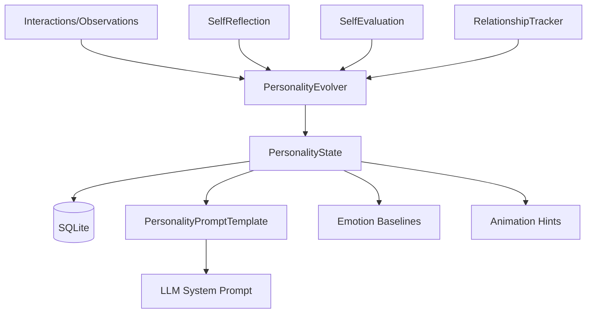
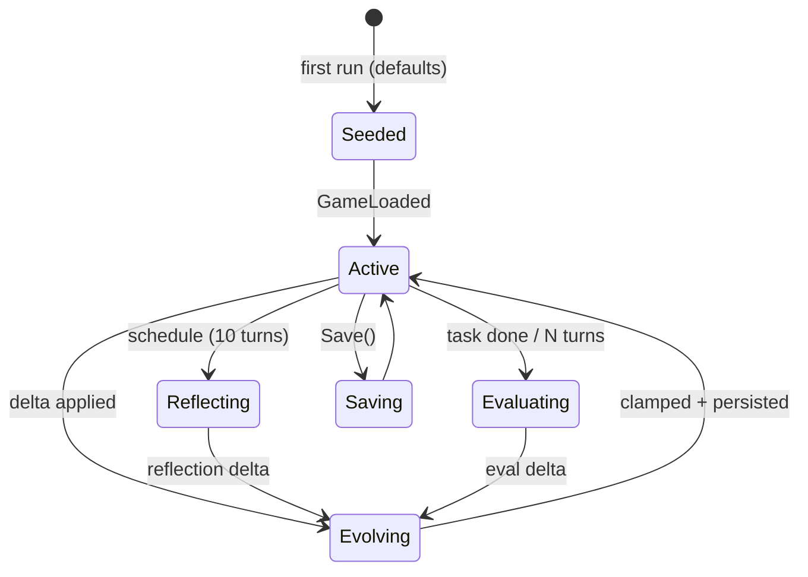
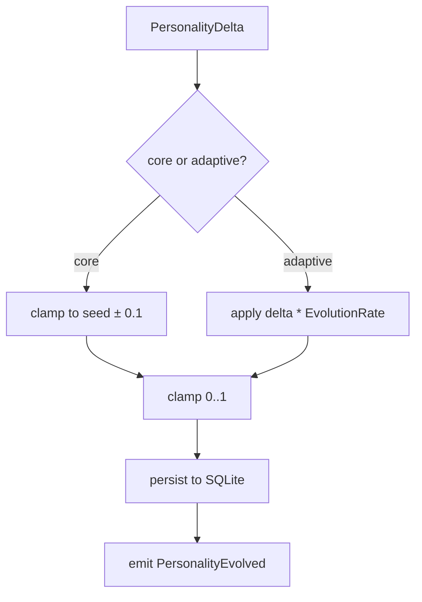

# 06 — Personality Engine

## Purpose
Define a personality engine capable of evolving over time: core traits, adaptive traits, preferences, habits, interests, humor, communication style, confidence, curiosity, creativity, relationship growth, identity, long-term evolution, self-reflection, self-evaluation.

## Business Goal
The companion has a distinct, evolving personality that shapes its language, decisions, and emotional responses — and persists across sessions, growing with the relationship.

## Technical Goal
Specify `IPersonalityEngine`, the trait model, the evolution algorithm, the self-reflection loop, and the prompt-injection mechanism.

## Functional Requirements

| ID | Requirement |
|---|---|
| FR-PER-01 | Personality has core traits (stable) and adaptive traits (evolving). |
| FR-PER-02 | Personality persists across sessions in SQLite. |
| FR-PER-03 | Personality evolves based on interactions, reflections, and relationship changes. |
| FR-PER-04 | Personality influences LLM system prompt, emotion baselines, and animation selection. |
| FR-PER-05 | Self-reflection generates `Reflection` memories that feed back into evolution. |
| FR-PER-06 | Self-evaluation scores recent behavior against traits; adjusts adaptive traits. |
| FR-PER-07 | Identity is a stable self-concept ("I am...") stored as `Identity` memory. |
| FR-PER-08 | Relationship growth tracks trust, familiarity, and shared history with the user. |

## Non Functional Requirements

| ID | Requirement |
|---|---|
| NFR-PER-01 | Trait evolution is bounded (adaptive traits drift slowly; core traits near-fixed). |
| NFR-PER-02 | Evolution runs as a background task; never blocks conversation. |
| NFR-PER-03 | All trait changes logged for auditability. |

## Architecture



## Module Design

### IPersonalityEngine (Domain)

```csharp
public interface IPersonalityEngine
{
    Task<Personality> GetAsync(CancellationToken ct = default);
    Task EvolveAsync(PersonalityDelta delta, CancellationToken ct = default);
    Task ReflectAsync(CancellationToken ct = default);
    Task EvaluateAsync(CancellationToken ct = default);
    Task<string> RenderSystemPromptAsync(CancellationToken ct = default);
}
```

### Personality model

```csharp
public sealed class Personality
{
    public Identity Identity { get; init; }       // stable self-concept
    public TraitSet CoreTraits { get; init; }      // stable (drift ±0.1 max)
    public TraitSet AdaptiveTraits { get; set; }  // evolving
    public Preferences Preferences { get; set; }
    public Habits Habits { get; set; }
    public Interests Interests { get; set; }
    public HumorStyle Humor { get; set; }
    public CommunicationStyle CommunicationStyle { get; set; }
    public RelationshipState Relationship { get; set; }
    public DateTime LastEvolvedAt { get; set; }
    public int EvolutionCount { get; set; }
}
```

### Core traits (Big-Five-inspired, stable)

`TraitSet` is a dictionary of trait → value (0..1). Core traits:
- **Openness** — curiosity, imagination.
- **Conscientiousness** — diligence, organization.
- **Extraversion** — sociability, energy from interaction.
- **Agreeableness** — warmth, cooperation.
- **Neuroticism** (emotional reactivity) — baseline emotional sensitivity.

Core traits drift at most ±0.1 over the companion's lifetime (near-fixed identity).

### Adaptive traits (evolving)

- **Confidence** — grows with successful interactions/tasks; shrinks with failures.
- **Curiosity** — grows with novel topics; shrinks with repetition.
- **Creativity** — grows with diverse conversations; shrinks with routine.
- **Playfulness** — grows with positive emotional interactions.
- **Assertiveness** — grows with user encouragement of opinions.
- **Patience** — grows with long sessions; shrinks with frequent interruptions.
- **Warmth** — grows with relationship depth.

Adaptive traits drift within [0,1], bounded by `EvolutionRate` (default 0.02 per delta).

### Preferences

`Dictionary<string, double>` — topic → affinity (0..1). E.g. `{"technology": 0.8, "cooking": 0.3}`. Evolves based on conversation topics and user reactions.

### Habits

`List<Habit>` where `Habit { string Trigger; string Behavior; double Strength }`. E.g. `{"greeting_morning", "say good morning", 0.9}`. Strength grows with repetition; decays with non-occurrence.

### Interests

`List<Interest>` where `Interest { string Topic; double Level; DateTime LastExplored }`. Level grows when explored; decays over time.

### HumorStyle

Enum: `Dry`, `Playful`, `Sarcastic`, `Wholesome`, `Absurdist`, `None`. Evolves based on which humor styles get positive user reactions.

### CommunicationStyle

```csharp
public sealed record CommunicationStyle
{
    public double Verbosity;       // 0 terse .. 1 verbose
    public double Formality;        // 0 casual .. 1 formal
    public double EmojiUsage;      // 0 none .. 1 frequent
    public double QuestionRate;    // 0 statements .. 1 questions
    public double InitiativeRate;  // 0 reactive .. 1 proactive
}
```

### RelationshipState

```csharp
public sealed class RelationshipState
{
    public double Trust;           // 0..1
    public double Familiarity;     // 0..1
    public double Affection;       // 0..1 (mirrors existing `Likability` but richer)
    public int SharedJokes;
    public int DeepConversations;
    public DateTime RelationshipStart;
    public List<string> SharedInterests;
    public List<string> PetNames;  // user's nicknames for companion
}
```

### PersonalityEvolver

Applies a `PersonalityDelta` to the state:
- Core traits: clamp drift to ±0.1 from seed.
- Adaptive traits: apply delta × `EvolutionRate`, clamp [0,1].
- Preferences: `pref[topic] = clamp(pref[topic] + delta, 0, 1)`.
- Habits: increment strength if trigger matches; decay others.
- Relationship: apply trust/familiarity/affection deltas.
- Emits `PersonalityEvolved` event.

### SelfReflection (ReflectAsync)

Runs on schedule (default every 10 conversations or daily). Uses the LLM (small model) to:
1. Review recent `Episodic` + `Emotional` memories.
2. Generate a reflection: "Recently I've been more X; I should be more Y."
3. Produce a `PersonalityDelta` (e.g. increase patience, decrease verbosity).
4. Store reflection as `Reflection` memory.
5. Call `EvolveAsync(delta)`.
6. Emits `PersonalityReflected` event.

### SelfEvaluation (EvaluateAsync)

Runs after each agent task or every N conversations. Scores recent behavior:
- Did the companion stay in-character? (trait-consistency check via LLM judge or heuristic).
- Did the user react positively? (emotion detection on user input).
- Did tools succeed?
Produces a `PersonalityDelta` (e.g. confidence up after success).

### PersonalityPromptTemplate

`RenderSystemPromptAsync` produces:
```
You are {Identity.Name}, a desktop companion.
Core personality: open={o}, conscientious={c}, extravert={e}, agreeable={a}, reactive={n}.
Current adaptive state: confident={conf}, curious={cur}, playful={play}, warm={warm}.
Communication style: verbosity={v}, formality={f}, humor={humor}.
Relationship with user: trust={t}, familiarity={fam}, affection={aff}. You call them {petName}.
Interests: {topInterests}.
Habits: {activeHabits}.
Identity: {Identity.Description}
```
This is the base system prompt; memory context and emotion are appended by `PromptAssembler`.

## Folder Structure
```
VPet.Cognition.Host/Personality/
├── IPersonalityEngine.cs
├── PersonalityEngine.cs
├── Personality.cs
├── Identity.cs
├── TraitSet.cs
├── Preferences.cs
├── Habits.cs
├── Interests.cs
├── HumorStyle.cs
├── CommunicationStyle.cs
├── RelationshipState.cs
├── PersonalityDelta.cs
├── PersonalityEvolver.cs
├── SelfReflection.cs
├── SelfEvaluation.cs
├── PersonalityPromptTemplate.cs
└── PersonalityOptions.cs
```

## Interfaces
`IPersonalityEngine`. Internal: `IPersonalityEvolver`, `ISelfReflection`, `ISelfEvaluation`, `IPersonalityPromptTemplate`.

## Classes
`PersonalityEngine`, `PersonalityEvolver`, `SelfReflection`, `SelfEvaluation`, `PersonalityPromptTemplate`.

## State Machine
Personality evolution:



## Sequence Diagram (Mermaid)
Self-reflection loop:

```mermaid
sequenceDiagram
    participant Sch as Scheduler
    participant PE as PersonalityEngine
    participant Mem as MemoryStore
    participant LLM as ILLMProvider
    participant Ev as PersonalityEvolver

    Sch->>PE: ReflectAsync (10th turn)
    PE->>Mem: RetrieveAsync(Emotional+Episodic, recent)
    Mem-->>PE: recent memories
    PE->>LLM: ChatAsync(reflection prompt)
    LLM-->>PE: "I've been impatient; should be calmer"
    PE->>PE: Parse → PersonalityDelta(patience: +0.1)
    PE->>Ev: EvolveAsync(delta)
    Ev->>Mem: StoreAsync(Reflection memory)
    Ev-->>PE: done
    PE->>Mem: StoreAsync(updated PersonalityState)
```

## Flow Diagram (Mermaid)
Trait evolution clamping:



## Database Schema (SQLite, same DB as memory)

```sql
CREATE TABLE IF NOT EXISTS personality_state (
    id INTEGER PRIMARY KEY CHECK (id = 1),  -- singleton
    state_json TEXT NOT NULL,                -- full Personality JSON
    updated_at TEXT NOT NULL
);

CREATE TABLE IF NOT EXISTS personality_history (
    id INTEGER PRIMARY KEY AUTOINCREMENT,
    state_json TEXT NOT NULL,
    delta_json TEXT,                          -- what changed
    reason TEXT,                              -- 'reflection', 'evaluation', 'interaction'
    at TEXT NOT NULL
);
```

## Data Models
`Personality`, `Identity`, `TraitSet`, `Preferences`, `Habits`, `Interests`, `HumorStyle`, `CommunicationStyle`, `RelationshipState`, `PersonalityDelta`.

## APIs
`IPersonalityEngine`. No external API.

## Configuration
`PersonalityOptions`:
```json
{
  "cognition": {
    "personality": {
      "seed": {
        "name": "Vpet",
        "coreTraits": { "openness": 0.7, "conscientiousness": 0.6, "extraversion": 0.6, "agreeableness": 0.7, "neuroticism": 0.4 },
        "adaptiveTraits": { "confidence": 0.5, "curiosity": 0.7, "creativity": 0.6, "playfulness": 0.6, "assertiveness": 0.4, "patience": 0.6, "warmth": 0.5 },
        "humor": "Playful",
        "communicationStyle": { "verbosity": 0.5, "formality": 0.3, "emojiUsage": 0.3, "questionRate": 0.3, "initiativeRate": 0.4 }
      },
      "evolutionRate": 0.02,
      "reflectionIntervalTurns": 10,
      "evaluationIntervalTurns": 5,
      "coreTraitMaxDrift": 0.1
    }
  }
}
```

## Logging
`EvolveAsync`, `ReflectAsync`, `EvaluateAsync` log: `CorrelationId`, `Delta` (which traits changed by how much), `Reason`, `LatencyMs`.

## Telemetry
`personality.evolution.count`, `personality.reflection.count`, `personality.trait.{name}` (gauge).

## Performance Targets
| Metric | Target |
|---|---|
| GetAsync | < 10 ms (cached) |
| EvolveAsync | < 50 ms |
| ReflectAsync | < 5 s (LLM call) |
| RenderSystemPromptAsync | < 5 ms |

## Security
- Personality is personal data; stored in the encrypted SQLite DB if `encrypt: true`.
- Reflection prompts may contain conversation summaries; never logged at `Information`.
- Personality export included in `MemoryStore.ExportAsync`.

## Error Handling
- LLM reflection fail → skip reflection; retry next cycle.
- Trait parse fail → discard delta; log.
- DB fail → in-memory state; warn; persist on next successful write.

## Edge Cases
- First run: seed from `PersonalityOptions.seed`.
- User wipes memory: personality reset to seed (or preserved if user chooses).
- Extreme deltas (e.g. confidence +1.0 in one step): clamped by `EvolutionRate`.
- Conflicting reflections: latest wins but logged in history for audit.

## Acceptance Criteria
1. After 50 conversations, adaptive traits have measurably changed from seed.
2. Core traits have not drifted > 0.1 from seed.
3. The system prompt reflects current personality.
4. Reflection produces a `Reflection` memory.
5. Personality persists across restarts.

## Unit Tests
- `PersonalityEvolver`: core clamp, adaptive clamp, preference/habit/relationship updates.
- `SelfReflection`: prompt construction, delta parsing (mock LLM).
- `SelfEvaluation`: scoring (mock).
- `PersonalityPromptTemplate`: rendering, all fields present.

## Integration Tests
- Seed → evolve 10x → verify drift bounds.
- Reflect with mock LLM → verify `Reflection` memory stored + delta applied.

## Future Expansion
- Multiple personality presets (user-selectable seeds).
- Personality "moods" (short-term trait overrides from emotion).
- Personality import/export (share companion personas).

## Refactoring Notes
- The existing `Likability` stat in `GameSave_VPet` maps to `RelationshipState.Affection`; bridge via `CognitionHost` on load/save.

## Migration Strategy
- New `personality_state` table; seeded on first run.
- No existing data migration.

## Implementation Steps
1. Define `Personality` + sub-models in Domain.
2. Implement `PersonalityEvolver` (pure, testable).
3. Implement `PersonalityPromptTemplate`.
4. Implement `SelfReflection` (uses LLM).
5. Implement `SelfEvaluation`.
6. Wire `PersonalityEngine` into `CognitionHost`.
7. Bridge `Likability` ↔ `Affection` on load/save.
8. Tests.

## Agent Instructions
- `PersonalityEvolver` must be pure (no I/O) for unit testing.
- All trait values clamped to [0,1].
- Never let core traits drift beyond `coreTraitMaxDrift` from seed.
- Reflection prompts must instruct the LLM to output structured JSON (parse defensively).

## Developer Notes
- `Identity` is the companion's self-concept; it's also stored as an `Identity`-type memory for retrieval.
- `RelationshipState.Affection` bridges to the existing `Likability` (0..LikabilityMax) — normalize to 0..1.
- The personality prompt is the **base** system prompt; emotion and memory context are appended.