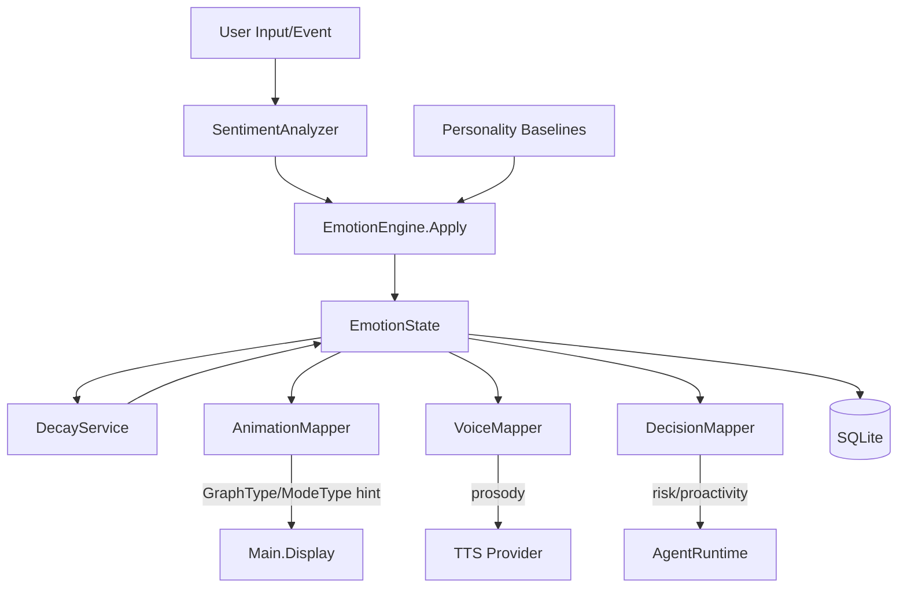
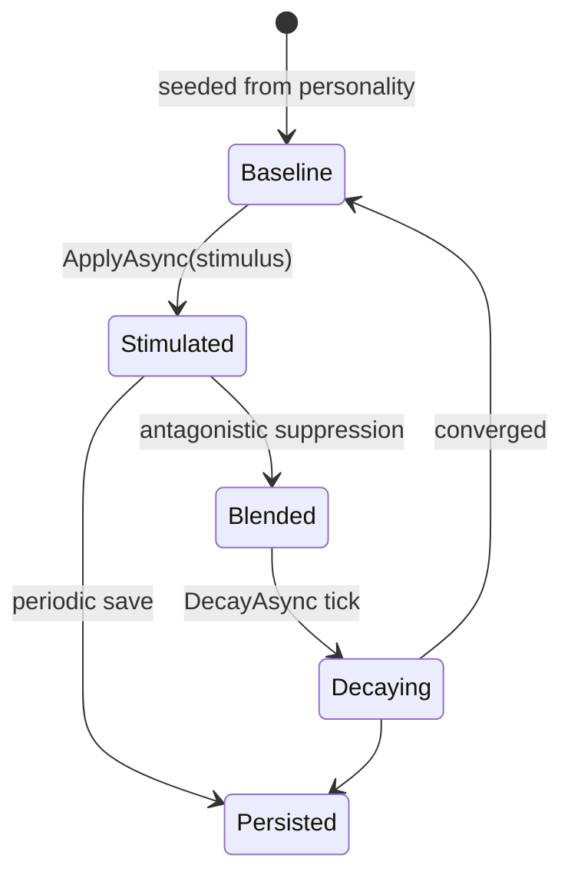
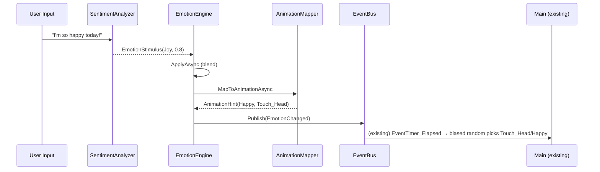
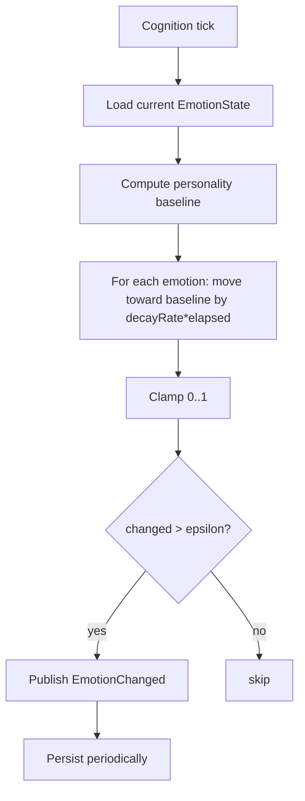

# 07 — Emotion Engine

## Purpose
Define an emotion engine supporting 10 emotions, blending, persistence, decay, animation mapping, voice mapping, and decision influence.

## Business Goal
The companion exhibits emotions that feel congruent and continuous — influencing its animations, voice prosody, and decisions — and that evolve from interactions and personality.

## Technical Goal
Specify `IEmotionEngine`, the 10-dimensional emotion vector, the blend/decay algorithms, and the mappings to animation and voice.

## Functional Requirements

| ID | Requirement |
|---|---|
| FR-EMO-01 | Support 10 emotions: Joy, Sadness, Anger, Curiosity, Stress, Excitement, Fear, Calmness, Surprise, Frustration. |
| FR-EMO-02 | Emotions blend (multiple active simultaneously). |
| FR-EMO-03 | Emotions persist across sessions. |
| FR-EMO-04 | Emotions decay over time toward a personality-derived baseline. |
| FR-EMO-05 | Emotions map to animation selection (influence `GraphType`/`ModeType`). |
| FR-EMO-06 | Emotions map to voice prosody (TTS speed/pitch). |
| FR-EMO-07 | Emotions influence agent decisions (risk appetite, proactivity). |
| FR-EMO-08 | Emotions are driven by user input (sentiment), events (tool success/failure), and personality baselines. |

## Non Functional Requirements

| ID | Requirement |
|---|---|
| NFR-EMO-01 | Emotion update < 10 ms (no I/O on hot path). |
| NFR-EMO-02 | Decay runs on the cognition tick (existing `TimeHandle`). |
| NFR-EMO-03 | Emotion state persisted periodically (not every tick). |

## Architecture



## Module Design

### IEmotionEngine (Domain)

```csharp
public interface IEmotionEngine
{
    Task<EmotionState> GetAsync(CancellationToken ct = default);
    Task ApplyAsync(EmotionStimulus stimulus, CancellationToken ct = default);
    Task DecayAsync(CancellationToken ct = default);
    Task<AnimationHint> MapToAnimationAsync(CancellationToken ct = default);
    Task<VoiceProsody> MapToVoiceAsync(CancellationToken ct = default);
    Task<DecisionBias> MapToDecisionAsync(CancellationToken ct = default);
}
```

### EmotionState

```csharp
public sealed class EmotionState
{
    public EmotionVector Vector { get; set; }   // 10 dims, 0..1 each
    public DateTime LastUpdatedAt { get; set; }
    public EmotionType Dominant => Vector.Dominant;
    public double Arousal => Vector.Arousal;     // computed
    public double Valence => Vector.Valence;     // computed
}
```

### EmotionVector (value object, 10 dims)

```csharp
public readonly struct EmotionVector
{
    public double Joy, Sadness, Anger, Curiosity, Stress, Excitement, Fear, Calmness, Surprise, Frustration;
    // Arousal = avg(Excitement, Stress, Anger, Surprise, Fear) - avg(Calmness, Sadness)
    // Valence = avg(Joy, Calmness, Curiosity) - avg(Sadness, Anger, Stress, Fear, Frustration)
    public EmotionType Dominant => /* argmax */;
}
```

### EmotionType enum

`Joy, Sadness, Anger, Curiosity, Stress, Excitement, Fear, Calmness, Surprise, Frustration`.

### EmotionStimulus

```csharp
public sealed record EmotionStimulus
{
    public EmotionType? Primary { get; init; }
    public double Intensity { get; init; }       // 0..1
    public string? Source { get; init; }          // "user_input", "tool_success", "tool_failure", "memory", "time"
    public Dictionary<EmotionType, double>? Blends { get; init; } // secondary emotions
}
```

### SentimentAnalyzer

Analyzes user input text → `EmotionStimulus`:
- **Local**: a small ONNX sentiment model (or rule-based keyword + emoji detection for offline-first zero-dep default).
- **LLM-assisted**: optionally ask the LLM to classify emotion in a side-channel (cached, batched).
- Detects user's emotion (e.g. user is sad → companion's `Sadness` + `Calmness` empathy rise; `Joy` falls).

### ApplyAsync (blending)

```
for each emotion e in stimulus:
    current[e] = clamp(current[e] + intensity * blendFactor, 0, 1)
// blendFactor default 0.3 (emotions shift gradually)
// antagonistic pairs suppress: Joy↑ → Sadness↓; Calmness↑ → Stress↓
```
Antagonistic pairs: (Joy, Sadness), (Calmness, Stress), (Calmness, Anger), (Excitement, Fear). When one rises, its antagonist decays by 50% of the rise.

### DecayAsync

Runs on cognition tick (every `EventTimer` 15 s, or a faster dedicated timer):
```
for each emotion e:
    target = personalityBaseline[e]
    current[e] = current[e] + (target - current[e]) * decayRate * elapsed
```
`decayRate` default 0.01/s (emotion halves in ~70 s toward baseline). Configurable per-emotion.

Personality baselines derived from core traits:
- High Neuroticism → higher baseline Stress/Fear.
- High Extraversion → higher baseline Joy/Excitement.
- High Agreeableness → higher baseline Calmness.

### AnimationMapper

Maps `EmotionState` → `AnimationHint`:
```csharp
public sealed record AnimationHint
{
    public GraphType? PreferredGraph;   // e.g. Joy → Touch_Head (happy idle)
    public ModeType? PreferredMode;      // Joy → Happy; Sadness → PoorCondition; Anger → PoorCondition
    public double Intensity;             // influences animation speed/selection weight
}
```
Mapping table:
| Dominant emotion | PreferredMode | PreferredGraph hint |
|---|---|---|
| Joy | Happy | Touch_Head / Idel (lively) |
| Sadness | PoorCondition | Sleep / Idel (slow) |
| Anger | PoorCondition | Raised_Static (defensive) |
| Curiosity | Nomal | Touch_Body (attentive) |
| Stress | PoorCondition | Work (fidgety) |
| Excitement | Happy | Move (energetic) |
| Fear | PoorCondition | SideHide (retreating) |
| Calmness | Nomal | Sleep / Idel (relaxed) |
| Surprise | Nomal | Raised_Dynamic (startled) |
| Frustration | PoorCondition | Touch_Body (agitated) |

This is a **hint**, not an override. The existing `MainDisplay` state machine still runs; the emotion engine raises a `EmotionChanged` event that a `CognitionGraphResolver` (optional, see `12_animation_system.md`) listens to, biasing the random selection in `EventTimer_Elapsed` toward the hinted graph/mode. **No Core change required for Phase 3** — the resolver subscribes to existing events and calls existing `Display*` methods.

### VoiceMapper

Maps `EmotionState` → `VoiceProsody`:
```csharp
public sealed record VoiceProsody
{
    public double SpeedMultiplier;   // 0.8 (sad) .. 1.2 (excited)
    public double PitchMultiplier;   // 0.9 (sad/calm) .. 1.1 (joy/surprise)
    public double VolumeMultiplier;  // 0.8 (fear) .. 1.1 (joy/anger)
}
```
Passed to TTS provider (see `08_voice_pipeline.md`).

### DecisionMapper

Maps `EmotionState` → `DecisionBias`:
```csharp
public sealed record DecisionBias
{
    public double RiskAppetite;      // Joy/Excitement ↑ risk; Fear/Stress ↓ risk
    public double Proactivity;       // Joy/Curiosity ↑ proactive; Sadness ↓
    public double ToolWillingness;   // Curiosity ↑; Fear/Stress ↓
}
```
Consumed by `AgentRuntime` (see `10_agent_system.md`).

## Folder Structure
```
VPet.Cognition.Host/Emotion/
├── IEmotionEngine.cs
├── EmotionEngine.cs
├── EmotionState.cs
├── EmotionVector.cs
├── EmotionType.cs
├── EmotionStimulus.cs
├── SentimentAnalyzer.cs
├── EmotionBlender.cs
├── DecayService.cs
├── AnimationMapper.cs
├── VoiceMapper.cs
├── DecisionMapper.cs
└── EmotionOptions.cs
```

## Interfaces
`IEmotionEngine`. Internal: `ISentimentAnalyzer`, `IEmotionBlender`, `IDecayService`, `IAnimationMapper`, `IVoiceMapper`, `IDecisionMapper`.

## Classes
`EmotionEngine`, `SentimentAnalyzer`, `EmotionBlender`, `DecayService`, `AnimationMapper`, `VoiceMapper`, `DecisionMapper`.

## State Machine
Emotion update:



## Sequence Diagram (Mermaid)
Emotion → animation influence:



## Flow Diagram (Mermaid)
Decay loop:



## Database Schema (SQLite, same DB)

```sql
CREATE TABLE IF NOT EXISTS emotion_state (
    id INTEGER PRIMARY KEY CHECK (id = 1),
    state_json TEXT NOT NULL,
    updated_at TEXT NOT NULL
);

CREATE TABLE IF NOT EXISTS emotion_history (
    id INTEGER PRIMARY KEY AUTOINCREMENT,
    state_json TEXT NOT NULL,
    stimulus_json TEXT,
    at TEXT NOT NULL
);
```

## Data Models
`EmotionState`, `EmotionVector`, `EmotionStimulus`, `AnimationHint`, `VoiceProsody`, `DecisionBias`.

## APIs
`IEmotionEngine`. No external API.

## Configuration
`EmotionOptions`:
```json
{
  "cognition": {
    "emotion": {
      "blendFactor": 0.3,
      "decayRatePerSec": 0.01,
      "persistInterval": "00:01:00",
      "antagonisticSuppression": 0.5,
      "sentiment": { "method": "rule", "model": "" }
    }
  }
}
```

## Logging
`ApplyAsync`, `DecayAsync` log: `CorrelationId`, `Stimulus`, `BeforeVector`, `AfterVector`, `Dominant`, `LatencyMs`.

## Telemetry
`emotion.dominant` (gauge per type), `emotion.apply.count`, `emotion.decay.count`.

## Performance Targets
| Metric | Target |
|---|---|
| ApplyAsync | < 10 ms |
| DecayAsync | < 5 ms |
| MapToAnimation | < 1 ms |
| SentimentAnalyzer (rule) | < 5 ms |

## Security
- Emotion history is personal data; in encrypted DB if `encrypt: true`.
- Sentiment analysis runs locally by default; cloud sentiment never sends user text off-device without consent.

## Error Handling
- Sentiment fail → neutral stimulus (no change); log.
- Decay math overflow → clamp; log.
- DB fail → in-memory state; persist on next success.

## Edge Cases
- All-zero vector → `Calmness` dominant by default.
- Conflicting stimuli in one turn → apply sequentially; last wins for antagonistic.
- Very high intensity (1.0) → clamped; antagonistic suppressed by 50%.
- App idle (no interaction for hours) → decays to baseline (likely Calmness).

## Acceptance Criteria
1. A sad user message raises `Sadness`/lowers `Joy` in the companion.
2. After 70 s of no stimulus, emotions move halfway to baseline.
3. `Joy` dominant → animation hint is `Happy` mode.
4. Emotion state persists across restarts.
5. Voice prosody reflects emotion (excited → faster/higher pitch).

## Unit Tests
- `EmotionBlender`: apply, antagonistic suppression, clamp.
- `DecayService`: convergence to baseline, elapsed scaling.
- `AnimationMapper`: all 10 emotions → correct hint.
- `VoiceMapper`: prosody ranges.
- `DecisionMapper`: bias ranges.
- `SentimentAnalyzer` (rule): keyword/emoji detection.

## Integration Tests
- Apply stimulus → decay 100 ticks → verify convergence.
- Emotion → animation hint → verify `EmotionChanged` event published.

## Future Expansion
- Emotion "intensity" affecting animation playback speed.
- Multi-modal sentiment (voice tone analysis from STT audio).
- Emotion-contagion (companion mirrors user emotion).

## Refactoring Notes
- The existing `ModeType` (Happy/Nomal/PoorCondition/Ill) is coarser than 10 emotions; the mapper reduces 10 → 4 modes. A future `CognitionGraphResolver` could request emotion-specific animations from MODs that provide them (e.g. a "joyful_idle" graph).

## Migration Strategy
- New `emotion_state` table; seeded from personality baselines on first run.
- No existing data migration.

## Implementation Steps
1. Define `EmotionState`, `EmotionVector`, `EmotionType`, `EmotionStimulus` in Domain.
2. Implement `EmotionBlender` (pure).
3. Implement `DecayService` (pure).
4. Implement `SentimentAnalyzer` (rule-based first).
5. Implement `AnimationMapper`, `VoiceMapper`, `DecisionMapper`.
6. Wire `EmotionEngine` into `CognitionHost`; subscribe to cognition tick for decay.
7. Bridge `EmotionChanged` → animation (via existing `TimeHandle`/`GraphDisplayHandler`).
8. Tests.

## Agent Instructions
- `EmotionBlender` and `DecayService` must be pure (no I/O) for unit testing.
- All emotion values clamped to [0,1].
- Never override the existing animation state machine directly; emit hints via events.
- Sentiment analysis must work offline (rule-based default).

## Developer Notes
- The existing `CalMode()` in `GameSave` computes a `ModeType` from vitals; the emotion engine's `AnimationHint.PreferredMode` is a **second input** to mode selection. Reconcile by: if emotion hint differs from `CalMode()`, use emotion hint with probability proportional to emotion intensity (so a very happy companion shows Happy even if slightly hungry).
- `VoiceProsody` is consumed by TTS — see `08_voice_pipeline.md`.