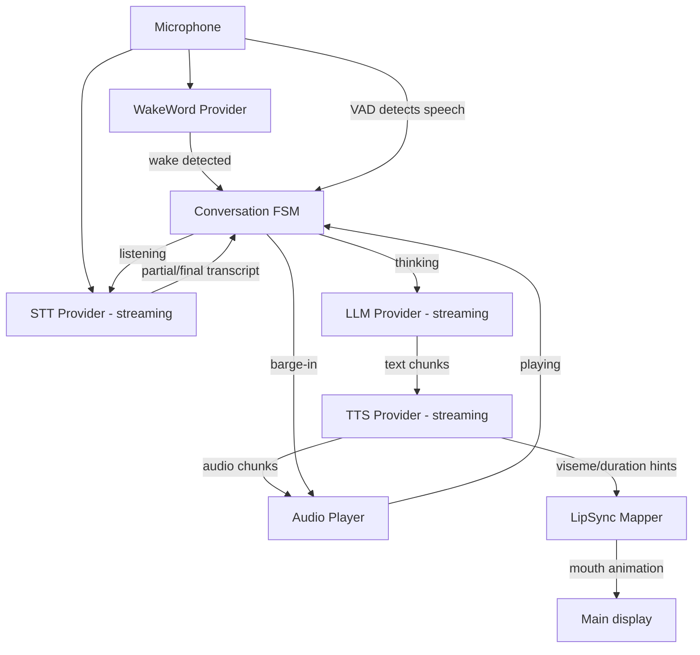
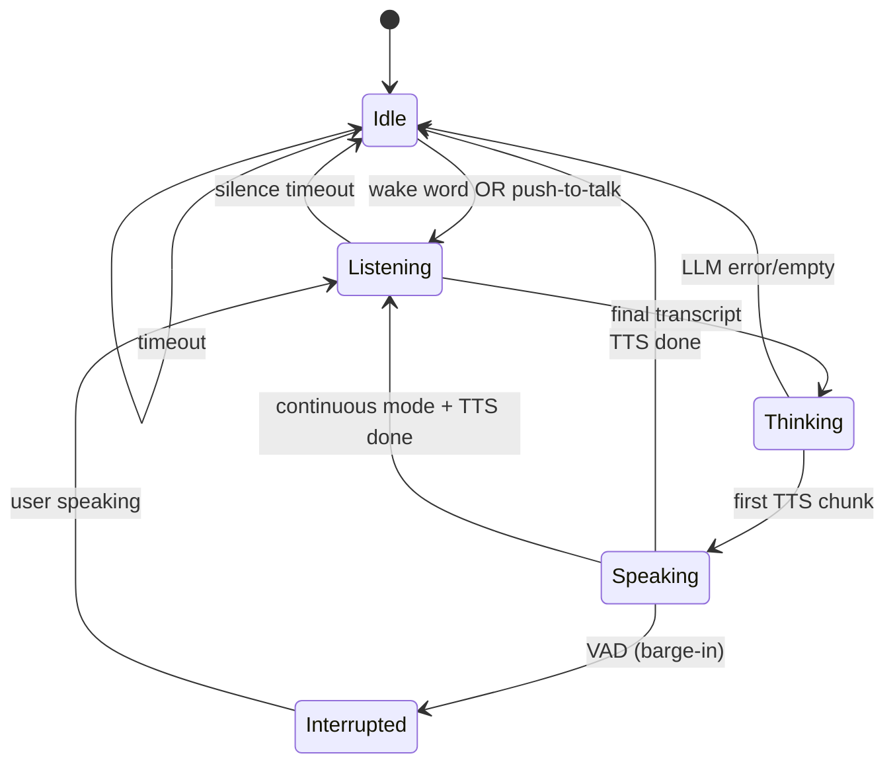
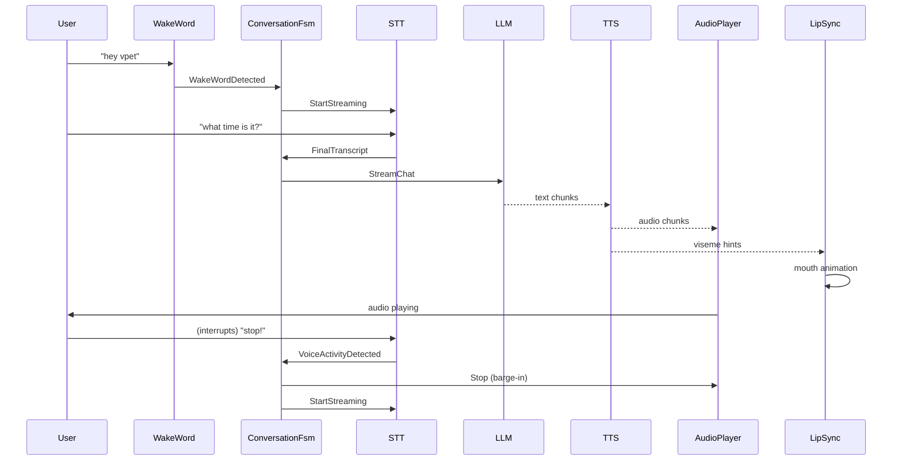
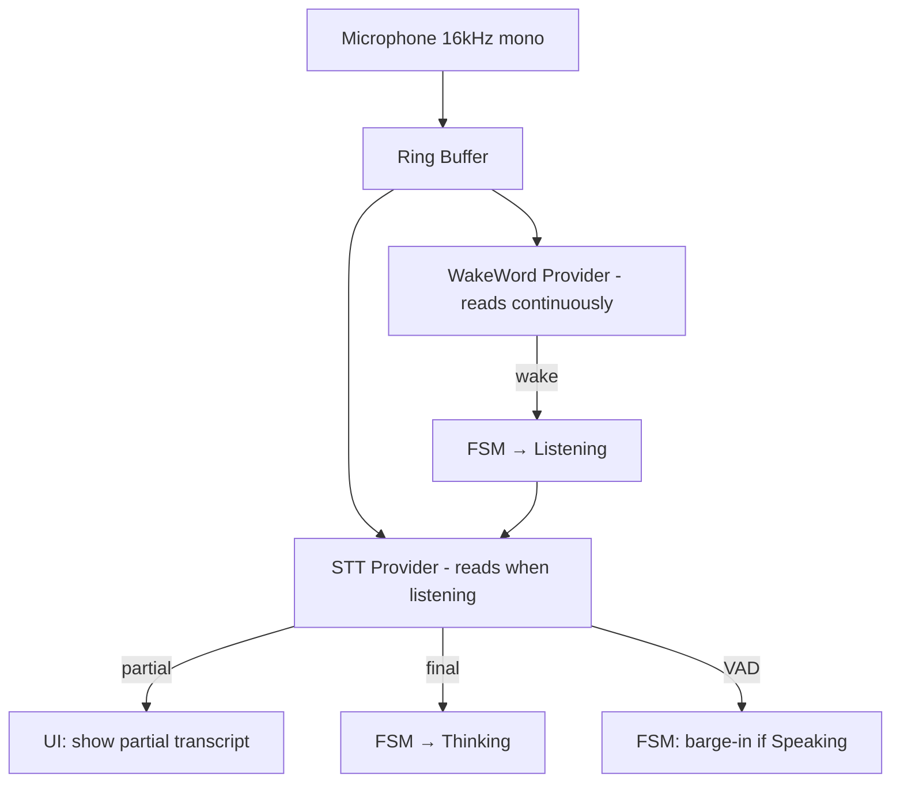

# 08 — Voice Pipeline

## Purpose
Define a natural voice conversation pipeline: wake word, streaming STT, streaming TTS, interruptions, latency optimization, lip sync, animation sync, and a conversation state machine.

## Business Goal
The companion speaks and listens naturally — low-latency, interruptible, with emotion-congruent voice and lip-synced animation.

## Technical Goal
Specify `IWakeWordProvider`, `ISttProvider`, `ITtsProvider`, the conversation FSM, streaming audio handling, and integration with the existing `MediaElement VoicePlayer` and `MessageBar`.

## Functional Requirements

| ID | Requirement |
|---|---|
| FR-VO-01 | Wake word detection (OpenWakeWord via ONNX) runs continuously when enabled. |
| FR-VO-02 | Streaming STT (Faster Whisper / whisper.cpp) transcribes speech in real time. |
| FR-VO-03 | Streaming TTS (Piper / Kokoro / XTTS v2) synthesizes speech in chunks. |
| FR-VO-04 | The user can interrupt the companion mid-speech (barge-in). |
| FR-VO-05 | TTS prosody reflects current emotion. |
| FR-VO-06 | Lip-sync hints drive animation (mouth movement). |
| FR-VO-07 | A conversation state machine manages listening/thinking/speaking transitions. |
| FR-VO-08 | All providers are swappable via config. |

## Non Functional Requirements

| ID | Requirement |
|---|---|
| NFR-VO-01 | Wake-to-text latency < 800 ms. |
| NFR-VO-02 | TTS first audio chunk < 500 ms. |
| NFR-VO-03 | Barge-in stops TTS within 200 ms. |
| NFR-VO-04 | Audio capture/playback never blocks the UI thread. |

## Architecture



## Module Design

### IWakeWordProvider (Domain)

```csharp
public interface IWakeWordProvider : IAsyncDisposable
{
    Task StartAsync(CancellationToken ct = default);
    Task StopAsync(CancellationToken ct = default);
    event Action<WakeWordDetectedEventArgs>? WakeWordDetected;
}
```
`WakeWordDetectedEventArgs { string WakeWord; double Confidence; DateTime At }`.

### ISttProvider (Domain)

```csharp
public interface ISttProvider : IAsyncDisposable
{
    Task StartStreamingAsync(CancellationToken ct = default);
    Task StopStreamingAsync(CancellationToken ct = default);
    event Action<TranscriptChunk>? PartialTranscript;
    event Action<TranscriptChunk>? FinalTranscript;
    event Action? VoiceActivityDetected;
    event Action? VoiceActivityEnded;
}
```
`TranscriptChunk { string Text; double Confidence; TimeSpan Start; TimeSpan Duration }`.

### ITtsProvider (Domain)

```csharp
public interface ITtsProvider : IAsyncDisposable
{
    IAsyncEnumerable<AudioChunk> SynthesizeAsync(string text, VoiceProsody prosody, CancellationToken ct = default);
    Task<IReadOnlyList<VisemeHint>> GetVisemesAsync(string text, CancellationToken ct = default);
}
```
`AudioChunk { byte[] PcmData; int SampleRate; int Channels; TimeSpan Duration }`.
`VisemeHint { int Viseme; TimeSpan Start; TimeSpan Duration }`.

### Conversation FSM

```csharp
public enum VoiceState { Idle, Listening, Thinking, Speaking, Interrupted }
public interface IConversationFsm
{
    VoiceState State { get; }
    Task StartAsync(CancellationToken ct = default);
    Task StopAsync(CancellationToken ct = default);
    event Action<VoiceState>? StateChanged;
}
```

Transitions:
- `Idle` + wake word → `Listening`.
- `Listening` + final transcript → `Thinking`.
- `Thinking` + first TTS chunk → `Speaking`.
- `Speaking` + VAD (user speech) → `Interrupted` (stop TTS) → `Listening`.
- `Speaking` + TTS done → `Idle` (or `Listening` if continuous mode).
- Any + timeout → `Idle`.

### Audio pipeline

- **Capture**: `NAudio.WaveInEvent` (16kHz, 16-bit, mono) → ring buffer. Wake word and STT read from the same buffer.
- **Playback**: `NAudio.WaveOutEvent` → buffered wave provider. TTS chunks enqueued; barge-in clears the queue and stops playback.
- **VAD**: simple energy-based voice activity detection for barge-in (threshold configurable); STT provider's own VAD can also signal.

### LipSyncMapper

Maps `VisemeHint` to mouth animation. The existing `Main` does not have a mouth-graph system, so lip sync is implemented as:
1. A `LipSyncOverlay` UserControl added to `Main.UIGrid_Back` (the existing reserved overlay layer) that draws a simple mouth shape driven by viseme.
2. Alternatively, if a MOD provides mouth-graph animations, the mapper selects them via `GraphCore.FindGraph("mouth_" + viseme)`.
3. The mapper emits viseme changes at 60 FPS during TTS playback; idle otherwise.

This is additive — no Core change. The overlay is added by `CognitionHost.AttachToPet`.

### Emotion → prosody

`VoiceProsody` from `IEmotionEngine.MapToVoiceAsync` (see `07_emotion_engine.md`) is passed to `ITtsProvider.SynthesizeAsync`. Providers that support prosody (XTTS v2, Kokoro) apply it; Piper applies speed via length-scale.

## Folder Structure
```
VPet.Cognition.Voice/
├── IWakeWordProvider.cs
├── ISttProvider.cs
├── ITtsProvider.cs
├── AudioChunk.cs
├── VisemeHint.cs
├── VoiceProsody.cs
├── WakeWord/
│   ├── OpenWakeWordProvider.cs      # ONNX
│   └── NullWakeWordProvider.cs      # disabled (text-only)
├── Stt/
│   ├── FasterWhisperProvider.cs      # faster-whisper via Python subprocess or native
│   ├── WhisperCppProvider.cs        # whisper.cpp native binding
│   └── NullSttProvider.cs
├── Tts/
│   ├── PiperProvider.cs             # piper native
│   ├── KokoroProvider.cs            # kokoro native
│   ├── XttsV2Provider.cs            # XTTS v2 via HTTP
│   └── NullTtsProvider.cs
├── Audio/
│   ├── AudioCapture.cs              # NAudio WaveIn
│   ├── AudioPlayer.cs               # NAudio WaveOut + barge-in
│   └── VoiceActivityDetector.cs
├── LipSyncMapper.cs
├── ConversationFsm.cs
└── VoiceOptions.cs
```

## Interfaces
`IWakeWordProvider`, `ISttProvider`, `ITtsProvider`, `IConversationFsm`.

## Classes
`OpenWakeWordProvider`, `FasterWhisperProvider`, `WhisperCppProvider`, `PiperProvider`, `KokoroProvider`, `XttsV2Provider`, `AudioCapture`, `AudioPlayer`, `VoiceActivityDetector`, `LipSyncMapper`, `ConversationFsm`.

## State Machine
Conversation FSM (detailed):



## Sequence Diagram (Mermaid)
Full voice turn with barge-in:



## Flow Diagram (Mermaid)
Audio capture shared by wake word + STT:



## Database Schema
None (voice is transient). Voice model paths in config.

## Data Models
`AudioChunk`, `VisemeHint`, `VoiceProsody`, `TranscriptChunk`, `WakeWordDetectedEventArgs`.

## APIs
Consumes: OpenWakeWord ONNX models, Faster Whisper (Python or native), whisper.cpp (native), Piper (native), Kokoro (native), XTTS v2 (HTTP).

## Configuration
`VoiceOptions`:
```json
{
  "cognition": {
    "voice": {
      "enabled": false,
      "wakeWord": { "provider": "openwakeword", "model": "hey_vpet.onnx", "threshold": 0.5 },
      "stt": { "provider": "faster-whisper", "model": "base", "language": "auto", "device": "cpu" },
      "tts": { "provider": "piper", "model": "en_US-amy-medium.onnx", "device": "cpu" },
      "audio": { "inputDevice": -1, "outputDevice": -1, "sampleRate": 16000 },
      "bargeIn": true,
      "continuousMode": false,
      "silenceTimeoutSec": 3
    }
  }
}
```

## Logging
Wake detection, STT final, TTS start/done, FSM transitions, barge-in events. All with `CorrelationId`.

## Telemetry
`voice.wake.latency_ms`, `voice.stt.latency_ms`, `voice.tts.first_chunk_ms`, `voice.barge_in.count`, `voice.fsm.transitions`.

## Performance Targets
| Metric | Target |
|---|---|
| Wake detection | < 300 ms after speech |
| STT final (3s utterance) | < 800 ms after silence |
| TTS first chunk | < 500 ms |
| Barge-in stop | < 200 ms |

## Security
- Audio is processed locally; never streamed to cloud unless a cloud STT/TTS provider is explicitly configured.
- Cloud TTS sends text (the companion's response) to the provider; warn user on first cloud TTS enable.
- Microphone access is opt-in (`voice.enabled: false` by default).

## Error Handling
- Mic unavailable → disable voice; fall back to text; toast user.
- Wake model missing → disable wake word; text-only or push-to-talk.
- STT fail → log; ask user to repeat (text prompt).
- TTS fail → show text in `MessageBar` only (existing behavior).
- Barge-in race → FSM idempotent; safe to stop already-stopped player.

## Edge Cases
- No microphone → voice disabled; text conversation works.
- User speaks during TTS but it's background noise → VAD threshold + STT confidence gate.
- Multiple wake words in quick succession → debounce 2 s.
- TTS longer than 30 s → chunk by sentence; allow barge-in between chunks.
- Whisper model download on first use → progress UI.

## Acceptance Criteria
1. With voice enabled, saying the wake word transitions FSM to `Listening`.
2. A spoken query produces a spoken response within 2 s total.
3. Speaking during TTS stops playback within 200 ms.
4. TTS prosody reflects emotion (excited → faster).
5. Disabling voice returns to text-only with no errors.

## Unit Tests
- `ConversationFsm`: all transitions, timeouts, barge-in.
- `VoiceActivityDetector`: energy threshold, silence detection.
- `LipSyncMapper`: viseme → mouth shape.
- `OpenWakeWordProvider`: with a mock ONNX session.
- `FasterWhisperProvider`/`WhisperCppProvider`: with a mock audio stream.
- `PiperProvider`/`KokoroProvider`/`XttsV2Provider`: with mock native/HTTP.

## Integration Tests
- Full turn: mock wake → mock STT → mock LLM → mock TTS → verify FSM transitions and audio player calls.
- Barge-in: mid-TTS VAD → verify player stopped.

## Future Expansion
- Speaker identification (recognize the user).
- Multi-voice (different voices for different emotions).
- Real-time voice cloning (XTTS v2 voice clone).
- Full-duplex conversation (no wake word; always listening with VAD).

## Refactoring Notes
- The existing `Main` has a `MediaElement VoicePlayer` used for `SayInfo` voice playback. The voice pipeline can use this for TTS output, or use `NAudio.WaveOutEvent` directly for lower latency. Prefer NAudio for streaming; keep `VoicePlayer` for legacy `SayInfo` non-streaming voice.
- `Main.SayProcess` (`List<Action<SayInfo>>`) is the existing TTS hook; the voice pipeline adds itself there for `SayInfoWithStream`.

## Migration Strategy
- Voice is disabled by default; no existing behavior changes.
- Enabling voice is a config switch.

## Implementation Steps
1. Define `IWakeWordProvider`, `ISttProvider`, `ITtsProvider`, `AudioChunk`, `VisemeHint` in Domain.
2. Implement `AudioCapture` + `AudioPlayer` (NAudio).
3. Implement `ConversationFsm`.
4. Implement `OpenWakeWordProvider` (ONNX Runtime).
5. Implement `FasterWhisperProvider` (native binding or subprocess).
6. Implement `PiperProvider` (native).
7. Implement `LipSyncMapper` + `LipSyncOverlay`.
8. Wire into `CognitionHost`; subscribe to `SayInfoWithStream` for TTS.
9. Tests.

## Agent Instructions
- Use `NAudio` for audio I/O (already a dependency of Windows app; add to Voice project).
- All audio I/O on background threads; never UI thread.
- Use `System.Threading.Channels` for audio chunk streaming between TTS and player.
- Barge-in must be thread-safe (lock the player queue).
- ONNX models loaded once, reused.

## Developer Notes
- Faster Whisper can be called via `faster-whisper` Python (subprocess + stdin/stdout JSON) or a native binding (`whisper-net`). Prefer native for offline-first; Python subprocess as fallback.
- Piper is a C++ library with C bindings; load via `DllImport`.
- OpenWakeWord models are ONNX; use `Microsoft.ML.OnnxRuntime`.
- Visemes: Piper/Kokoro provide phoneme timings; map phonemes → visemes (Preston Blair 13-viseme set or simpler 5-viseme set).