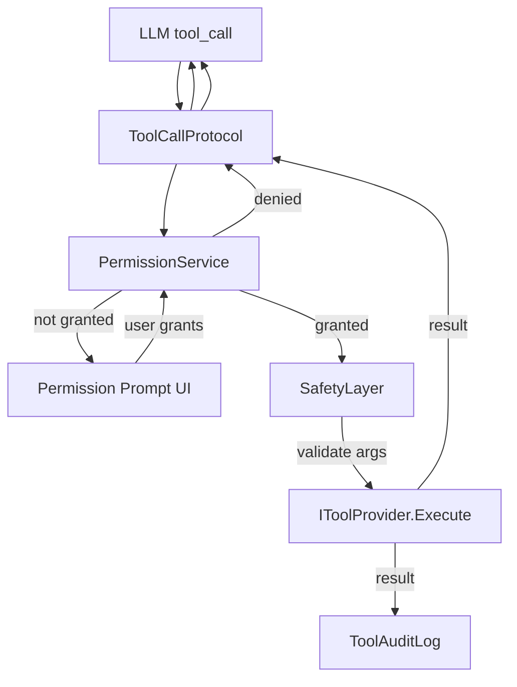
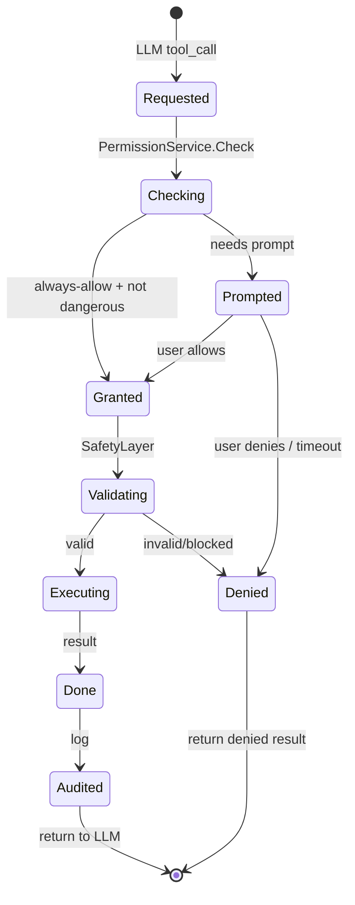
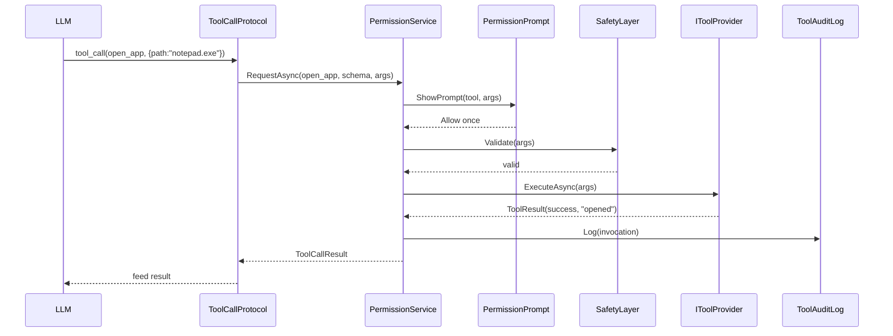
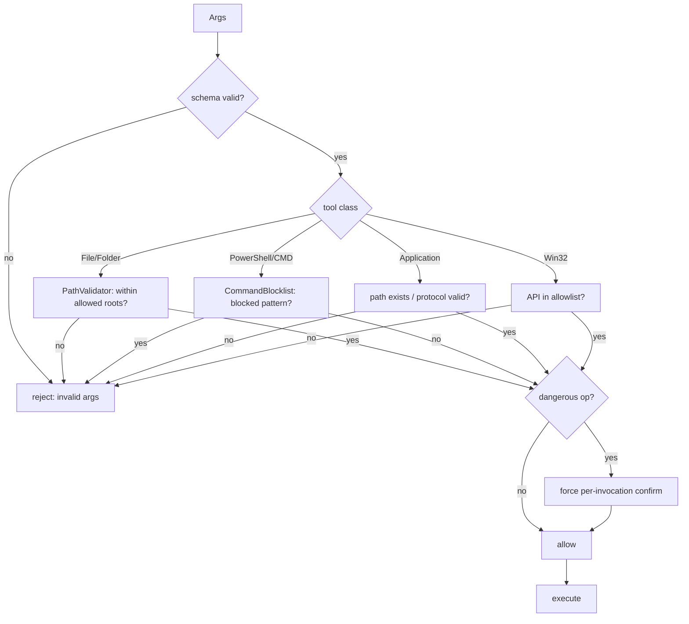

# 09 — Tool Calling

## Purpose
Define secure tool execution: applications, PowerShell, CMD, files, folders, clipboard, browser, Windows APIs — only through a permission system with a safety layer and audit log.

## Business Goal
The companion can act on the user's behalf (open apps, run commands, manage files, browse) safely, with explicit per-tool-class permission and full auditability.

## Technical Goal
Specify `IToolProvider`, `IPermissionService`, `SafetyLayer`, `ToolAuditLog`, the tool-call protocol (from `04_ai_pipeline.md`), and the permission UX.

## Functional Requirements

| ID | Requirement |
|---|---|
| FR-TO-01 | Tools: Application, PowerShell, CMD, File, Folder, Clipboard, Browser, Win32. |
| FR-TO-02 | Every tool execution requires explicit user permission per tool class (deny-by-default). |
| FR-TO-03 | Permissions are scoped, revocable, and audited. |
| FR-TO-04 | Tool arguments are validated against a schema before execution. |
| FR-TO-05 | Tool execution is sandboxed where possible (restricted paths, no admin elevation). |
| FR-TO-06 | Tool results feed back to the LLM. |
| FR-TO-07 | The user can grant "always allow" per tool class (with revocation). |
| FR-TO-08 | Dangerous operations (delete, format, admin) require per-invocation confirmation (no "always allow"). |

## Non Functional Requirements

| ID | Requirement |
|---|---|
| NFR-TO-01 | Permission prompt within 500 ms of tool request. |
| NFR-TO-02 | Tool execution timeout configurable (default 30 s). |
| NFR-TO-03 | All tool invocations logged with full args + result. |

## Architecture



## Module Design

### IToolProvider (Domain)

```csharp
public interface IToolProvider
{
    string ToolName { get; }
    ToolClass Class { get; }
    ToolSchema Schema { get; }
    Task<ToolResult> ExecuteAsync(JsonElement arguments, CancellationToken ct = default);
}
```
`ToolSchema { string Name; string Description; JsonElement ParametersJsonSchema; bool RequiresConfirmation; bool AllowAlways; }`.
`ToolResult { bool Success; string Output; string? Error; TimeSpan Duration }`.

### ToolClass enum

`Application, PowerShell, CMD, File, Folder, Clipboard, Browser, Win32`.

### IPermissionService (Domain)

```csharp
public interface IPermissionService
{
    Task<PermissionState> CheckAsync(string toolName, CancellationToken ct = default);
    Task<PermissionState> RequestAsync(string toolName, ToolSchema schema, JsonElement args, CancellationToken ct = default);
    Task GrantAsync(string toolName, bool alwaysAllow, CancellationToken ct = default);
    Task DenyAsync(string toolName, CancellationToken ct = default);
    Task RevokeAsync(string toolName, CancellationToken ct = default);
    Task<IReadOnlyList<PermissionGrant>> ListGrantsAsync(CancellationToken ct = default);
}
```

Permission states: `NotRequested, Prompted, Granted, Denied, Revoked`.

### SafetyLayer

Validates before execution:
1. **Schema validation** — args match `ParametersJsonSchema` (via `JsonSchema.NET`).
2. **Path validation** — file/folder tools restricted to allowed roots (default: user profile; configurable allowlist). No `..` traversal outside roots.
3. **Command validation** — PowerShell/CMD commands checked against a blocklist (e.g. `Format-Volume`, `Remove-Item -Recurse C:\`, `del /f /s /q C:\`). Blocked patterns configurable.
4. **Elevation check** — reject any command requesting admin elevation.
5. **Dangerous op flag** — if `Schema.RequiresConfirmation` or the command matches a dangerous pattern, force per-invocation confirmation (ignore "always allow").

### ToolAuditLog

Every invocation logged:
```
InvocationId, ToolName, ArgsJson, PermissionState, Success, Output (truncated), Error, StartedAt, DurationMs, CorrelationId
```
Persisted to SQLite `tool_invocations` table. Viewable in UI (see `13_ui_ux.md`).

### Tool providers

| Provider | Class | Operations |
|---|---|---|
| `ProcessTool` | Application | Start app by path/protocol (`Process.Start` with `UseShellExecute`). |
| `PowerShellTool` | PowerShell | Run `pwsh -Command` or `-ScriptBlock` with args. Output captured. |
| `CmdTool` | CMD | Run `cmd /c` with args. Output captured. |
| `FileSystemTool` | File/Folder | Read, write, list, move, copy, delete (delete = dangerous, per-invocation). |
| `ClipboardTool` | Clipboard | Get/set text clipboard. |
| `BrowserTool` | Browser | Open URL in default browser (`Process.Start` shell). |
| `Win32Tool` | Win32 | Limited Win32 API calls (e.g. `SetForegroundWindow`, `ShowWindow`) via P/Invoke allowlist. |

### Permission UX

`PermissionPromptWindow` (WPF, `WindowX`):
- Shows: tool name, class, description, full arguments (JSON, syntax-highlighted), risk level.
- Buttons: "Allow once", "Always allow" (disabled if `!AllowAlways` or dangerous), "Deny".
- Auto-deny after 30 s timeout (configurable).
- Raised on the UI thread via `Dispatcher.InvokeAsync`.

## Folder Structure
```
VPet.Cognition.Tools/
├── IToolProvider.cs
├── ToolClass.cs
├── ToolSchema.cs
├── ToolResult.cs
├── IPermissionService.cs
├── PermissionState.cs
├── PermissionGrant.cs
├── SafetyLayer.cs
├── ToolAuditLog.cs
├── Providers/
│   ├── ProcessTool.cs
│   ├── PowerShellTool.cs
│   ├── CmdTool.cs
│   ├── FileSystemTool.cs
│   ├── ClipboardTool.cs
│   ├── BrowserTool.cs
│   └── Win32Tool.cs
├── PathValidator.cs
├── CommandBlocklist.cs
└── ToolOptions.cs
```

## Interfaces
`IToolProvider`, `IPermissionService`. Internal: `ISafetyLayer`, `IToolAuditLog`, `IPathValidator`, `ICommandBlocklist`.

## Classes
`ProcessTool`, `PowerShellTool`, `CmdTool`, `FileSystemTool`, `ClipboardTool`, `BrowserTool`, `Win32Tool`, `SafetyLayer`, `ToolAuditLog`, `PathValidator`, `CommandBlocklist`.

## State Machine
Tool invocation:



## Sequence Diagram (Mermaid)
Tool call with permission:



## Flow Diagram (Mermaid)
Safety validation:



## Database Schema (SQLite, same DB)

```sql
CREATE TABLE IF NOT EXISTS tool_invocations (
    id TEXT PRIMARY KEY,
    tool_name TEXT NOT NULL,
    args_json TEXT NOT NULL,
    permission_state TEXT NOT NULL,
    success INTEGER NOT NULL,
    output TEXT,
    error TEXT,
    started_at TEXT NOT NULL,
    duration_ms INTEGER NOT NULL,
    correlation_id TEXT NOT NULL
);

CREATE TABLE IF NOT EXISTS permission_grants (
    tool_name TEXT PRIMARY KEY,
    state TEXT NOT NULL,             -- 'granted' or 'denied'
    always_allow INTEGER NOT NULL DEFAULT 0,
    granted_at TEXT NOT NULL,
    revoked_at TEXT
);
```

## Data Models
`ToolSchema`, `ToolResult`, `PermissionGrant`, `ToolInvocationRecord`.

## APIs
No external API. Consumes: `System.Diagnostics.Process`, Win32 P/Invoke (allowlisted).

## Configuration
`ToolOptions`:
```json
{
  "cognition": {
    "tools": {
      "enabled": true,
      "timeoutSec": 30,
      "allowedPaths": ["C:\\Users\\<user>"],
      "blockedCommands": ["Format-Volume", "Remove-Item -Recurse C:\\", "del /f /s /q C:\\"],
      "dangerousPatterns": ["format", "del /f", "rm -rf", "Remove-Item.*-Recurse.*C:"],
      "win32Allowlist": ["SetForegroundWindow", "ShowWindow", "GetForegroundWindow"],
      "promptTimeoutSec": 30
    }
  }
}
```

## Logging
Every invocation logged at `Information`: `ToolName`, `PermissionState`, `Success`, `DurationMs`. Args at `Debug` (may contain sensitive data; toggle).

## Telemetry
`tool.invocations.count`, `tool.denied.count`, `tool.duration_ms`, `tool.{name}.count`.

## Performance Targets
| Metric | Target |
|---|---|
| Permission check (cached) | < 5 ms |
| Permission prompt display | < 500 ms |
| Tool execution | < timeout (30 s default) |

## Security
- **Deny-by-default**: no tool runs without explicit grant.
- **No admin elevation**: reject elevation requests.
- **Path restriction**: file/folder tools confined to `allowedPaths`.
- **Command blocklist**: configurable dangerous command patterns.
- **Per-invocation for dangerous ops**: `delete`, `format`, `Remove-Item -Recurse` always prompt.
- **Audit**: every invocation persisted; viewable; exportable.
- **No secrets in args logged at Information**: only at Debug with toggle.
- See `15_security.md` for full security model.

## Error Handling
- Schema invalid → `ToolResult(false, error: "invalid args")`.
- Path outside roots → `ToolResult(false, error: "path not allowed")`.
- Command blocked → `ToolResult(false, error: "command blocked")`.
- Process timeout → kill process; `ToolResult(false, error: "timeout")`.
- Process non-zero exit → `ToolResult(false, output, error: "exit code N")`.
- Permission denied → `ToolResult(false, error: "permission denied")`; fed back to LLM so it can reflect.

## Edge Cases
- User grants "always allow" then changes mind → revoke via UI.
- Tool produces huge output → truncate to 4 KB for LLM; full in audit.
- Tool hangs → timeout kills process.
- Multiple tool calls in one LLM response → execute sequentially; each permissioned.
- Tool call with missing required arg → schema validation rejects.

## Acceptance Criteria
1. An ungranted tool call triggers the permission prompt.
2. "Allow once" executes once; next call prompts again.
3. "Always allow" executes without prompt for non-dangerous tools.
4. A dangerous command (e.g. `Remove-Item -Recurse`) always prompts even with "always allow".
5. A path outside `allowedPaths` is rejected.
6. Every invocation appears in the audit log.
7. Revoking a grant causes next call to prompt.

## Unit Tests
- `SafetyLayer`: schema validation, path validation, blocklist, dangerous detection.
- `PathValidator`: allowed roots, traversal, absolute/relative.
- `CommandBlocklist`: pattern matching.
- `PermissionService`: grant/deny/revoke, always-allow, dangerous override.
- Each tool provider with mocked `Process`/P/Invoke.

## Integration Tests
- Full flow: LLM tool call → prompt → grant → execute → audit → result to LLM.
- Deny flow: prompt → deny → denied result to LLM.
- Dangerous flow: always-allow set → dangerous command → still prompts.

## Future Expansion
- Custom tool plugins (MODs register `IToolProvider`).
- Tool chaining (output of one feeds next).
- Sandboxed execution (AppContainer/job object).
- Remote tools (MCP protocol).

## Refactoring Notes
- The existing `Item.UseAction` pattern (static dict of handlers) is similar; tool providers are registered in DI, not a static dict, for testability.

## Migration Strategy
- New `tool_invocations` + `permission_grants` tables.
- No existing data migration.

## Implementation Steps
1. Define `IToolProvider`, `IPermissionService`, `ToolSchema`, `ToolResult` in Domain.
2. Implement `SafetyLayer`, `PathValidator`, `CommandBlocklist`.
3. Implement `PermissionService` (SQLite-backed).
4. Implement `ToolAuditLog`.
5. Implement tool providers (Process, PowerShell, CMD, FileSystem, Clipboard, Browser, Win32).
6. Implement `PermissionPromptWindow` (WPF).
7. Wire `ToolCallProtocol` (from `04_ai_pipeline.md`) to `PermissionService` → `SafetyLayer` → `IToolProvider`.
8. Tests.

## Agent Instructions
- Never use `Process.Start` with `ShellExecute` for PowerShell/CMD (use `RedirectStandardOutput`).
- Always set `ProcessStartInfo.WorkingDirectory`, `UseShellExecute=false`, `CreateNoWindow=true` for command tools.
- Validate all paths with `Path.GetFullPath` before checking against `allowedPaths`.
- Never log full command output at `Information` (may contain secrets); truncate + `Debug`.
- Dangerous patterns must be regex-checked case-insensitively.
- Win32 P/Invoke allowlist: only explicitly listed functions callable.

## Developer Notes
- The LLM is instructed (via system prompt) to emit tool calls in the provider's native format or `<tool>` XML for local models (see `04_ai_pipeline.md`).
- Tool results fed back as `Role=Tool` messages; the LLM then produces a final natural-language response.
- The agent reflector (see `10_agent_system.md`) handles repeated tool failures by replanning.