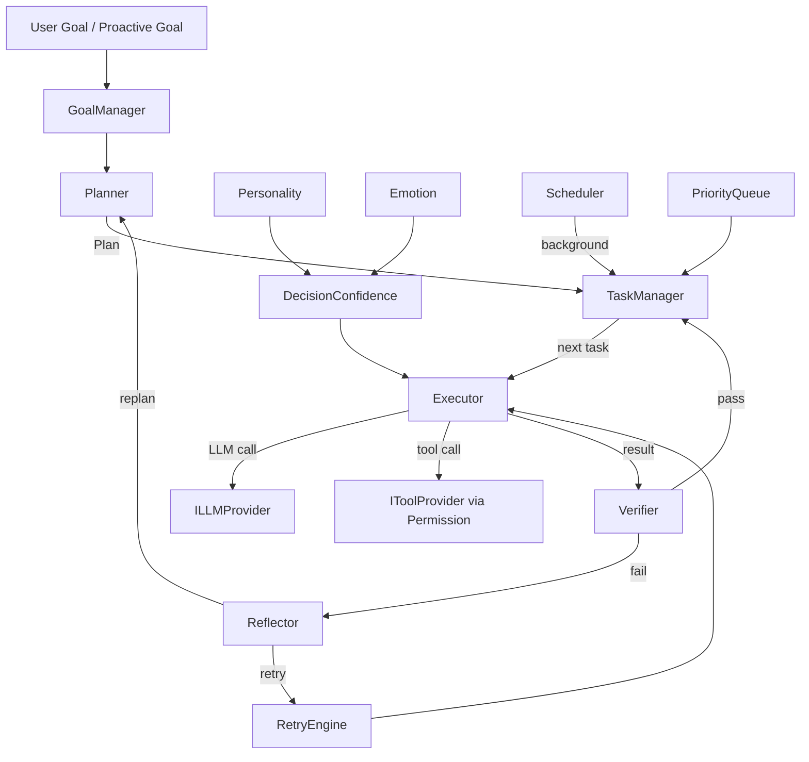
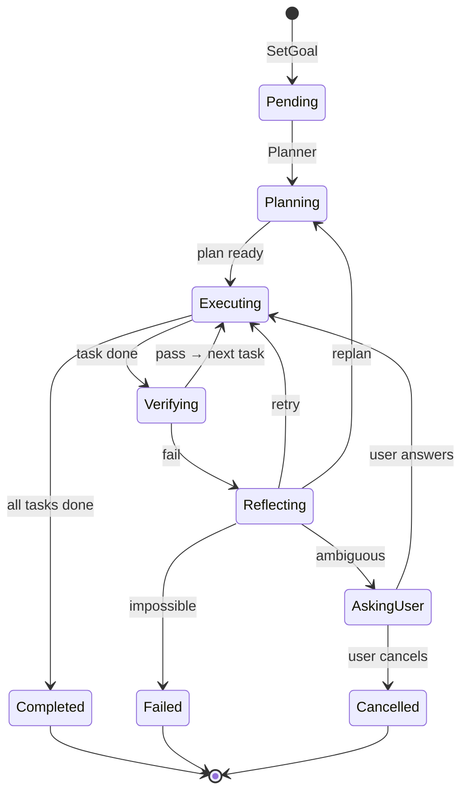
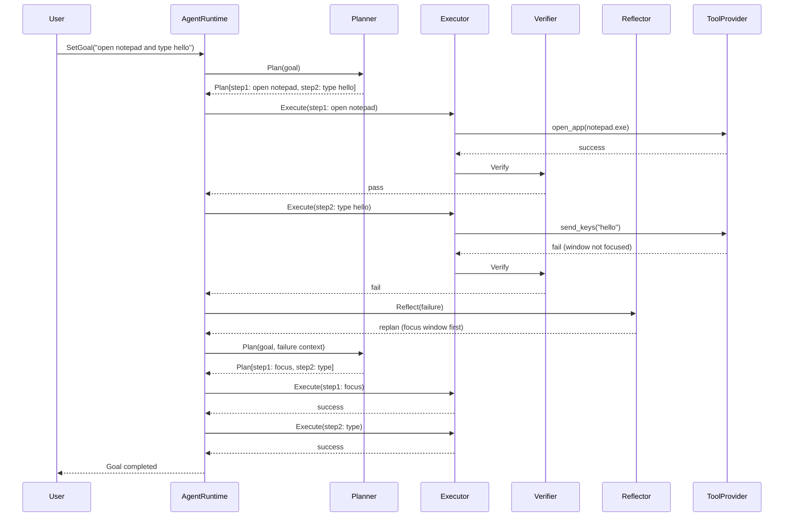
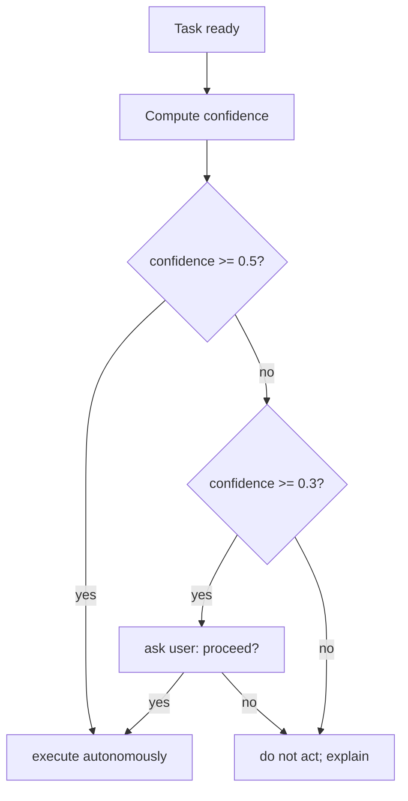

# 10 — Agent System

## Purpose
Define an autonomous planning system: Planner, Executor, Verifier, Reflector, Retry Engine, Scheduler, Background Tasks, Priority Queue, Goal Manager, Task Manager, Decision Confidence, Tool Calling, Permission System, Safety Layer.

## Business Goal
The companion can autonomously pursue goals (e.g. "organize my notes", "remind me to drink water", "check the weather and suggest clothing") by planning, executing, verifying, and reflecting — safely and within confidence bounds.

## Technical Goal
Specify `IAgentRuntime` and its components, the plan/task models, the scheduler, and the integration with the LLM, tools, memory, personality, and emotion.

## Functional Requirements

| ID | Requirement |
|---|---|
| FR-AG-01 | The agent can create a plan (multi-step) for a goal. |
| FR-AG-02 | The agent executes steps (LLM calls, tool calls). |
| FR-AG-03 | The agent verifies step results. |
| FR-AG-04 | The agent reflects on failures and replans. |
| FR-AG-05 | A retry engine retries transient failures with backoff. |
| FR-AG-06 | A scheduler runs background tasks (reminders, periodic checks). |
| FR-AG-07 | A priority queue orders pending tasks. |
| FR-AG-08 | A goal manager tracks active/completed goals. |
| FR-AG-09 | A task manager tracks individual task state. |
| FR-AG-10 | Decision confidence gates autonomous actions (low confidence → ask user). |
| FR-AG-11 | Tool calls go through the permission system (see `09_tool_calling.md`). |
| FR-AG-12 | Emotion and personality bias decisions (see `06`/`07`). |

## Non Functional Requirements

| ID | Requirement |
|---|---|
| NFR-AG-01 | Agent loop never blocks the UI thread. |
| NFR-AG-02 | Background tasks are cancellable and reschedulable. |
| NFR-AG-03 | Plans are persisted so a crashed agent can resume. |

## Architecture



## Module Design

### IAgentRuntime (Domain)

```csharp
public interface IAgentRuntime
{
    Task<GoalId> SetGoalAsync(string description, GoalPriority priority, CancellationToken ct = default);
    Task RunAsync(CancellationToken ct = default);
    Task CancelAsync(GoalId goalId, CancellationToken ct = default);
    Task<IReadOnlyList<Goal>> GetActiveGoalsAsync(CancellationToken ct = default);
    event Action<AgentEvent>? EventRaised;
}
```

### Goal

```csharp
public sealed class Goal
{
    public GoalId Id { get; init; }
    public string Description { get; init; }
    public GoalPriority Priority { get; set; }
    public GoalStatus Status { get; set; }      // Pending, Planning, Executing, Verifying, Reflecting, Completed, Failed, Cancelled
    public Plan? Plan { get; set; }
    public DateTime CreatedAt { get; init; }
    public DateTime? CompletedAt { get; set; }
    public double Confidence { get; set; }
}
```

### Plan / Task

```csharp
public sealed class Plan
{
    public List<AgentTask> Steps { get; init; } = new();
    public string Rationale { get; init; }      // LLM's reasoning
}

public sealed class AgentTask
{
    public string Id { get; init; }
    public string Description { get; init; }
    public TaskKind Kind { get; init; }          // LlmCall, ToolCall, Wait, Remember, Notify
    public string? ToolName { get; init; }
    public JsonElement? Arguments { get; set; }
    public TaskStatus Status { get; set; }        // Pending, Running, Done, Failed, Skipped
    public ToolResult? Result { get; set; }
    public int RetryCount { get; set; }
}
```

### Planner

Uses the LLM to decompose a goal into steps. Prompt:
```
Goal: {description}
Available tools: {schemas}
Current emotion: {vector}
Personality: {traits}
Produce a JSON plan: { steps: [{ description, kind, toolName?, arguments? }], rationale }
```
Constraints: max 10 steps per plan; each step must map to a `TaskKind`.

### Executor

Executes a task:
- `LlmCall` → `ILLMProvider.ChatAsync` with the task description as user input.
- `ToolCall` → `ToolCallProtocol` → `PermissionService` → `IToolProvider.ExecuteAsync`.
- `Wait` → `Task.Delay`.
- `Remember` → `IMemoryStore.StoreAsync` (episodic).
- `Notify` → show in `MessageBar` / speak via TTS.

### Verifier

Checks a task result:
- For `LlmCall`: did the LLM produce a non-empty, on-topic response? (heuristic + optional LLM judge).
- For `ToolCall`: `ToolResult.Success`.
- For `Remember`/`Notify`: always pass.
On fail → `Reflector`.

### Reflector

Uses the LLM to analyze failure and decide:
- **Retry** (transient) → `RetryEngine`.
- **Replan** (approach wrong) → `Planner` with failure context.
- **Give up** (impossible) → mark goal failed; notify user; store `Reflection` memory.
- **Ask user** (ambiguous) → pause goal; prompt user via UI.

### RetryEngine

Retries with exponential backoff: 1s, 2s, 4s (max 3). Only for transient failures (timeout, 5xx). Non-transient (permission denied, invalid args) → no retry → reflector.

### Scheduler

Runs background tasks:
- **Reminders** — at a specific time, create a `Notify` goal.
- **Periodic checks** — every interval, create a goal (e.g. "check if user has been idle, suggest break").
- **Memory consolidation** — delegates to memory system (see `05_memory_system.md`).
- **Personality reflection** — delegates to personality engine (see `06_personality_engine.md`).
Uses `IHostedService` + `Timer` (or `PeriodicTimer`). All cancellable.

### PriorityQueue

Orders pending goals/tasks by:
```
priority = goalPriority * 0.5 + recency * 0.2 + userInitiated * 0.3
```
`GoalPriority`: `Low=0, Normal=1, High=2, Critical=3`. User-initiated goals get a bonus.

### GoalManager / TaskManager

- `GoalManager`: CRUD for goals; persists to SQLite; emits `GoalSet`/`GoalAchieved` events.
- `TaskManager`: tracks task state within a goal's plan; advances to next step on success.

### DecisionConfidence

Computed per decision:
```
confidence = llmConfidence * 0.4 + toolSuccessRate * 0.3 + personalityAssertiveness * 0.2 + emotionRiskAppetite * 0.1
```
- `llmConfidence` — LLM logprobs if available, else 0.7 default.
- `toolSuccessRate` — historical success of the tool class.
- If `confidence < threshold` (default 0.5) → ask user before executing.
- If `confidence < 0.3` → do not act; explain uncertainty.

## Folder Structure
```
VPet.Cognition.Host/Agent/
├── IAgentRuntime.cs
├── AgentRuntime.cs
├── Goal.cs
├── Plan.cs
├── AgentTask.cs
├── TaskKind.cs
├── GoalPriority.cs
├── GoalStatus.cs
├── Planner.cs
├── Executor.cs
├── Verifier.cs
├── Reflector.cs
├── RetryEngine.cs
├── Scheduler.cs
├── PriorityQueue.cs
├── GoalManager.cs
├── TaskManager.cs
├── DecisionConfidence.cs
└── AgentOptions.cs
```

## Interfaces
`IAgentRuntime`. Internal: `IPlanner`, `IExecutor`, `IVerifier`, `IReflector`, `IRetryEngine`, `IScheduler`, `IPriorityQueue`, `IGoalManager`, `ITaskManager`, `IDecisionConfidence`.

## Classes
`AgentRuntime`, `Planner`, `Executor`, `Verifier`, `Reflector`, `RetryEngine`, `Scheduler`, `PriorityQueue`, `GoalManager`, `TaskManager`, `DecisionConfidence`.

## State Machine
Agent goal lifecycle:



## Sequence Diagram (Mermaid)
Goal execution with reflection:



## Flow Diagram (Mermaid)
Decision confidence gate:



## Database Schema (SQLite, same DB)

```sql
CREATE TABLE IF NOT EXISTS goals (
    id TEXT PRIMARY KEY,
    description TEXT NOT NULL,
    priority INTEGER NOT NULL,
    status INTEGER NOT NULL,
    plan_json TEXT,
    confidence REAL,
    created_at TEXT NOT NULL,
    completed_at TEXT
);

CREATE TABLE IF NOT EXISTS agent_tasks (
    id TEXT PRIMARY KEY,
    goal_id TEXT NOT NULL REFERENCES goals(id) ON DELETE CASCADE,
    description TEXT NOT NULL,
    kind INTEGER NOT NULL,
    tool_name TEXT,
    arguments_json TEXT,
    status INTEGER NOT NULL,
    result_json TEXT,
    retry_count INTEGER NOT NULL DEFAULT 0,
    started_at TEXT,
    completed_at TEXT
);

CREATE TABLE IF NOT EXISTS scheduled_tasks (
    id TEXT PRIMARY KEY,
    kind TEXT NOT NULL,             -- 'reminder', 'periodic'
    description TEXT,
    fire_at TEXT NOT NULL,
    interval_sec INTEGER,           -- for periodic
    goal_description TEXT,
    enabled INTEGER NOT NULL DEFAULT 1
);
```

## Data Models
`Goal`, `Plan`, `AgentTask`, `GoalPriority`, `GoalStatus`, `TaskKind`, `TaskStatus`, `ScheduledTask`.

## APIs
`IAgentRuntime`. No external API.

## Configuration
`AgentOptions`:
```json
{
  "cognition": {
    "agent": {
      "enabled": true,
      "maxStepsPerPlan": 10,
      "maxRetries": 3,
      "confidenceThreshold": 0.5,
      "minConfidence": 0.3,
      "maxConcurrentGoals": 3,
      "backgroundTasks": {
        "idleBreakReminder": { "enabled": true, "intervalMin": 60 },
        "memoryConsolidation": { "enabled": true, "intervalMin": 5 }
      }
    }
  }
}
```

## Logging
`SetGoal`, `Plan`, `Execute`, `Verify`, `Reflect`, `Retry`, `Complete`, `Fail` all log with `CorrelationId`, `GoalId`, `TaskId`, `LatencyMs`.

## Telemetry
`agent.goals.active`, `agent.goals.completed`, `agent.goals.failed`, `agent.tasks.executed`, `agent.retries`, `agent.reflections`, `agent.confidence.avg`.

## Performance Targets
| Metric | Target |
|---|---|
| Plan creation | < 3 s (LLM) |
| Task execution (LLM) | < 5 s |
| Task execution (tool) | < timeout |
| Background task scheduling | < 10 ms |

## Security
- All tool calls go through `PermissionService` (see `09_tool_calling.md`).
- Background tasks that use tools still require permission (no bypass).
- Agent cannot create goals with `Critical` priority autonomously (only user).
- Agent cannot modify its own confidence thresholds (config-only).

## Error Handling
- LLM plan fail → retry plan once; then ask user.
- Tool fail → reflector decides.
- All tasks fail → goal failed; notify user; store reflection.
- Scheduler task throws → log; reschedule; do not crash host.

## Edge Cases
- Empty plan → goal failed; ask user.
- Plan with > max steps → truncate; warn.
- Infinite replan loop (> 5 replans) → give up; ask user.
- Goal cancelled mid-execution → stop current task; mark cancelled.
- App shutdown mid-goal → persist state; resume on next start (if goal still relevant).

## Acceptance Criteria
1. A user goal "open notepad" produces a 1-step plan that executes after permission.
2. A failed tool triggers reflection and replan.
3. A low-confidence decision asks the user.
4. Background reminder fires at the scheduled time.
5. Goals persist across restarts.

## Unit Tests
- `Planner`: plan parsing (mock LLM), max steps, invalid JSON.
- `Executor`: each `TaskKind` (mock providers).
- `Verifier`: pass/fail heuristics.
- `Reflector`: retry/replan/giveup/ask decisions (mock LLM).
- `RetryEngine`: backoff, max retries, transient vs non-transient.
- `PriorityQueue`: ordering.
- `DecisionConfidence`: threshold gating.

## Integration Tests
- Full goal: set → plan → execute → verify → complete.
- Failure path: execute → fail → reflect → replan → succeed.
- Background: schedule reminder → fire → notify.

## Future Expansion
- Multi-agent (multiple goals concurrently with resource sharing).
- Long-horizon planning (hierarchical plans).
- Learning from reflections (improve planning over time).
- MCP (Model Context Protocol) remote tools.

## Refactoring Notes
- The existing `ScheduleTask` in `VPet-Simulator.Windows.Interface` is a simpler scheduled-work system; the agent's `Scheduler` is richer. Bridge: load existing `SchedulePackage` into agent goals on startup (migration).

## Migration Strategy
- New `goals`/`agent_tasks`/`scheduled_tasks` tables.
- Existing `ScheduleTask`/`SchedulePackage` loaded as agent scheduled tasks on first run (one-way migration).

## Implementation Steps
1. Define `IAgentRuntime`, `Goal`, `Plan`, `AgentTask` in Domain.
2. Implement `GoalManager`/`TaskManager` (SQLite).
3. Implement `Planner` (LLM).
4. Implement `Executor` (dispatch to LLM/tools/memory/notify).
5. Implement `Verifier` + `Reflector` (LLM).
6. Implement `RetryEngine`.
7. Implement `Scheduler` + `PriorityQueue`.
8. Implement `DecisionConfidence`.
9. Wire `AgentRuntime` into `CognitionHost` as `IHostedService`.
10. Tests.

## Agent Instructions
- The agent loop runs on a background thread; all UI updates via `Dispatcher.InvokeAsync`.
- Never execute a tool without permission (even in background tasks).
- Persist goal/task state after every transition (crash recovery).
- Cap concurrent goals to `maxConcurrentGoals`.
- The reflector must not loop > 5 times; give up and ask user.

## Developer Notes
- `DecisionConfidence` is the key safety gate: low confidence → ask, never act blindly.
- The agent's "proactivity" (from personality `initiativeRate` and emotion `Proactivity`) determines how often it sets its own goals (e.g. "I noticed you've been working 2 hours, want a break?").
- Background tasks are the main source of proactive behavior; they create goals that flow through the same pipeline.