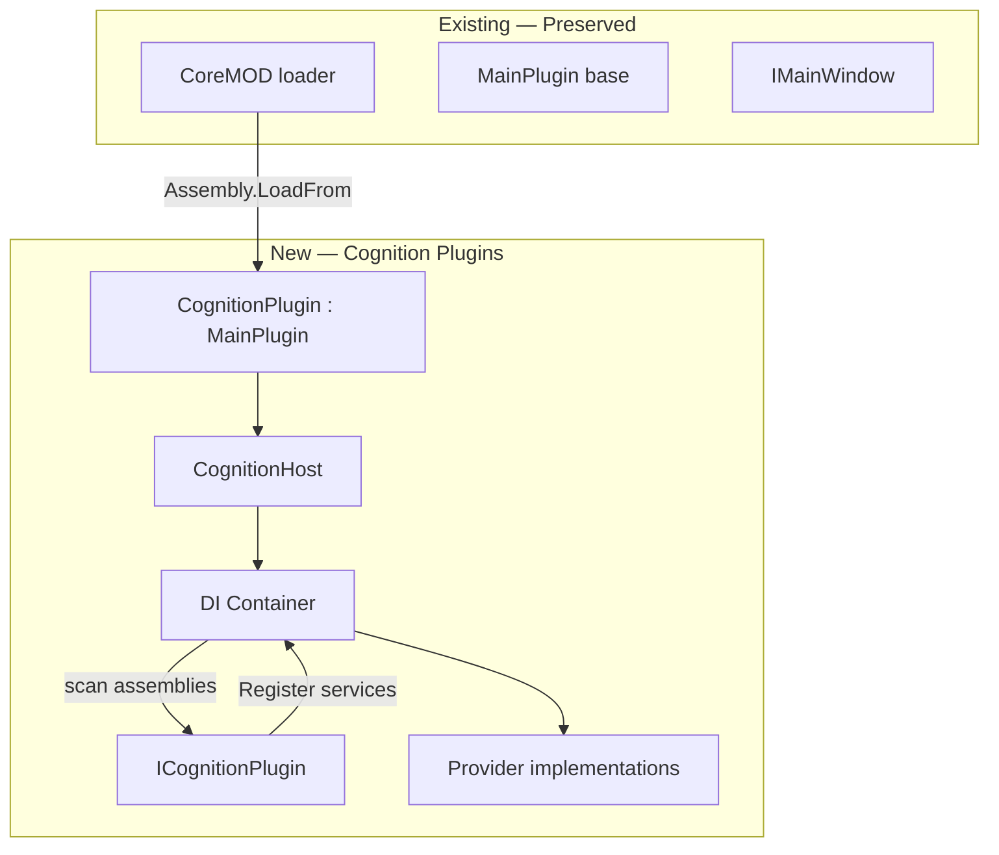
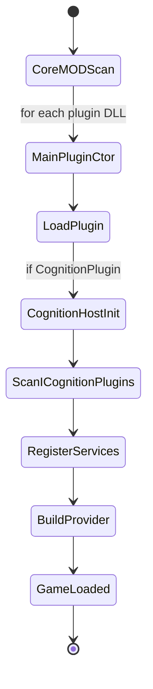
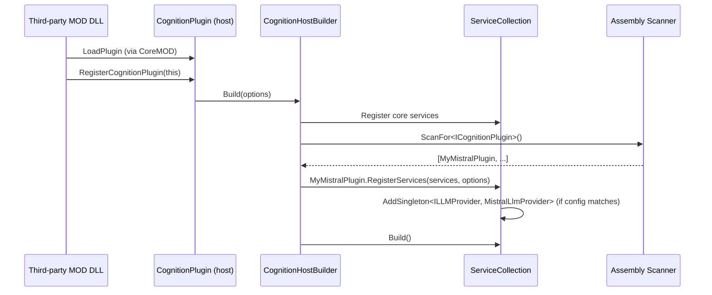
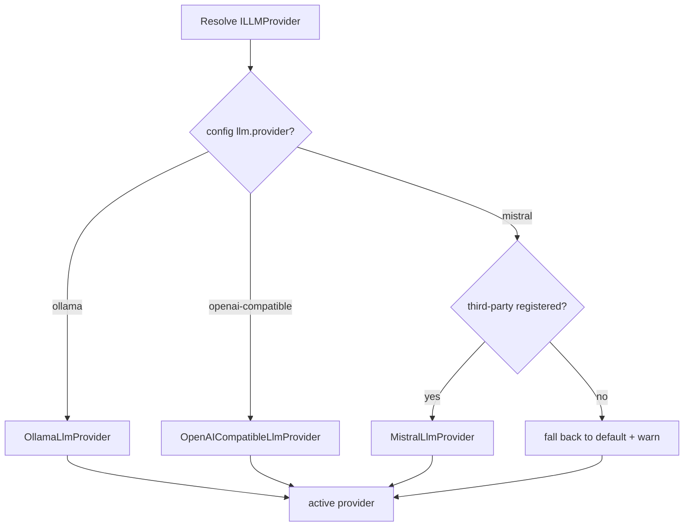

# 11 — Plugin System

## Purpose
Define the evolution of the plugin/MOD system: preserve the existing `MainPlugin` ecosystem while adding new cognitive plugin contracts (LLM providers, memory stores, voice providers, tool providers, personality/emotion extensions).

## Business Goal
Third-party developers can add new AI providers, memory backends, voices, tools, and personality modules as MODs — without touching core code.

## Technical Goal
Document the existing plugin system (preserved), the new cognitive plugin contracts, discovery via DI, and the signature/trust model.

## Functional Requirements

| ID | Requirement |
|---|---|
| FR-PL-01 | Existing `MainPlugin`-based MODs load and run unchanged. |
| FR-PL-02 | New cognitive plugins implement interfaces from `VPet.Cognition.Domain`. |
| FR-PL-03 | Cognitive plugins are discovered via DI (assembly scan for `ICognitionPlugin` implementations). |
| FR-PL-04 | A cognitive plugin can register: `ILLMProvider`, `IMemoryStore`, `IEmbeddingProvider`, `ISttProvider`, `ITtsProvider`, `IWakeWordProvider`, `IToolProvider`, `IPersonalityExtension`, `IEmotionExtension`. |
| FR-PL-05 | Provider selection (which registered provider is active) is a config switch. |
| FR-PL-06 | Plugins are signed; unsigned require `passmod` (existing behavior preserved). |

## Non Functional Requirements

| ID | Requirement |
|---|---|
| NFR-PL-01 | Plugin load failure does not crash the app (per-plugin try/catch, existing). |
| NFR-PL-02 | Plugin discovery < 1 s for 50 plugins. |

## Architecture



## Module Design

### Existing plugin system (preserved — see `02_current_architecture.md`)

- `MainPlugin` abstract base: `LoadPlugin`/`GameLoaded`/`EndGame`/`Save`/`Setting`/`LoadDIY`.
- `CoreMOD` loader: `Assembly.LoadFrom` + X509 signature validation + `passmod` consent.
- `IMainWindow` contract.
- `PetLoader.IGraphConvert`, `Item.Creators`/`UseAction`, `ToolBar.AddMenuButton` extension points.

### New: ICognitionPlugin

```csharp
public interface ICognitionPlugin
{
    string PluginId { get; }
    void RegisterServices(IServiceCollection services, CognitionOptions options);
}
```

A cognitive plugin implements `ICognitionPlugin` and is discovered by scanning loaded assemblies for the interface. `RegisterServices` adds its providers to the DI container. The `CognitionHost` resolves the active providers based on config (`llm:provider`, `memory:provider`, etc.).

### CognitionPlugin (the host's own MainPlugin)

`VPet.Cognition.Host.CognitionPlugin : MainPlugin` is the entry point. In `LoadPlugin`:
1. Build `CognitionOptions` from `Setting.lps` + `appsettings.json`.
2. Create `ServiceCollection`.
3. Register core services (event bus, logging, options).
4. Scan loaded assemblies for `ICognitionPlugin` implementations; call each `RegisterServices`.
5. Register built-in providers (OpenAI-compatible, Ollama, SQLite, Piper, etc.) as defaults.
6. Build `ServiceProvider`.
7. Resolve `CognitionHost`; `AttachToPet(MW.Main)`.

### Third-party cognitive plugin example

```csharp
// MyMistralPlugin.cs — in a MOD's plugin/ DLL
public class MyMistralPlugin : ICognitionPlugin
{
    public string PluginId => "my-mistral";
    public void RegisterServices(IServiceCollection services, CognitionOptions options)
    {
        if (options.Llm.Provider == "mistral")
            services.AddSingleton<ILLMProvider, MistralLlmProvider>();
    }
}
```

The MOD's `MainPlugin` (or a combined plugin) calls `CognitionHost.RegisterCognitionPlugin(this)` during `LoadPlugin` so the host scans its assembly.

### Provider selection

`CognitionOptions` has a `provider` field per capability. The DI registration uses a keyed/factory pattern: the active provider is resolved by name. If a third-party plugin registered a provider matching the configured name, it wins; otherwise the built-in default is used.

## Folder Structure
No new folder — cognitive plugins are MODs with DLLs in `mod/<name>/plugin/`. The host scans all loaded assemblies.

## Interfaces
`ICognitionPlugin` (new). Existing: `MainPlugin`, `IMainWindow`, `PetLoader.IGraphConvert`, `Item.Creators`/`UseAction`.

## Classes
`CognitionPlugin`, `CognitionHostBuilder`.

## State Machine
Plugin load order:



## Sequence Diagram (Mermaid)
Third-party provider registration:



## Flow Diagram (Mermaid)
Provider resolution by config:



## Database Schema
None (plugins don't own DB; they use the shared SQLite via `IMemoryStore`).

## Data Models
`ICognitionPlugin`, `CognitionOptions`.

## APIs
`ICognitionPlugin.RegisterServices`. Existing `IMainWindow` for plugin↔host.

## Configuration
Provider selection in `CognitionOptions` (see `14_configuration.md`). Plugin-specific config via `appsettings.json` sections keyed by `PluginId`.

## Logging
Plugin discovery, registration, and provider activation logged.

## Telemetry
`plugin.cognitive.count`, `plugin.provider.{name}.active`.

## Performance Targets
| Metric | Target |
|---|---|
| Assembly scan (50 plugins) | < 1 s |
| DI build | < 500 ms |

## Security
- Existing signature validation preserved (see `02_current_architecture.md` and `15_security.md`).
- Cognitive plugins run in-process (full trust) — same as existing plugins. Sandboxing is a future goal.
- A cognitive plugin that registers a provider does not auto-activate; the user must select it in config.

## Error Handling
- `ICognitionPlugin.RegisterServices` throws → log; skip plugin; continue.
- Provider not found for configured name → fall back to default; warn user.

## Edge Cases
- Two plugins register the same provider name → last registered wins; log warning.
- Plugin depends on a missing DLL → assembly load fails (existing CoreMOD catch); skip.
- User uninstalls a plugin that was the active provider → fall back to default on next load.

## Acceptance Criteria
1. Existing MODs (animations, foods, text, code plugins) load unchanged.
2. A third-party `ICognitionPlugin` registering an `ILLMProvider` is selectable via config.
3. Removing the `VPet.Cognition.*` DLLs returns the app to existing behavior.

## Unit Tests
- `CognitionHostBuilder`: scans mock assemblies, registers services, resolves providers.
- Provider selection: config → correct provider resolved.

## Integration Tests
- Load a test MOD containing a fake `ICognitionPlugin`; verify its provider is registered and resolvable.

## Future Expansion
- Sandboxed plugin execution (AppContainer / out-of-process).
- Plugin marketplace integration (Steam Workshop for cognitive plugins).
- Plugin dependency resolution.

## Refactoring Notes
- No existing plugin API changes. `ICognitionPlugin` is additive.
- The `CognitionPlugin` itself is a `MainPlugin`, so it goes through the same loader.

## Migration Strategy
- Additive. No migration.

## Implementation Steps
1. Define `ICognitionPlugin` in Domain.
2. Implement assembly scanner in `CognitionHostBuilder`.
3. Implement `CognitionPlugin : MainPlugin` in Host.
4. Register built-in providers as defaults.
5. Document the third-party plugin authoring guide.
6. Tests.

## Agent Instructions
- Scan only assemblies already loaded by `CoreMOD` (do not load additional DLLs).
- Use `Assembly.GetTypes()` with try/catch per type (some types may fail to load).
- Never auto-activate a third-party provider; require config selection.

## Developer Notes
- The `CognitionPlugin` DLL must be signed for release (or `passmod` for dev).
- Plugin authors add a reference to `VPet.Cognition.Domain` (NuGet-published) to implement `ICognitionPlugin`.
- The existing `VPet.Plugin.Demo` is the reference for traditional plugins; a new `VPet.Cognition.Plugin.Demo` should be created as a reference for cognitive plugins.