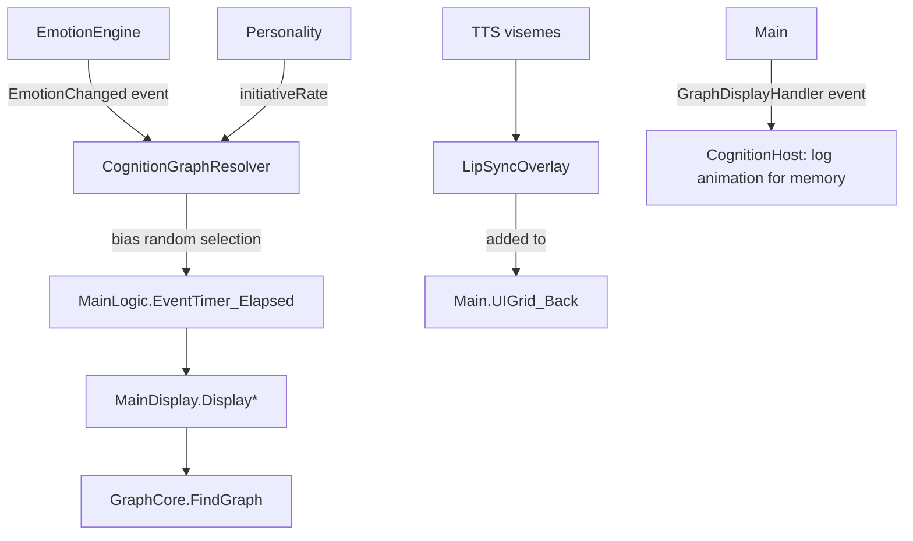
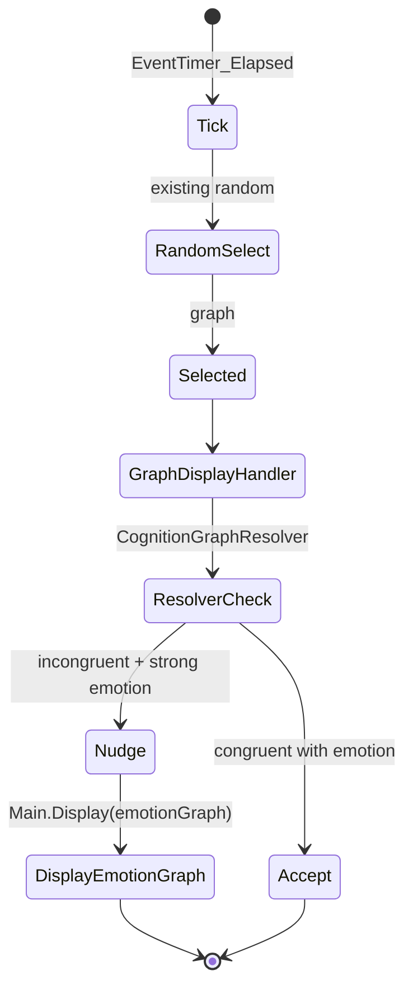
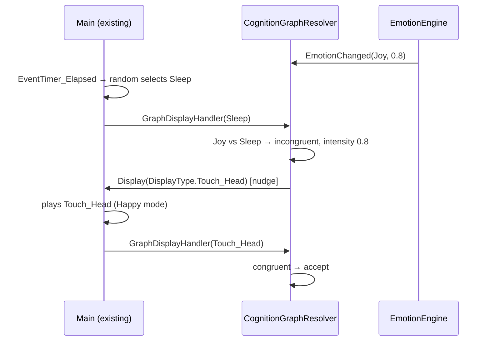
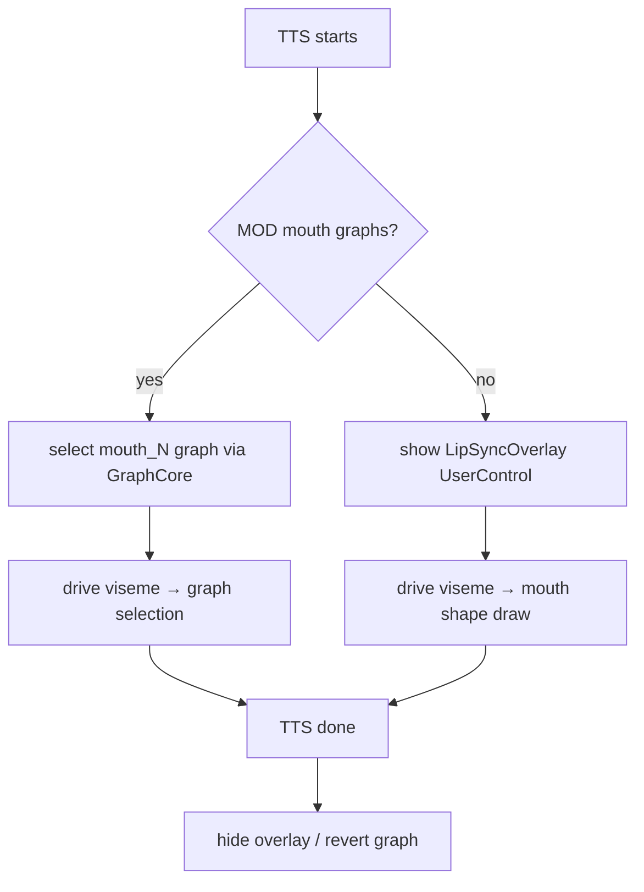

# 12 — Animation System

## Purpose
Document the existing animation system (preserved) and define how the cognition layer (emotion, personality, voice) integrates with it — without rewriting the renderer.

## Business Goal
The companion's animations feel emotionally congruent: happy when joyful, retreating when fearful, lip-synced when speaking.

## Technical Goal
Specify the integration seams between `GraphCore`/`MainDisplay` (existing) and `IEmotionEngine`/`IPersonalityEngine`/voice (new), via events and optional hooks.

## Functional Requirements

| ID | Requirement |
|---|---|
| FR-AN-01 | The existing `GraphCore`/`MainDisplay` animation engine is preserved. |
| FR-AN-02 | Emotion influences animation selection (mode + graph type hint). |
| FR-AN-03 | Voice lip-sync drives a mouth overlay or mouth-graph animations. |
| FR-AN-04 | Personality influences idle animation frequency (proactive vs calm). |
| FR-AN-05 | MODs can provide emotion-specific animations (e.g. `joyful_idle`). |
| FR-AN-06 | The existing `ModeType` (Happy/Nomal/PoorCondition/Ill) is reconciled with the 10-emotion model. |

## Non Functional Requirements

| ID | Requirement |
|---|---|
| NFR-AN-01 | Animation selection latency unchanged (< 16 ms per tick). |
| NFR-AN-02 | Emotion hint injection does not alter the existing state machine's determinism (it biases random selection, not overrides). |

## Architecture



## Module Design

### Existing animation system (preserved — see `02_current_architecture.md`)

- `GraphCore` — registry + cache + `FindGraph(name, animat, mode)` with mode fallback.
- `MainDisplay` — state machine: `DisplayNomal`/`DisplayMove`/`DisplayIdel`/`DisplayTouchHead`/etc.
- `MainLogic.EventTimer_Elapsed` — random idle selection over `case 0..10`.
- `GraphType` (28 values), `AnimatType` (Single/A_Start/B_Loop/C_End), `ModeType` (Happy/Nomal/PoorCondition/Ill, ordered 0..3).
- `Main.GraphDisplayHandler` event fires on every animation change.

### New: CognitionGraphResolver

An optional component (loaded by `CognitionHost`) that subscribes to:
- `IEmotionEngine` `EmotionChanged` event → stores current `AnimationHint`.
- `Main.TimeHandle` (existing, every tick) → does NOT override; instead it sets a bias that `MainLogic.EventTimer_Elapsed` reads.

**Integration approach (no Core change required):**

The existing `EventTimer_Elapsed` uses `Function.Random.Rnd` to pick an idle action. The resolver cannot inject into that random without modifying Core. Two options:

**Option A (preferred, zero Core change):** The resolver subscribes to `Main.GraphDisplayHandler` (fires after selection). If the selected animation strongly conflicts with the emotion (e.g. `Joy` dominant but `Sleep` selected), the resolver calls `Main.DisplayNomal()` to re-trigger selection, or directly calls `Main.Display(DisplayType.Touch_Head)` to nudge toward a happier animation. This is a "post-selection nudge" — lightweight, no Core edit.

**Option B (optional Core hook, requires ADR):** Add a `public Func<GraphType, GraphType> GraphSelectionBias` delegate to `Main` (default identity). `MainLogic.EventTimer_Elapsed` applies it before random selection. The resolver sets it to map emotion → preferred graph. This is a minimal, additive change to Core (one delegate field + one call site). Requires an ADR.

For Phase 3, **Option A** is used. Option B is a documented future enhancement.

### Emotion → ModeType reconciliation

The existing `GameSave.CalMode()` computes `ModeType` from vitals (Health/Feeling/Likability). The emotion engine's `AnimationHint.PreferredMode` is a second input. Reconciliation:
```
finalMode = emotionIntensity > 0.6 ? emotionHint : calMode()
```
If emotion is strong, it overrides the vital-based mode; otherwise vitals win. This keeps the Tamagotchi simulation meaningful while letting emotions shine.

### LipSyncOverlay

A `UserControl` added to `Main.UIGrid_Back` (the existing reserved overlay layer). It renders a simple mouth shape (5-viseme set) driven by `VisemeHint` from TTS. When TTS is not playing, it's hidden. If a MOD provides mouth-graph animations registered as `"mouth_0".."mouth_4"` in `GraphCore`, the overlay uses those instead of drawing.

### MOD-provided emotion animations

MODs can register animations with names like `joyful_idle`, `sad_idle`, `angry_idle`. The resolver, on `EmotionChanged`, checks `GraphCore.FindGraph(emotionName + "_idle", AnimatType.B_Loop, mode)`. If found, it nudges selection toward it. If not found, falls back to the standard `Idel` graph. This is fully backward-compatible — MODs without emotion animations work as before.

## Folder Structure
```
VPet.Cognition.Host/Animation/
├── CognitionGraphResolver.cs
├── EmotionModeReconciler.cs
└── LipSyncOverlay.xaml(.cs)   # in VPet.Cognition.Wpf
```

## Interfaces
No new public interface. Internal: `ICognitionGraphResolver`, `IEmotionModeReconciler`.

## Classes
`CognitionGraphResolver`, `EmotionModeReconciler`, `LipSyncOverlay`.

## State Machine
Animation selection with emotion bias (Option A):



## Sequence Diagram (Mermaid)
Emotion-biased animation:



## Flow Diagram (Mermaid)
Lip sync overlay lifecycle:



## Database Schema
None (animation is transient). Animation logs stored as episodic memory if significant.

## Data Models
`AnimationHint` (from `07_emotion_engine.md`), `VisemeHint` (from `08_voice_pipeline.md`).

## APIs
Existing: `Main.Display(DisplayType)`, `Main.GraphDisplayHandler`, `Main.TimeHandle`, `GraphCore.FindGraph`.

## Configuration
`AnimationOptions`:
```json
{
  "cognition": {
    "animation": {
      "emotionBiasEnabled": true,
      "emotionOverrideThreshold": 0.6,
      "lipSyncEnabled": true,
      "lipSyncVisemeCount": 5
    }
  }
}
```

## Logging
`GraphDisplayHandler` events logged at `Debug` with `GraphType`, `ModeType`, `EmotionDominant`, `Nudged` (bool).

## Telemetry
`animation.emotion_nudge.count`, `animation.lipsync.active_seconds`.

## Performance Targets
| Metric | Target |
|---|---|
| Resolver check per tick | < 1 ms |
| LipSync overlay render | 60 FPS |

## Security
No security concerns (animation is local, no external I/O).

## Error Handling
- Emotion graph not found → fall back to standard `Idel`.
- LipSync overlay render fail → hide overlay; log.
- `GraphDisplayHandler` subscriber throws → log; continue (do not break animation).

## Edge Cases
- Emotion intensity exactly at threshold → use vital-based mode (no override).
- MOD provides partial emotion graphs (only `joyful_idle`, not `sad_idle`) → only joyful nudges; others fall back.
- TTS with no viseme data → overlay shows neutral mouth; no animation.
- Rapid emotion changes → debounce nudges (max 1 nudge per 5 s) to avoid animation thrashing.

## Acceptance Criteria
1. With `emotionBiasEnabled`, a joyful companion shows happy animations more often.
2. Disabling `emotionBiasEnabled` returns to exact existing animation behavior.
3. LipSync overlay appears during TTS and hides after.
4. MOD-provided emotion graphs are used when available.

## Unit Tests
- `CognitionGraphResolver`: congruent/incongruent detection, nudge decision, debounce.
- `EmotionModeReconciler`: threshold logic, vital vs emotion.
- `LipSyncOverlay`: viseme → shape mapping.

## Integration Tests
- Emotion change → animation nudge → verify `Main.Display` called with expected graph.
- TTS start → overlay visible → TTS end → overlay hidden.

## Future Expansion
- Option B (Core hook `GraphSelectionBias` delegate) for direct biasing.
- Full body emotion animations (not just idle).
- Procedural animation (parameterized by emotion intensity).

## Refactoring Notes
- The existing `GC.Collect()` calls in `MainDisplay` after animation swaps are tech debt; not fixed here but flagged.
- The existing `Function.Random.Rnd` shared instance is a concurrency smell; the resolver uses its own `Random` to avoid contention.

## Migration Strategy
- Additive. No existing animation data or MOD changes.

## Implementation Steps
1. Implement `CognitionGraphResolver` (subscribe to `EmotionChanged` + `GraphDisplayHandler`).
2. Implement `EmotionModeReconciler`.
3. Implement `LipSyncOverlay` UserControl.
4. Wire into `CognitionHost.AttachToPet`.
5. Tests.

## Agent Instructions
- Do NOT modify `VPet-Simulator.Core` in Phase 3 (use Option A).
- If Option B is later approved (ADR), add only a `public Func<GraphType, GraphType> GraphSelectionBias` field to `Main` and apply it in `MainLogic` — minimal, additive.
- Nudge debounce: max 1 nudge per 5 s to avoid thrashing.
- LipSync overlay goes in `Main.UIGrid_Back` (existing reserved layer), not `PetGrid`.

## Developer Notes
- `Main.UIGrid_Back` is the existing back overlay grid; `UIGrid` is the front (ToolBar/MessageBar/WorkTimer). LipSync should be behind the pet sprite but in front of the desktop — `UIGrid_Back` is correct.
- `Main.GraphDisplayHandler` is `event Action<GraphInfo>` — the resolver subscribes to it.
- The existing `ModeType` ordering (Happy=0..Ill=3) is used by `GraphCore.FindGraph` for fallback; the reconciler must respect this.