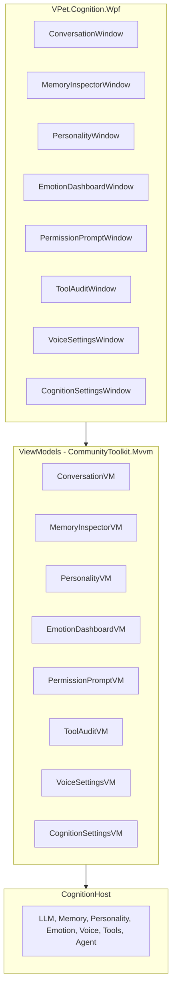
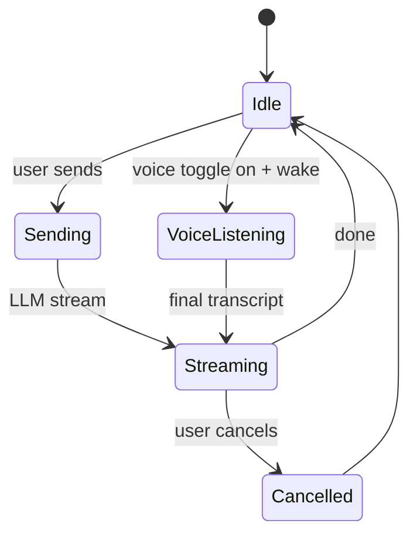
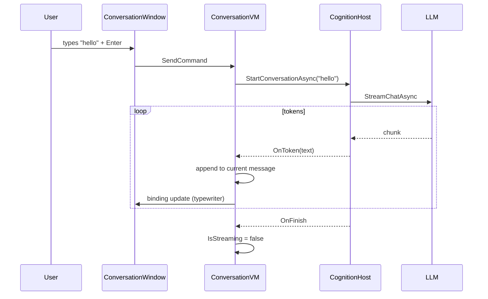

# 13 — UI/UX

## Purpose
Define the UI/UX for the AI-transformed VPet: conversation interface, memory inspector, personality settings, emotion dashboard, permission prompts, and voice controls.

## Business Goal
The user can converse with the companion, inspect/edit its memories, tune its personality, observe its emotions, approve tool calls, and configure voice — all in a polished, accessible WPF UI consistent with the existing VPet aesthetic.

## Technical Goal
Specify the new WPF views/viewmodels in `VPet.Cognition.Wpf` using `CommunityToolkit.Mvvm`, integrated with the existing `WindowX`/Panuon theming.

## Functional Requirements

| ID | Requirement |
|---|---|
| FR-UI-01 | A conversation window shows streaming text in/out, history, cancel, and voice toggle. |
| FR-UI-02 | A memory inspector lists/searches memories by type, with detail view and delete. |
| FR-UI-03 | A personality settings panel shows current traits (core + adaptive) and relationship state. |
| FR-UI-04 | An emotion dashboard shows the 10-dimensional emotion vector and dominant emotion. |
| FR-UI-05 | A permission prompt window for tool calls (see `09_tool_calling.md`). |
| FR-UI-06 | A tool audit log viewer. |
| FR-UI-07 | Voice settings (wake word, STT, TTS, devices, test buttons). |
| FR-UI-08 | A cognition settings page (provider selection, model paths, API keys). |
| FR-UI-09 | All new windows use the existing Panuon `WindowX` chrome and theme. |
| FR-UI-10 | All new windows are accessible (keyboard-navigable, high-contrast compatible). |

## Non Functional Requirements

| ID | Requirement |
|---|---|
| NFR-UI-01 | Conversation window opens < 300 ms. |
| NFR-UI-02 | Memory list scrolls smoothly at 10k items (virtualization). |
| NFR-UI-03 | All UI updates via data binding; no direct control manipulation in VMs. |

## Architecture



## Module Design

### ConversationWindow

- **Layout**: `WindowX` with a `ScrollViewer` + `ItemsControl` (virtualized) for message history (user right-aligned, companion left-aligned, styled bubbles). A `TextBox` + send button at bottom. A voice toggle button (mic icon). A cancel button during streaming.
- **Streaming**: companion messages update in place (typewriter effect already in `MessageBar`; the conversation window mirrors it for a richer chat UI).
- **VM**: `ConversationVM` with `ObservableCollection<ChatMessageVm>`, `string InputText`, `IRelayCommand SendCommand`, `IRelayCommand CancelCommand`, `bool IsStreaming`, `bool VoiceEnabled`.
- **Integration**: `SendCommand` calls `CognitionHost.StartConversationAsync(text)`; subscribes to stream events to append tokens.

### MemoryInspectorWindow

- **Layout**: left pane = filter (type dropdown, search box) + `ListView` (virtualized) of memories (summary, type icon, importance bar, date). Right pane = detail (full content, metadata, related IDs, delete button).
- **VM**: `MemoryInspectorVM` with `ObservableCollection<MemoryVm>`, `MemoryType? Filter`, `string SearchText`, `MemoryVm? Selected`, `IRelayCommand DeleteCommand`, `IRelayCommand ExportCommand`, `IRelayCommand WipeCommand` (with confirmation).
- **Pagination**: load 100 at a time; "load more" button.

### PersonalityWindow

- **Layout**: radar chart (core traits) + bar chart (adaptive traits) + relationship panel (trust/familiarity/affection gauges) + identity text + communication style sliders.
- **VM**: `PersonalityVM` with `Personality Model`, `IRelayCommand ResetCommand` (reset to seed, with confirmation).

### EmotionDashboardWindow

- **Layout**: 10 vertical bars (one per emotion, 0..1) + dominant emotion label + arousal/valence indicators + a small history sparkline.
- **VM**: `EmotionDashboardVM` with `EmotionState Model`, subscribes to `EmotionChanged` for live updates (60 FPS throttle).

### PermissionPromptWindow

- See `09_tool_calling.md`. Modal `WindowX`; shows tool, class, args (JSON highlighted), risk; Allow once / Always allow / Deny; 30 s auto-deny.

### ToolAuditWindow

- **Layout**: `DataGrid` (virtualized) of `ToolInvocationRecord` (time, tool, args, permission, success, duration). Filter by tool/success. Export button.
- **VM**: `ToolAuditVM` with `ObservableCollection<ToolInvocationVm>`, filters, export.

### VoiceSettingsWindow

- **Layout**: enable toggle, wake word model picker, STT model picker, TTS model picker, input/output device dropdowns, test buttons (record 3s → transcribe; type text → synthesize), barge-in toggle, continuous mode toggle.
- **VM**: `VoiceSettingsVM` bound to `VoiceOptions`; `IRelayCommand TestSttCommand`, `IRelayCommand TestTtsCommand`.

### CognitionSettingsWindow

- **Layout**: tabbed — LLM (provider dropdown, endpoint, model, API key (password box), timeout, test button), Memory (DB path, encrypt toggle, vector dim, consolidation interval), Agent (enable, confidence threshold, max goals), Personality (seed reset), Emotion (blend factor, decay rate).
- **VM**: `CognitionSettingsVM` bound to `CognitionOptions`; `IRelayCommand TestLlmCommand` (sends "hello" and shows response).
- **Integration**: opened from `CognitionPlugin.Setting()` (existing `MainPlugin.Setting` hook) and from a toolbar DIY button.

### Toolbar integration

`CognitionPlugin.LoadDIY()` adds a "💬" (or localized) button to `ToolBar` via `MW.Main.ToolBar.AddMenuButton(MenuType.DIY, "Chat", () => open ConversationWindow)`. This uses the existing extension point — no Core change.

## Folder Structure
```
VPet.Cognition.Wpf/
├── App.xaml resources (shared styles)
├── Views/
│   ├── ConversationWindow.xaml(.cs)
│   ├── MemoryInspectorWindow.xaml(.cs)
│   ├── PersonalityWindow.xaml(.cs)
│   ├── EmotionDashboardWindow.xaml(.cs)
│   ├── PermissionPromptWindow.xaml(.cs)
│   ├── ToolAuditWindow.xaml(.cs)
│   ├── VoiceSettingsWindow.xaml(.cs)
│   └── CognitionSettingsWindow.xaml(.cs)
├── ViewModels/
│   ├── ConversationVM.cs
│   ├── MemoryInspectorVM.cs
│   ├── PersonalityVM.cs
│   ├── EmotionDashboardVM.cs
│   ├── PermissionPromptVM.cs
│   ├── ToolAuditVM.cs
│   ├── VoiceSettingsVM.cs
│   └── CognitionSettingsVM.cs
├── Controls/
│   ├── EmotionBar.xaml(.cs)        # 10-bar emotion control
│   ├── LipSyncOverlay.xaml(.cs)
│   └── ChatBubble.xaml(.cs)
├── Converters/
│   └── (standard WPF converters)
└── CognitionWpfModule.cs           # DI registration for views/VMs
```

## Interfaces
No new public interfaces. VMs depend on `CognitionHost` services.

## Classes
The VMs and views listed above.

## State Machine
Conversation window:



## Sequence Diagram (Mermaid)
Conversation window send:



## Flow Diagram (Mermaid)
Memory inspector load:

```mermaid
flowchart TD
    A[Open MemoryInspector] --> B[Load first 100 memories]
    B --> C{user scrolls to bottom?}
    C -->|yes| D[Load next 100]
    D --> C
    C -->|user searches| E[SearchAsync(keyword)]
    E --> F[Replace list with results]
    C -->|user selects| G[Show detail pane]
    G --> H{user deletes?}
    H -->|yes| I[Confirm dialog]
    I --> J[DeleteAsync]
    J --> K[Remove from list]
```

## Database Schema
None (UI reads from existing SQLite via services).

## Data Models
View-models: `ChatMessageVm`, `MemoryVm`, `PersonalityVm`, `EmotionVm`, `ToolInvocationVm`.

## APIs
No external API. UI calls `CognitionHost` services.

## Configuration
UI settings (window positions, last tab) stored in `Setting.lps` `cognition` lines.

## Logging
Window open/close, command execution logged at `Debug`.

## Telemetry
`ui.conversation.messages`, `ui.memory.inspections`, `ui.permission.prompts`, `ui.permission.grants`, `ui.permission.denies`.

## Performance Targets
| Metric | Target |
|---|---|
| Conversation window open | < 300 ms |
| Memory list 10k scroll | 60 FPS (virtualized) |
| Emotion dashboard live update | 60 FPS |

## Security
- API key fields are `PasswordBox` (masked).
- Memory wipe requires typed confirmation.
- Permission prompts are modal (no bypass via tab-switching).

## Error Handling
- Service unavailable → show error banner in window; disable controls.
- LLM test fail → show error message in settings.
- Memory load fail → show empty state with retry button.

## Edge Cases
- Empty conversation → show welcome message.
- Empty memory → show "No memories yet" empty state.
- Very long conversation → virtualize; keep last 200 in memory.
- Emotion dashboard while emotion engine disabled → show "disabled" state.

## Acceptance Criteria
1. User can open the conversation window from the toolbar and have a streaming conversation.
2. Memory inspector lists, searches, and deletes memories.
3. Personality window shows current traits and allows reset.
4. Emotion dashboard updates live.
5. Permission prompt appears for tool calls and records the decision.
6. All windows are keyboard-navigable.

## Unit Tests
- Each VM: command execution with mocked services, property changes, error states.
- `ConversationVM`: token appending, cancel, voice toggle.
- `MemoryInspectorVM`: pagination, search, delete, wipe confirmation.
- `PermissionPromptVM`: allow/deny/always, timeout.

## Integration Tests
- Open `ConversationWindow` → send → verify streaming tokens appear → finish.
- Open `MemoryInspectorWindow` → verify memories from test DB appear.
- Open `PermissionPromptWindow` from a tool call → grant → verify execution.

## Future Expansion
- Conversation themes (light/dark).
- Memory graph visualization (nodes + edges).
- Emotion timeline chart.
- Mobile companion app (remote control).

## Refactoring Notes
- New VMs use `CommunityToolkit.Mvvm` (`[ObservableProperty]`, `[RelayCommand]`) — not the existing `SimpleObservable` (which is preserved in `VPet.Solution`).
- Windows use `Panuon.WPF.UI.WindowX` for consistent chrome with existing dialogs.

## Migration Strategy
- New windows; no existing UI changes.
- Toolbar gains one DIY button (existing extension point).

## Implementation Steps
1. Create `VPet.Cognition.Wpf` project.
2. Implement `ConversationWindow` + `ConversationVM` (Phase 1).
3. Implement `CognitionSettingsWindow` (Phase 1).
4. Implement `MemoryInspectorWindow` (Phase 2).
5. Implement `PersonalityWindow` + `EmotionDashboardWindow` (Phase 3).
6. Implement `VoiceSettingsWindow` (Phase 4).
7. Implement `PermissionPromptWindow` + `ToolAuditWindow` (Phase 5).
8. Implement `LipSyncOverlay` + `EmotionBar` controls.
9. Wire `CognitionPlugin.LoadDIY` to add toolbar button.
10. Tests.

## Agent Instructions
- Use `CommunityToolkit.Mvvm` for all new VMs.
- Use `[ObservableProperty]` and `[RelayCommand]` source generators.
- Use `WindowX` from Panuon for all windows.
- Use `VirtualizingStackPanel` for all long lists.
- Never call `Dispatcher.Invoke` from VMs; use `SynchronizationContext` or `DispatcherQueue`.
- All windows must be closable with `Esc` and navigable with `Tab`.

## Developer Notes
- The conversation window is the primary AI interface; the existing `MessageBar` (speech bubble on the pet) continues to work for short barks. The conversation window is for full conversations.
- `CognitionPlugin.Setting()` opens `CognitionSettingsWindow`.
- `CognitionPlugin.LoadDIY()` adds the chat button to the toolbar.
- Windows are registered in `MW.Windows` (existing `List<Window>`) so they're closed on app exit.