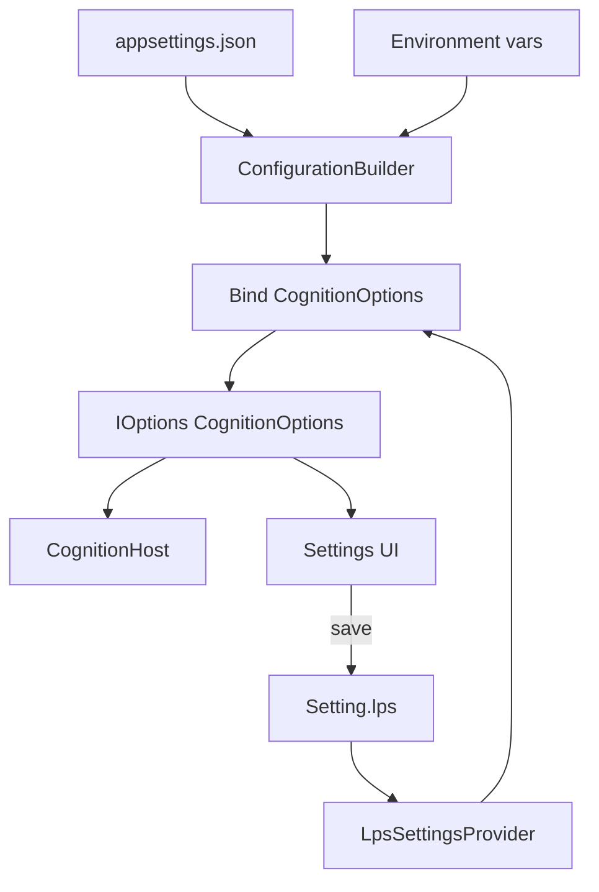
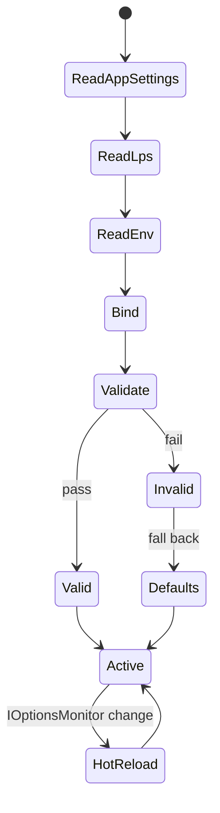
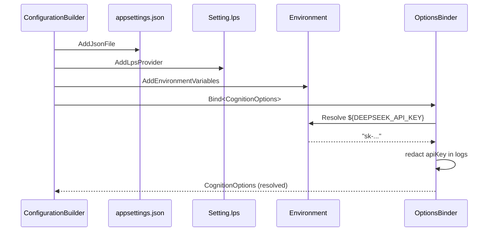

# 14 — Configuration

## Purpose
Define the configuration system for the AI-transformed VPet: provider selection, model paths, voice models, memory DB, permissions, logging, telemetry, and the bridge between the existing LPS settings and the new `IOptions<T>` pattern.

## Business Goal
The user can configure all cognitive capabilities (which LLM, which voice, memory location, tool permissions) through a settings UI and config files — without editing code.

## Technical Goal
Specify `CognitionOptions`, the `appsettings.json` schema, the LPS bridge (`LpsSettingsProvider`), hot-reload where safe, and secret management.

## Functional Requirements

| ID | Requirement |
|---|---|
| FR-CFG-01 | All cognitive settings are strongly-typed options objects (`IOptions<T>`). |
| FR-CFG-02 | Settings come from `appsettings.json` + `Setting.lps` `cognition` lines (LPS bridge). |
| FR-CFG-03 | Provider selection (LLM, STT, TTS, wake word, memory, embedding) is a config switch. |
| FR-CFG-04 | API keys support `${ENV_VAR}` expansion and are never logged. |
| FR-CFG-05 | Model paths are configurable (absolute or relative to app dir). |
| FR-CFG-06 | Memory DB path and encryption toggle are configurable. |
| FR-CFG-07 | Tool permissions, allowed paths, and blocklists are configurable. |
| FR-CFG-08 | Logging level and sinks are configurable. |
| FR-CFG-09 | Settings UI (see `13_ui_ux.md`) edits the same options. |
| FR-CFG-10 | Hot-reload for non-destructive settings (log level, retrieval top-K); cold-restart for provider/model changes. |

## Non Functional Requirements

| ID | Requirement |
|---|---|
| NFR-CFG-01 | Options binding < 100 ms. |
| NFR-CFG-02 | Invalid config → clear error message; fall back to defaults. |

## Architecture



## Module Design

### CognitionOptions (root)

```csharp
public sealed class CognitionOptions
{
    public LlmOptions Llm { get; set; } = new();
    public MemoryOptions Memory { get; set; } = new();
    public PersonalityOptions Personality { get; set; } = new();
    public EmotionOptions Emotion { get; set; } = new();
    public VoiceOptions Voice { get; set; } = new();
    public ToolOptions Tools { get; set; } = new();
    public AgentOptions Agent { get; set; } = new();
    public AnimationOptions Animation { get; set; } = new();
    public LoggingOptions Logging { get; set; } = new();
    public TelemetryOptions Telemetry { get; set; } = new();
}
```

Each sub-options class is documented in its domain document. This document defines the binding, LPS bridge, and secret handling.

### appsettings.json schema

```json
{
  "cognition": {
    "llm": {
      "provider": "ollama",
      "endpoint": "http://localhost:11434",
      "model": "qwen2.5:7b",
      "apiKey": "",
      "timeout": "00:01:00",
      "maxTokens": 1024,
      "temperature": 0.7,
      "seed": null,
      "fallbackProvider": "openai-compatible",
      "fallbackEndpoint": "https://api.deepseek.com",
      "fallbackModel": "deepseek-chat",
      "fallbackApiKey": "${DEEPSEEK_API_KEY}"
    },
    "memory": {
      "dbPath": "data/cognition.db",
      "encrypt": false,
      "vectorDimensions": 768,
      "embeddingProvider": "local",
      "embeddingModel": "models/bge-small.onnx",
      "consolidationInterval": "00:05:00",
      "forgettingInterval": "1.00:00:00",
      "maxDbSizeMb": 500
    },
    "personality": { "seed": { "name": "Vpet" }, "evolutionRate": 0.02 },
    "emotion": { "blendFactor": 0.3, "decayRatePerSec": 0.01, "sentiment": { "method": "rule" } },
    "voice": {
      "enabled": false,
      "wakeWord": { "provider": "openwakeword", "model": "hey_vpet.onnx", "threshold": 0.5 },
      "stt": { "provider": "faster-whisper", "model": "base" },
      "tts": { "provider": "piper", "model": "en_US-amy-medium.onnx" }
    },
    "tools": { "enabled": true, "timeoutSec": 30, "allowedPaths": [], "blockedCommands": [] },
    "agent": { "enabled": true, "maxStepsPerPlan": 10, "confidenceThreshold": 0.5 },
    "animation": { "emotionBiasEnabled": true, "lipSyncEnabled": true },
    "logging": { "level": "Information", "file": "logs/cognition-.log", "console": true },
    "telemetry": { "enabled": true, "otlpEndpoint": null }
  }
}
```

### LpsSettingsProvider

Bridges the existing `Setting.lps` (LinePutScript) to `CognitionOptions`. The `Setting.lps` gains a `cognition` line:
```
cognition#:|provider#ollama|endpoint#http://localhost:11434|model#qwen2.5:7b|...
```
`LpsSettingsProvider` reads this line and merges it into the `IConfiguration` as a provider source (lower priority than `appsettings.json`, so JSON overrides LPS for conflicts; in practice they're kept in sync by the settings UI).

The settings UI writes to `Setting.lps` (existing persistence) so the existing `VPet.Solution` editor can also read/edit cognition settings (by adding a `cognition` page there in the future).

### Secret management

- API keys in `appsettings.json` use `"${ENV_VAR}"` syntax; resolved at bind time from `Environment.GetEnvironmentVariable`.
- API keys in `Setting.lps` are stored in a `cognition` Sub with a `key` field; **plaintext in LPS** (existing limitation). For security, the settings UI stores keys in the Windows Credential Manager (DPAPI) and writes only a reference `keyref#credmanager:deepseek` to LPS. `LpsSettingsProvider` resolves `keyref` via DPAPI.
- API keys are never logged. The `LoggingOptions` has a `redactKeys` list (default: `["apiKey", "fallbackApiKey"]`); Serilog destructuring redacts these.

### Hot-reload

`IOptionsMonitor<T>` for hot-reloadable settings:
- `Logging.level` — change log level without restart.
- `Memory.retrieval.defaultTopK` — change retrieval count.
- `Emotion.blendFactor`/`decayRatePerSec` — tune emotion live.
- `Animation.emotionBiasEnabled` — toggle bias.

Cold-restart required for:
- Provider/endpoint/model changes (provider re-init).
- Memory DB path/encryption (DB re-open).
- Voice model changes (model reload).

The settings UI indicates which changes require restart.

## Folder Structure
```
VPet.Cognition.Host/
├── Options/
│   ├── CognitionOptions.cs
│   ├── LlmOptions.cs
│   ├── MemoryOptions.cs
│   ├── PersonalityOptions.cs
│   ├── EmotionOptions.cs
│   ├── VoiceOptions.cs
│   ├── ToolOptions.cs
│   ├── AgentOptions.cs
│   ├── AnimationOptions.cs
│   ├── LoggingOptions.cs
│   └── TelemetryOptions.cs
├── Lps/
│   └── LpsSettingsProvider.cs
└── Logging/
    ├── SerilogConfig.cs
    └── SecretRedactor.cs
```

## Interfaces
`IOptions<CognitionOptions>`, `IOptionsMonitor<T>` for hot-reload. Internal: `ILpsSettingsProvider`.

## Classes
`CognitionOptions` and sub-options, `LpsSettingsProvider`, `SerilogConfig`, `SecretRedactor`.

## State Machine
Config load:



## Sequence Diagram (Mermaid)
Config binding with secret:



## Flow Diagram (Mermaid)
Secret resolution:

```mermaid
flowchart TD
    A[apiKey value] --> B{starts with ${ ?}
    B -->|yes| C[GetEnvironmentVariable]
    B -->|no| D{starts with keyref# ?}
    D -->|yes| E[DPAPI Credential Manager]
    D -->|no| F[plaintext value]
    C --> G{found?}
    G -->|yes| H[use env value]
    G -->|no| I[empty + warn]
    E --> J{found?}
    J -->|yes| K[use DPAPI value]
    J -->|no| I
    H --> L[redact in logs]
    K --> L
    F --> L
```

## Database Schema
None (config is files). Memory DB path is a config value.

## Data Models
`CognitionOptions` and all sub-options classes.

## APIs
No external API. `Microsoft.Extensions.Configuration` + `Microsoft.Extensions.Options`.

## Configuration
This document IS the configuration spec.

## Logging
Serilog configured from `LoggingOptions`:
- Sinks: Console (if `console: true`), File (rolling, `file` pattern), Debug.
- Level: `level` (default `Information`).
- Destructuring: `SecretRedactor` redacts keys in `redactKeys`.
- Output template: `[{Timestamp:HH:mm:ss} {Level:u3} {CorrelationId} {SourceContext}] {Message:lj}{NewLine}{Exception}`.
- `CorrelationId` enriched per cognitive operation via `LogContext.PushProperty`.

## Telemetry
`TelemetryOptions`:
- `enabled` (default true) — in-process metrics collection.
- `otlpEndpoint` (default null) — optional OTLP gRPC export (e.g. `http://localhost:4317`).
- Metrics: LLM latency, STT/TTS latency, memory retrieval, agent decisions, tool invocations.
- If `otlpEndpoint` set, `OpenTelemetry.Metrics` exporter pushes every 60 s. Off by default (privacy).

## Performance Targets
| Metric | Target |
|---|---|
| Options bind | < 100 ms |
| Hot-reload propagation | < 500 ms |

## Security
- API keys never in logs (Serilog redaction).
- API keys in DPAPI (Windows Credential Manager) when set via UI; plaintext only if user edits LPS directly (documented risk).
- `appsettings.json` in `.gitignore` if it contains keys; `appsettings.example.json` checked in with placeholders.
- See `15_security.md`.

## Error Handling
- Invalid JSON → `FormatException`; fall back to defaults; show error.
- Missing env var → empty key; warn; provider will fail at runtime with clear message.
- Invalid LPS cognition line → skip; use defaults; warn.
- Bind validation fail → `OptionsValidationException`; fall back to defaults.

## Edge Cases
- No `appsettings.json` → all defaults.
- No `cognition` line in LPS → all defaults from JSON.
- Conflicting JSON + LPS → JSON wins (higher priority source).
- User edits LPS while app running → not hot-reloaded (LPS is read at startup); restart required. JSON hot-reload works via `IOptionsMonitor`.

## Acceptance Criteria
1. Changing `llm:provider` in settings UI changes the active provider on restart.
2. API key set via UI is stored in DPAPI, not plaintext in LPS.
3. API keys do not appear in any log file.
4. Invalid config falls back to defaults with a clear error.
5. Hot-reloadable settings take effect without restart.

## Unit Tests
- `LpsSettingsProvider`: parse cognition line, merge with JSON, missing line.
- `SecretRedactor`: redact all key fields.
- Options validation: invalid values → defaults.
- Env var expansion: present, missing, empty.

## Integration Tests
- Load config from test `appsettings.json` + test LPS → verify bound options.
- Hot-reload: change JSON → verify `IOptionsMonitor` fires.

## Future Expansion
- Cloud config sync (optional).
- Per-user profiles (multiple cognition configs).
- Config import/export.

## Refactoring Notes
- The existing `Setting : LPS_D` in Windows app is the source of truth for non-cognition settings; cognition settings live in the `cognition` line of the same file. `LpsSettingsProvider` reads only that line.
- `VPet.Solution` (editor app) can add a cognition settings page in the future by reading the same `cognition` line.

## Migration Strategy
- `appsettings.json` created on first run with defaults if missing.
- `cognition` line added to `Setting.lps` on first cognition save.
- No existing settings removed.

## Implementation Steps
1. Define all options classes.
2. Implement `LpsSettingsProvider` (reads `cognition` line → `IConfiguration` provider).
3. Implement `SerilogConfig` + `SecretRedactor`.
4. Implement `CognitionHostBuilder` config binding.
5. Implement env var + DPAPI secret resolution.
6. Tests.

## Agent Instructions
- Use `Microsoft.Extensions.Configuration` (not custom config).
- Never read API keys from hardcoded values.
- Always redact keys in logs.
- Validate options on bind (`Validate` overload of `AddOptions<T>().Validate(...)`).
- `appsettings.json` is the default; LPS overrides are merged.

## Developer Notes
- The existing `Setting.lps` is read by `Setting : LPS_D`; the `cognition` line is a Sub-less line with `#` info containing JSON-like key#value pairs. `LpsSettingsProvider` parses it.
- For the settings UI to write back, it updates the `cognition` line in `Setting.lps` via `MW.Set.FindorAddLine("cognition")`.
- DPAPI: `System.Security.Cryptography.ProtectedData` for file-based, or `CredentialManager` NuGet for Windows Credential Manager.