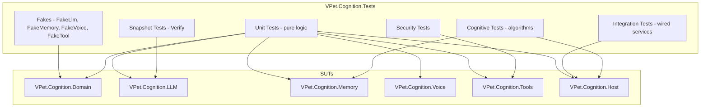
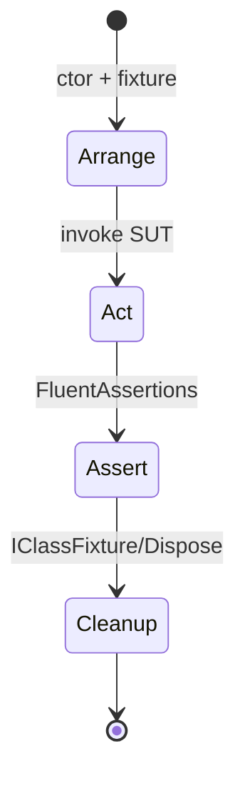
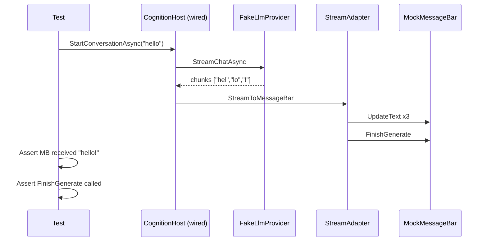
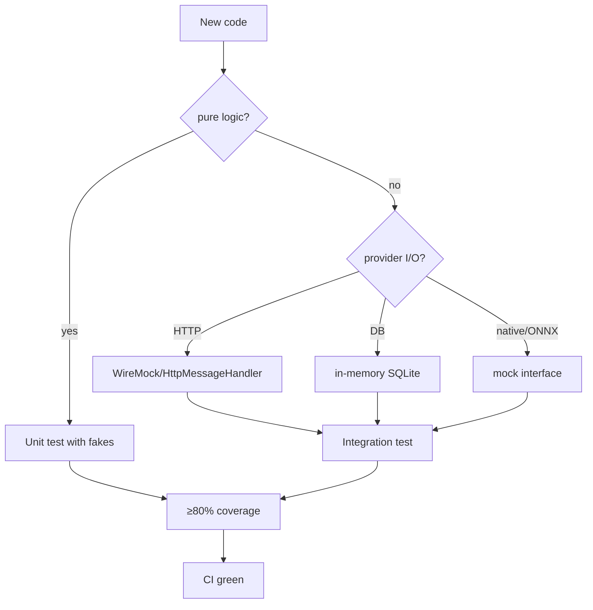

# 16 — Testing

## Purpose
Define the testing strategy for the AI-transformed VPet: unit, integration, cognitive, voice, agent, and security tests — with deterministic fakes, snapshot testing, and coverage targets.

## Business Goal
The companion is reliable: every cognitive capability is tested, provider swaps are safe, and regressions are caught before release.

## Technical Goal
Specify the test project (`VPet.Cognition.Tests`), test categories, fakes/mocks, snapshot testing, coverage targets, and CI integration.

## Functional Requirements

| ID | Requirement |
|---|---|
| FR-TST-01 | Every Domain interface has a fake implementation in the test project. |
| FR-TST-02 | Every provider has ≥1 happy-path and ≥1 error-path unit test. |
| FR-TST-03 | Integration tests cover end-to-end conversation, memory, agent, tool, and voice flows. |
| FR-TST-04 | Snapshot tests (Verify) cover prompt templates and LLM request/response DTOs. |
| FR-TST-05 | Security tests cover permission denial, path rejection, egress blocking, secret redaction. |
| FR-TST-06 | Cognitive tests verify memory consolidation, forgetting, personality evolution, emotion decay. |
| FR-TST-07 | Voice tests cover FSM transitions and barge-in. |
| FR-TST-08 | Agent tests cover plan/execute/verify/reflect/retry. |
| FR-TST-09 | All tests are deterministic (no real network, no real models, seeded random). |
| FR-TST-10 | Coverage ≥ 80% on new code. |

## Non Functional Requirements

| ID | Requirement |
|---|---|
| NFR-TST-01 | Full test suite < 60 s. |
| NFR-TST-02 | Tests run on CI (GitHub Actions) on every PR. |

## Architecture



## Module Design

### Test project: `VPet.Cognition.Tests`

- **Framework**: xUnit + FluentAssertions + Moq + Verify.
- **Target**: `net8.0` (headless; no WPF needed for most tests). WPF-dependent tests (views) in a separate `VPet.Cognition.Wpf.Tests` targeting `net8.0-windows`.
- **Fakes**: in `Fakes/` — `FakeLlmProvider` (returns canned/streamed responses), `FakeMemoryStore` (in-memory dict), `FakeEmbeddingProvider` (deterministic hash-based vectors), `FakeSttProvider`/`FakeTtsProvider`/`FakeWakeWordProvider`, `FakeToolProvider`, `FakePermissionService` (auto-grant/deny configurable).
- **HTTP mocking**: `WireMock.Net` for LLM/embedding/TTS HTTP providers.
- **DB**: in-memory SQLite (`:memory:` connection string) for memory/permission/audit tests.
- **Random**: `Function.Random` replaced with injectable `IRandom` or seeded `Random` in new code.

### Test categories

| Category | Scope | Examples |
|---|---|---|
| **Unit** | Pure logic, no I/O | `EmotionBlender`, `DecayService`, `ImportanceScorer`, `PathValidator`, `CommandBlocklist`, `PriorityQueue`, `DecisionConfidence`, `TokenCounter`, `XmlToolCallParser` |
| **Provider unit** | Provider with mocked I/O | `OpenAICompatibleLlmProvider` (HttpMessageHandler mock), `SqliteMemoryStore` (in-memory DB), `OpenWakeWordProvider` (mock ONNX) |
| **Integration** | Wired services, fake providers | Conversation turn (fake LLM → stream → MessageBar mock), memory store+retrieve, agent goal lifecycle, tool call with permission |
| **Snapshot** | Stable output | `PersonalityPromptTemplate` output, `ChatRequest` JSON serialization, `ContextInjector` formatted block |
| **Security** | Security controls | Permission deny, path reject, egress block, secret redact, audit hash chain, signature validation (mock) |
| **Cognitive** | Algorithm correctness | Consolidation promotes after threshold, forgetting removes after idle, personality drift bounds, emotion decay convergence |
| **Voice** | FSM + audio mocks | ConversationFsm transitions, barge-in, VAD threshold |
| **Agent** | Plan/execute/reflect | Planner parses plan, executor dispatches, verifier passes/fails, reflector retries/replans/gives up |

### Determinism rules

1. No real network — all HTTP via `WireMock.Net` or `HttpMessageHandler` mock.
2. No real models — all ONNX/native via mocks/fakes.
3. Seeded `Random` — all randomness via injectable seeded source.
4. No `DateTime.Now` — inject `ISystemClock` (or `TimeProvider` in .NET 8).
5. No real filesystem — use temp dirs (`Path.GetTempPath`) for DB tests; clean up in `Dispose`.

### .NET 8 `TimeProvider`

Use `TimeProvider` (new in .NET 8) for all time-dependent code:
```csharp
public class EmotionEngine
{
    private readonly TimeProvider _time;
    public EmotionEngine(TimeProvider time) { _time = time; }
}
```
Tests use `FakeTimeProvider` (from `Microsoft.Extensions.TimeProvider.Testing` or a custom fake) to advance time deterministically.

## Folder Structure
```
VPet.Cognition.Tests/
├── Fakes/
│   ├── FakeLlmProvider.cs
│   ├── FakeMemoryStore.cs
│   ├── FakeEmbeddingProvider.cs
│   ├── FakeSttProvider.cs
│   ├── FakeTtsProvider.cs
│   ├── FakeWakeWordProvider.cs
│   ├── FakeToolProvider.cs
│   ├── FakePermissionService.cs
│   └── FakeTimeProvider.cs
├── Domain/
│   ├── EmotionBlenderTests.cs
│   ├── DecayServiceTests.cs
│   ├── ImportanceScorerTests.cs
│   └── ...
├── LLM/
│   ├── OpenAICompatibleLlmProviderTests.cs
│   ├── OllamaLlmProviderTests.cs
│   ├── PromptAssemblerTests.cs
│   ├── StreamAdapterTests.cs
│   └── XmlToolCallParserTests.cs
├── Memory/
│   ├── SqliteMemoryStoreTests.cs
│   ├── ConsolidatorTests.cs
│   ├── ForgettingServiceTests.cs
│   ├── CompressionServiceTests.cs
│   └── RetrieverTests.cs
├── Voice/
│   ├── ConversationFsmTests.cs
│   ├── VoiceActivityDetectorTests.cs
│   └── LipSyncMapperTests.cs
├── Tools/
│   ├── SafetyLayerTests.cs
│   ├── PathValidatorTests.cs
│   ├── CommandBlocklistTests.cs
│   ├── PermissionServiceTests.cs
│   └── ToolAuditLogTests.cs
├── Agent/
│   ├── PlannerTests.cs
│   ├── ExecutorTests.cs
│   ├── VerifierTests.cs
│   ├── ReflectorTests.cs
│   ├── RetryEngineTests.cs
│   └── PriorityQueueTests.cs
├── Host/
│   ├── CognitionHostBuilderTests.cs
│   ├── EventBusTests.cs
│   └── LpsSettingsProviderTests.cs
├── Security/
│   ├── EgressFilterTests.cs
│   ├── SecretRedactorTests.cs
│   └── AuditHashChainTests.cs
├── Snapshots/
│   └── .verified/  (Verify output)
└── GlobalUsings.cs
```

## Interfaces
Test-only fakes implement Domain interfaces.

## Classes
Fakes listed above.

## State Machine
Test lifecycle (xUnit):



## Sequence Diagram (Mermaid)
Integration test: conversation turn:



## Flow Diagram (Mermaid)
Test categorization:



## Database Schema
In-memory SQLite (`:memory:`) for tests. Schema migrations run on test setup.

## Data Models
Test-specific: `ChatMessageVm` mocks, `MockMessageBar` implementing `IMassageBar`.

## APIs
No external API in tests (all mocked).

## Configuration
Test `appsettings.json` + test LPS strings inline.

## Logging
Tests capture logs via `Serilog.Sinks.TestCorrelator` or `xUnit ITestOutputHelper` sink for assertions.

## Telemetry
Tests assert on metrics counters.

## Performance Targets
| Metric | Target |
|---|---|
| Full suite | < 60 s |
| Unit test | < 100 ms each |
| Integration test | < 1 s each |

## Security
Security tests are first-class (see `Security/` folder).

## Error Handling
Tests assert that error paths produce correct `Result<T, Error>` and that providers fall back correctly.

## Edge Cases
- Flaky tests (timing) → use `FakeTimeProvider`, never `Thread.Sleep` in tests.
- Snapshot drift → `Verify` prompts to accept new snapshot; CI fails on unaccepted.
- DB migration tests → run on fresh in-memory DB each test.

## Acceptance Criteria
1. `dotnet test` passes with ≥80% coverage on new code.
2. No test makes a real network call.
3. No test depends on `DateTime.Now` or unseeded `Random`.
4. CI runs tests on every PR and fails on < 80% coverage or any failing test.
5. Snapshot tests catch prompt template regressions.

## Unit Tests
This document IS the test spec.

## Integration Tests
This document IS the test spec.

## Future Expansion
- Property-based tests (FsCheck) for emotion/memory algorithms.
- Mutation testing (Stryker.NET).
- Load tests for memory retrieval at 1M memories.
- Voice integration tests with real audio files (optional, opt-in).

## Refactoring Notes
- The existing codebase has **no tests**. New code is fully tested; existing code is not retrofitted with tests in this phase (out of scope), but new code that touches existing code adds tests for the touched paths.

## Migration Strategy
- New test project; no existing test migration.

## Implementation Steps
1. Create `VPet.Cognition.Tests` project (xUnit + FluentAssertions + Moq + Verify).
2. Implement all fakes.
3. Write unit tests for pure logic (Domain).
4. Write provider unit tests (mocked I/O).
5. Write integration tests (wired services + fakes).
6. Write snapshot tests (Verify).
7. Write security tests.
8. Write cognitive/voice/agent tests.
9. Add CI workflow (GitHub Actions).
10. Add coverage gate (Coverlet + report).

## Agent Instructions
- Every new interface MUST have a fake committed in the same PR.
- Every new public method MUST have ≥1 unit test.
- Use `FluentAssertions` (`result.Should().BeSuccess()`).
- Use `Verify` for any string/JSON output test.
- Never use `Thread.Sleep` in tests; use `FakeTimeProvider`.
- Never make real network calls; use `WireMock.Net` or `HttpMessageHandler` mock.
- Seed all `Random` instances.
- Use `IClassFixture<T>` for shared expensive setup (e.g. DI container).
- Name tests `MethodName_Scenario_ExpectedResult`.

## Developer Notes
- `Verify` stores `.verified` files in `Snapshots/.verified/`; commit them. CI runs `Verify` in strict mode (fails on mismatch).
- `WireMock.Net` server starts on a random port per test; dispose after.
- For in-memory SQLite, use `DataSource=:memory:` and `Mode=Memory` in connection string; each test gets a fresh DB.
- `Coverlet` MSBuild integration: `<CollectCoverage>true</CollectCoverage>` + `coverlet.msbuild` package; CI publishes coverage report.