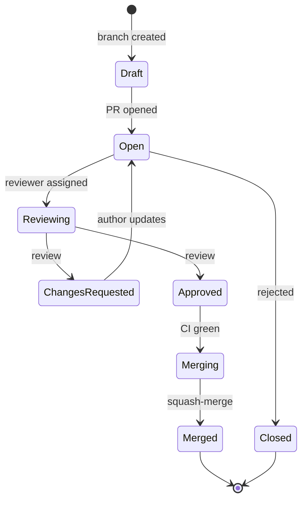
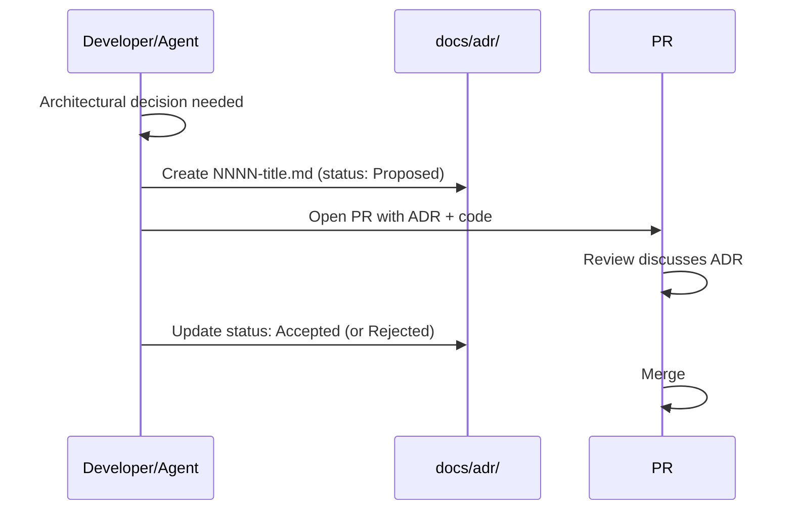
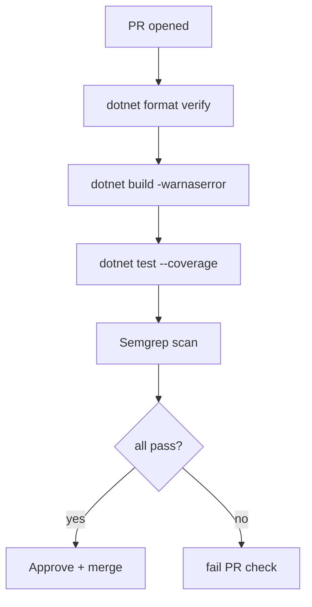

# 17 — Development Rules

## Purpose
Define the coding standards, PR rules, ADR process, branch strategy, and contribution workflow for the AI-transformed VPet.

## Business Goal
Ensure the codebase remains maintainable, secure, and consistent as multiple agents and humans contribute.

## Technical Goal
Specify the enforceable rules (CI-checked) and the human-judgment rules (review-checked).

## Functional Requirements

| ID | Requirement |
|---|---|
| FR-DR-01 | All new code follows the coding standards (CI-enforced). |
| FR-DR-02 | All PRs pass build + test + format + Semgrep. |
| FR-DR-03 | Architectural decisions are recorded as ADRs. |
| FR-DR-04 | Conventional commits are used. |
| FR-DR-05 | Trunk-based development; short-lived feature branches. |

## Non Functional Requirements
N/A (process document).

## Architecture
N/A.

## Module Design
N/A.

## Folder Structure
```
docs/
├── adr/                    # Architecture Decision Records
│   ├── 0001-record-architecture-decisions.md
│   ├── 0002-use-clean-architecture.md
│   └── ...
```

## Interfaces
N/A.

## Classes
N/A.

## State Machine
PR lifecycle:



## Sequence Diagram (Mermaid)
ADR creation:



## Flow Diagram (Mermaid)
CI pipeline:



## Database Schema
N/A.

## Data Models
N/A.

## APIs
N/A.

## Configuration
N/A.

## Logging
N/A.

## Telemetry
N/A.

## Performance Targets
N/A.

## Security
N/A (see `15_security.md`).

## Error Handling
N/A.

## Edge Cases
N/A.

## Acceptance Criteria
1. CI passes on all merged PRs.
2. Every architectural decision has an ADR.
3. Commit messages follow Conventional Commits.

## Unit Tests
N/A.

## Integration Tests
N/A.

## Future Expansion
- Automated ADR generation from PR descriptions.
- Semantic-release versioning.

## Refactoring Notes
N/A.

## Migration Strategy
N/A.

## Implementation Steps
1. Add `.editorconfig` (already exists; extend for new projects).
2. Add `dotnet format` to CI.
3. Add Semgrep to CI.
4. Create `docs/adr/` with ADR 0001.
5. Add PR template (`.github/pull_request_template.md`).
6. Add CI workflow (`.github/workflows/ci.yml`).

## Agent Instructions
- Follow all rules in this document.
- Create an ADR for any decision that deviates from the spec.
- Run `dotnet format`, `dotnet build`, `dotnet test`, Semgrep before reporting done.

## Developer Notes

### Coding standards (CI-enforced)

1. **File-scoped namespaces**.
2. **`readonly struct`** for value types; **`record`** for immutable DTOs.
3. **`sealed`** by default.
4. **Nullable enabled** (`<Nullable>enable</Nullable>`).
5. **No public fields**; properties only.
6. **No `dynamic`**.
7. **No `GC.Collect()`** in new code.
8. **No `Thread.Sleep`** on UI thread.
9. **No `.Result`/`.Wait()`**.
10. **XML docs on all public APIs** (`<GenerateDocumentationFile>true`, no `NoWarn CS1591`).
11. **Async methods suffixed `Async`** with `CancellationToken cancellationToken = default`.
12. **`dotnet format`** clean.
13. **`TreatWarningsAsErrors`** on new projects.
14. **Conventional commits**: `feat:`, `fix:`, `docs:`, `refactor:`, `test:`, `chore:`, `perf:`, `build:`.

### PR rules

1. **Trunk-based**: feature branches < 2 days.
2. **Squash-merge** to `main`.
3. **No direct pushes to `main`**.
4. **PR description**: changed files, tests run, scans run, remaining risks.
5. **CI must pass**: build, test (≥80% coverage on new code), format, Semgrep.
6. **No new `CS1591` warnings**.
7. **ADR required** for architectural decisions.

### ADR process

- Location: `docs/adr/NNNN-title.md`.
- Format: Michael Nygard template (Context, Decision, Status, Consequences).
- Status: `Proposed` → `Accepted` or `Rejected`.
- Numbered sequentially.
- Committed with the code change that implements the decision.

### Branch strategy

- `main` — always shippable.
- `feat/<short-name>` — feature work.
- `fix/<short-name>` — bug fixes.
- `docs/<short-name>` — documentation.
- Branch lifetime < 2 days; rebase if longer.

### CI workflow (`.github/workflows/ci.yml`)

```yaml
name: ci
on: [pull_request]
jobs:
  build:
    runs-on: windows-latest
    steps:
      - uses: actions/checkout@v4
      - uses: actions/setup-dotnet@v4
        with: { dotnet-version: '8.0.x' }
      - run: dotnet format verify --severity error
      - run: dotnet build -warnaserror
      - run: dotnet test --collect:"XPlat Code Coverage"
      - uses: codecov/codecov-action@v4
      - uses: returntocorp/semgrep-action@v1
```

### Reviewer checklist

- [ ] Follows coding standards.
- [ ] Tests added and pass.
- [ ] Coverage ≥ 80% on new code.
- [ ] No secrets in code/logs.
- [ ] ADR added if architectural.
- [ ] Docs updated.
- [ ] No `GC.Collect()`, `Thread.Sleep` on UI, `.Result`/`.Wait()`.
- [ ] All public APIs XML-documented.
- [ ] Conventional commit message.