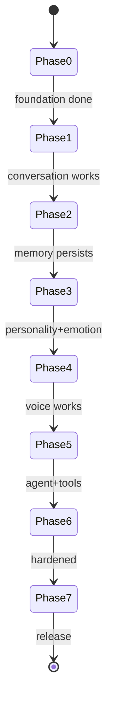
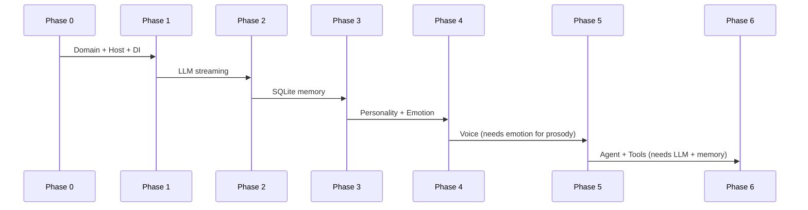
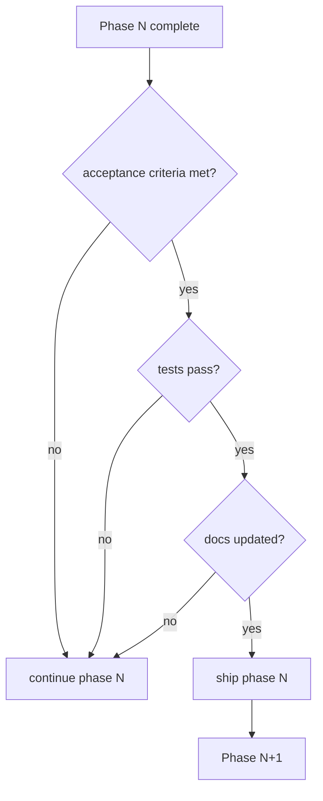

# 18 — Roadmap

## Purpose
Define the phased delivery plan with milestones, dependencies, and shippable outcomes for each phase.

## Business Goal
Deliver a conversing companion as early as possible, then layer in cognition (memory, personality, emotion, voice, agent, tools) — each phase independently shippable and valuable.

## Technical Goal
Map the Development Order (from `task.md` §14) to milestones with acceptance criteria, dependencies, and estimated effort.

## Functional Requirements

| ID | Requirement |
|---|---|
| FR-RM-01 | Each phase is independently shippable. |
| FR-RM-02 | Each phase has clear acceptance criteria. |
| FR-RM-03 | Dependencies between phases are explicit. |

## Non Functional Requirements
N/A.

## Architecture
See `03_target_architecture.md`.

## Module Design
N/A.

## Folder Structure
N/A.

## Interfaces
N/A.

## Classes
N/A.

## State Machine
Phase progression:

## Sequence Diagram (Mermaid)
Phase dependency:

## Flow Diagram (Mermaid)
Milestone gates:

## Database Schema
N/A.

## Data Models
N/A.

## APIs
N/A.

## Configuration
N/A.

## Logging
N/A.

## Telemetry
N/A.

## Performance Targets
Per-phase targets in each domain document.

## Security
Per-phase security in `15_security.md`.

## Error Handling
N/A.

## Edge Cases
N/A.

## Acceptance Criteria
See each phase below.

## Unit Tests
See `16_testing.md`.

## Integration Tests
See `16_testing.md`.

## Future Expansion
See `19_future_features.md`.

## Refactoring Notes
N/A.

## Migration Strategy
N/A.

## Implementation Steps
This document IS the implementation plan.

## Agent Instructions
Execute one phase at a time. Do not start Phase N+1 until Phase N's acceptance criteria are met.

## Developer Notes

### Phase 0 — Foundation

**Goal**: Domain abstractions + Host + DI + plugin load seam.
**Dependencies**: none.
**Deliverables**:
- `VPet.Cognition.Domain` with all interfaces, entities, events, errors.
- `VPet.Cognition.Host` with `CognitionPlugin : MainPlugin`, DI, event bus, options binding.
- `VPet.Cognition.Tests` with all fakes.
- `CognitionPlugin` loads as a no-op into the existing app.
**Acceptance**:
- App boots with `CognitionPlugin` loaded; no behavior change.
- `dotnet build` + `dotnet test` pass.
- All fakes committed.
**Effort**: ~1 week.

### Phase 1 — Conversation (LLM + text)

**Goal**: Streaming text conversation.
**Dependencies**: Phase 0.
**Deliverables**:
- `VPet.Cognition.LLM` with `OpenAICompatibleLlmProvider`, `OllamaLlmProvider`.
- `PromptAssembler`, `StreamAdapter` to `SayInfoWithStream`.
- `ConversationWindow` + `ConversationVM`.
- `CognitionSettingsWindow` (LLM tab).
- Working memory (in-context; no persistence).
**Acceptance**:
- User opens conversation window, types, gets streaming response.
- Switching provider in config works on restart.
- Cancel stops stream within 200 ms.
**Effort**: ~2 weeks.

### Phase 2 — Memory (persistence + retrieval)

**Goal**: Companion remembers across sessions.
**Dependencies**: Phase 1.
**Deliverables**:
- `VPet.Cognition.Memory` with `SqliteMemoryStore`, `LocalEmbeddingProvider`.
- `ImportanceScorer`, `Consolidator`, `ForgettingService`, `CompressionService`.
- `Retriever` + `ContextInjector` into prompts.
- `MemoryInspectorWindow`.
**Acceptance**:
- After restart, companion recalls a fact from a prior session.
- Retrieval < 200 ms on 10k memories.
- Consolidation promotes short-term to long-term.
**Effort**: ~3 weeks.

### Phase 3 — Personality + Emotion

**Goal**: Evolving personality + emotion influencing animation/voice.
**Dependencies**: Phase 2.
**Deliverables**:
- `PersonalityEngine`, `PersonalityEvolver`, `SelfReflection`, `SelfEvaluation`.
- `EmotionEngine`, `EmotionBlender`, `DecayService`, `SentimentAnalyzer`.
- `CognitionGraphResolver` (emotion → animation nudge).
- `PersonalityWindow`, `EmotionDashboardWindow`.
- `Likability` ↔ `Affection` bridge.
**Acceptance**:
- After 50 conversations, adaptive traits changed from seed; core traits not.
- Joy dominant → happy animations more often.
- Emotion persists across restarts.
**Effort**: ~3 weeks.

### Phase 4 — Voice

**Goal**: Natural voice conversation.
**Dependencies**: Phase 3 (emotion → prosody).
**Deliverables**:
- `VPet.Cognition.Voice` with wake word, STT, TTS providers.
- `ConversationFsm`, `AudioCapture`, `AudioPlayer`, `VoiceActivityDetector`.
- `LipSyncOverlay`.
- `VoiceSettingsWindow`.
**Acceptance**:
- Wake word → listening → spoken query → spoken response within 2 s.
- Barge-in stops TTS within 200 ms.
- TTS prosody reflects emotion.
**Effort**: ~4 weeks.

### Phase 5 — Agent + Tools

**Goal**: Autonomous goals + secure tool execution.
**Dependencies**: Phase 1 (LLM), Phase 2 (memory).
**Deliverables**:
- `AgentRuntime`, `Planner`, `Executor`, `Verifier`, `Reflector`, `RetryEngine`, `Scheduler`.
- `VPet.Cognition.Tools` with all tool providers, `PermissionService`, `SafetyLayer`, `ToolAuditLog`.
- `PermissionPromptWindow`, `ToolAuditWindow`.
**Acceptance**:
- User goal "open notepad" → plan → permission → execute.
- Failed tool → reflection → replan.
- Low confidence → asks user.
- Every tool invocation audited.
**Effort**: ~4 weeks.

### Phase 6 — Hardening

**Goal**: Production-ready.
**Dependencies**: all phases.
**Deliverables**:
- Security review (`15_security.md`): egress filter, secret redaction, audit hash chain.
- Full test suite at ≥80% coverage.
- Performance profiling: LLM/STT/TTS latency, memory retrieval, animation frame budget.
- Documentation finalization + ADRs.
- `VPet.Cognition.Plugin.Demo` reference plugin.
**Acceptance**:
- All acceptance criteria in `task.md` §11 met.
- No critical/high Semgrep findings.
- Cold start < 10 s.
- Runs offline 24 h without degradation.
**Effort**: ~2 weeks.

### Total estimated effort: ~19 weeks (4-5 months).

### Milestone summary

| Milestone | Phase | Shippable outcome |
|---|---|---|
| M0 | 0 | Plugin loads; no-op |
| M1 | 1 | Text conversation |
| M2 | 2 | Memory across sessions |
| M3 | 3 | Personality + emotion + animation |
| M4 | 4 | Voice conversation |
| M5 | 5 | Autonomous agent + tools |
| M6 | 6 | Production release |