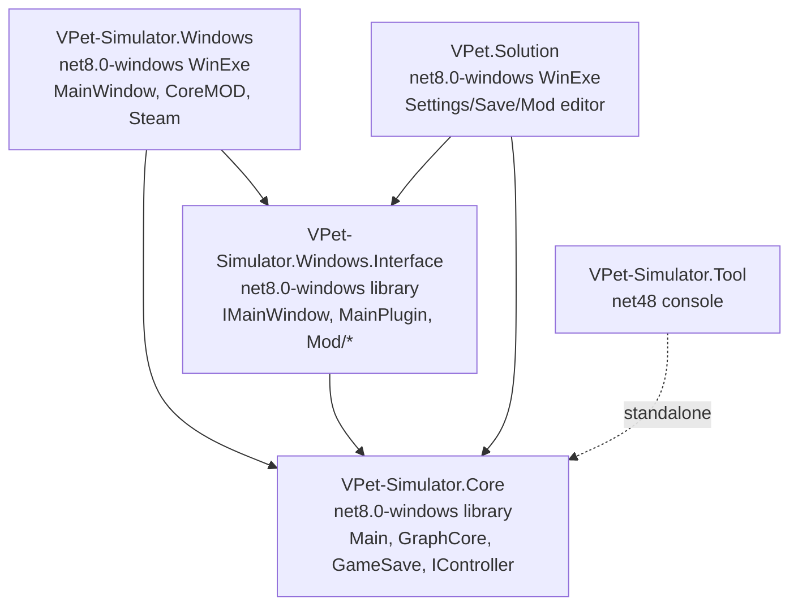
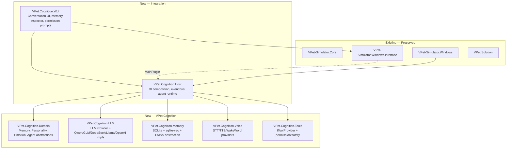

# task.md — VPet Enterprise Engineering Specification (Master Document)

> **Document status:** Authoritative. All other documents in `docs/` are linked from here and must remain consistent with the contracts defined in this file.
> **Audience:** Autonomous coding agents (Claude Code, GPT-5.5 Agent, GLM Agent, Codex) and human engineers implementing the VPet transformation.
> **Repository under transformation:** https://github.com/LorisYounger/VPet (commit at task start: `main` branch, .NET 8 / WPF).

---

## 1. Vision

Transform **VPet** from a deterministic, animation-driven desktop pet toy into an **offline-first, modular, autonomous AI desktop companion** that feels alive — capable of long-term memory, evolving personality, emotional intelligence, secure tool usage, and natural voice conversations — while remaining deterministic, maintainable, secure, and extensible.

The companion must:

- **Feel alive**: continuous presence, proactive conversation, mood-congruent animation, voice with lip sync, memory of the user across sessions.
- **Stay deterministic**: every AI call is wrapped in a verifiable contract; behavior is reproducible given the same inputs and seed.
- **Stay offline-first**: all core cognition (LLM, STT, TTS, wake word, vector memory) can run on local hardware; cloud providers are optional, swappable, and never a hard dependency.
- **Stay vendor-free**: no provider lock-in. Every AI capability is behind an interface with at least one local and one cloud reference implementation.
- **Stay safe**: tool execution (shell, files, clipboard, browser, Win32) is gated by an explicit permission system and a safety layer.
- **Stay extensible**: the existing plugin/MOD ecosystem continues to work; new cognitive capabilities are added as plugins implementing new interfaces.

## 2. Mission

Deliver a complete, production-ready engineering specification that an autonomous coding agent can execute without ambiguity, producing a maintainable WPF/.NET 8 application whose architecture is Clean Architecture + DDD + Event-Driven + Plugin-based, with interchangeable AI providers and a human-like cognitive architecture (memory, personality, emotion, agent, voice, tools).

## 3. Scope

### In scope

1. Full architectural analysis of the existing VPet solution (5 projects).
2. Target architecture for the AI-transformed VPet.
3. AI pipeline with interchangeable LLM providers (Qwen, GLM, DeepSeek, Llama, OpenAI-compatible).
4. Cognitive memory architecture (working, short-term, long-term, semantic, episodic, relationship, workspace, emotional, reflection, goal, identity) with consolidation, importance scoring, forgetting, compression, retrieval, search, and privacy.
5. Personality engine with evolving core/adaptive traits, preferences, habits, interests, humor, communication style, confidence, curiosity, creativity, relationship growth, identity, long-term evolution, self-reflection, self-evaluation.
6. Emotion engine (joy, sadness, anger, curiosity, stress, excitement, fear, calmness, surprise, frustration) with blending, persistence, decay, animation mapping, voice mapping, decision influence.
7. Voice pipeline: wake word (OpenWakeWord), streaming STT (Faster Whisper, whisper.cpp), streaming TTS (Piper, Kokoro, XTTS v2), interruptions, latency optimization, lip sync, animation sync, conversation state machine.
8. Agent architecture: planner, executor, verifier, reflector, retry engine, scheduler, background tasks, priority queue, goal manager, task manager, decision confidence, tool calling, permission system, safety layer.
9. Secure tool calling: applications, PowerShell, CMD, files, folders, clipboard, browser, Windows APIs — only through a permission system.
10. Plugin system evolution preserving the existing MOD ecosystem.
11. Animation system integration with emotion/personality.
12. UI/UX for conversation, memory inspection, personality settings, emotion dashboard, permission prompts.
13. Configuration system (provider selection, model paths, voice models, memory DB, permissions).
14. Security model (plugin sandboxing, secret management, tool permissions, memory privacy).
15. Testing strategy (unit, integration, cognitive, voice, agent, security).
16. Development rules, coding standards, repository rules.
17. Roadmap and future features.

### Out of scope (this specification)

- Replacing the existing animation rendering engine (GraphCore/PNGAnimation). The AI layer consumes animation events; it does not rewrite the renderer.
- Removing Steam Workshop support. The MOD distribution channel is preserved.
- Cloud-only features that cannot fall back to local execution.
- Mobile platforms.

## 4. Project Philosophy

| Principle | Meaning in VPet |
|---|---|
| **Offline-first** | Local models are the default. Network is an enhancement, not a requirement. The app must boot and converse with zero internet. |
| **Deterministic-by-default** | AI outputs are bounded by contracts, schemas, and seeds. Randomness is explicit and reproducible. |
| **Feel-alive, not fake-alive** | Proactivity, memory continuity, and emotional congruence are first-class. The companion remembers you. |
| **No vendor lock-in** | Every AI capability is an interface. At least one local and one cloud implementation ship. |
| **Plugin-first extensibility** | New cognition (a new memory type, a new emotion, a new tool) is added by implementing an interface in a plugin, not by editing core. |
| **Safe by construction** | Tool execution is deny-by-default. Permissions are explicit, scoped, revocable, and audited. |
| **Preserve what works** | The existing MOD ecosystem, animation system, save format, and Steam integration are not broken. The AI layer is additive. |
| **Observable** | Every cognitive decision is logged with structured logs and telemetry. Behavior is debuggable. |
| **Testable** | AI providers, memory, personality, emotion, agent, and tools all have unit and integration tests with deterministic fakes. |

## 5. Architecture Principles

1. **Clean Architecture** — dependencies point inward toward domain; domain has no dependency on infrastructure or UI.
2. **DDD** — bounded contexts: Cognition (memory/personality/emotion/agent), Voice, Tools, Animation, Persistence, Plugin.
3. **SOLID** — every module has one reason to change; interfaces are small and behavior-injectable.
4. **Event-Driven** — cross-module communication uses a typed in-process event bus; the existing `event Action<...>` pattern is preserved and formalized.
5. **CQRS where appropriate** — memory writes (consolidation, importance scoring) are separated from reads (retrieval, search).
6. **Repository pattern only where beneficial** — memory stores and tool history use repositories; in-memory state does not.
7. **Async/Await** — all I/O (LLM, STT, TTS, DB, files, network) is async with cancellation tokens. UI thread never blocks.
8. **Structured logging** — `ILogger<T>` with Serilog sinks; every cognitive operation emits a correlation id.
9. **Configuration provider** — strongly-typed options objects bound from `appsettings.json` + LPS settings; hot-reloadable where safe.
10. **Plugin-based** — new providers and cognitive modules are plugins implementing interfaces discovered via DI.
11. **Replaceable AI providers** — provider selection is a config switch; runtime swaps providers without code changes.
12. **No vendor lock-in** — no provider SDK is referenced by the domain layer; only interfaces.

## 6. Engineering Standards

| Area | Standard |
|---|---|
| Language | C# 12+ (`LangVersion=latest`) |
| Framework | .NET 8 (`net8.0-windows`) for WPF; `net8.0` for headless libraries |
| UI | WPF + MVVM (CommunityToolkit.Mvvm for new VMs; existing `SimpleObservable` preserved in `VPet.Solution`) |
| DI | `Microsoft.Extensions.DependencyInjection` — the app composition root |
| Logging | `Serilog` with `ILogger<T>`; sinks: console, file (rolling), debug |
| Configuration | `Microsoft.Extensions.Configuration` + `IOptions<T>`; LPS settings bridged via a `ILpsSettingsProvider` |
| Persistence | SQLite (`Microsoft.Data.Sqlite`) + `sqlite-vec` for vectors; FAISS abstraction interface; future Qdrant |
| Testing | xUnit + FluentAssertions + Moq; `Verify` for snapshot testing of prompts/outputs |
| Static analysis | Semgrep + `dotnet format` + `Roslyn analyzers` (StyleCop, Sonar) |
| CI | GitHub Actions: build + test + format check + Semgrep on every PR |
| Async | All public async APIs accept `CancellationToken`; never `.Result`/`.Wait()` |
| Error handling | Result patterns for domain errors; exceptions only for truly exceptional cases; never swallow exceptions silently |

## 7. Coding Standards

1. **File-scoped namespaces** for all new files.
2. **`readonly struct`** for value types; `record` for immutable DTOs.
3. **`sealed`** classes by default; `virtual` only where extension is a documented contract.
4. **Nullable reference types enabled** (`<Nullable>enable</Nullable>`) in all new projects.
5. **No `public` fields**; properties only.
6. **No `dynamic`** in new code; use strongly-typed generics.
7. **No `GC.Collect()`** in new code (the existing Core calls it after animation swaps — flagged as tech debt, not propagated).
8. **No `Thread.Sleep`** on the UI thread; use `Task.Delay`.
9. **No `Assembly.LoadFrom`** outside the plugin loader; the plugin loader uses it in a sandboxed context with signature validation.
10. **All public APIs XML-documented** (`GenerateDocumentationFile=true`, no `NoWarn CS1591` in new projects).
11. **All async methods suffixed `Async`** and accept `CancellationToken cancellationToken = default`.
12. **All DI registrations explicit**; no service locator.
13. **All secrets from configuration/env**, never in code or git.
14. **All tool executions audited** with a `ToolInvocationRecord`.

## 8. Repository Rules

1. **Trunk-based development**; feature branches < 2 days; PR required.
2. **Conventional commits** (`feat:`, `fix:`, `docs:`, `refactor:`, `test:`, `chore:`, `perf:`, `build:`).
3. **PR must pass**: build, tests, format, Semgrep, no new `CS1591` warnings.
4. **No direct pushes to `main`**; squash-merge PRs.
5. **`docs/` is part of the repo**; architectural decisions are recorded as ADRs in `docs/adr/`.
6. **No secrets in the repo**; `.gitignore` covers `*.key`, `*.pfx`, `appsettings.*.Local.json`, model files.
7. **MOD assets excluded from build** (`Compile Remove="mod\**"` already in csproj — preserved).
8. **`mklink.bat`** symlink step preserved for dev setup (links `mod/` into build output).

## 9. Development Workflow

```
1. Analyze  → read architecture, deps, data flow, lifecycle (this docs/ project is the reference)
2. Implement → minimal surgical change; new code in new projects where possible
3. Test      → xUnit + Verify; add tests for new behavior; run `dotnet test`
4. Scan      → Semgrep MCP scan_code + `dotnet format` + analyzers
5. Optimize  → profile LLM/STT/TTS latency; memory DB query plans; animation frame budget
6. Document  → update the relevant docs/*.md; add ADR for architectural decisions
7. Report     → PR description: changed files, tests run, scans run, remaining risks
```

## 10. Definition of Done

A feature is done when:

1. All acceptance criteria in the relevant `docs/*.md` are met.
2. `dotnet build` succeeds with zero warnings (new code) and no new warnings (existing code).
3. `dotnet test` passes with ≥80% coverage on new code.
4. Semgrep scan has no critical/high findings on changed files.
5. `dotnet format` reports no changes needed.
6. The relevant `docs/*.md` is updated.
7. An ADR is added for any architectural decision.
8. The feature works offline (no internet) with the default local provider.
9. The feature is behind the permission system if it executes tools.
10. Structured logs and telemetry are emitted for the feature.

## 11. Acceptance Rules

1. The app boots and converses with **zero internet** using local LLM + local STT + local TTS.
2. Switching AI providers is a **configuration change only** — no code changes, no recompile.
3. The companion remembers the user across sessions (long-term memory persists in SQLite).
4. Personality evolves over time and is persisted.
5. Emotions influence animation selection and voice prosody.
6. Tool execution requires explicit user permission per tool class; denials are audited.
7. The existing MOD ecosystem loads and runs unchanged.
8. All AI calls are cancellable and have timeouts.
9. No secret is ever logged, serialized into saves, or sent to a third party without consent.
10. Every public AI/memory/personality/emotion/agent/tool interface has at least one unit-tested fake and one integration-tested real implementation.

## 12. Dependency Graph

### Existing (preserved)



### Target (additive — new projects in green)



New projects are **additive** — they do not modify existing project references. `VPet.Cognition.Host` is loaded as a `MainPlugin` into the existing `MainWindow`, exactly like existing plugins (`VPet.Plugin.Demo`). This guarantees the existing ecosystem is not broken.

## 13. Documentation Map

| File | Title | Purpose |
|---|---|---|
| `task.md` | **This file** | Master document: vision, scope, principles, standards, dependency graph, dev order |
| `01_project_overview.md` | Project Overview | What VPet is, what it becomes, stakeholders, glossary |
| `02_current_architecture.md` | Current Architecture | Deep analysis of the existing 5-project solution |
| `03_target_architecture.md` | Target Architecture | Clean Architecture + DDD + bounded contexts + new project layout |
| `04_ai_pipeline.md` | AI Pipeline | LLM provider abstraction, prompt engineering, streaming, tool-call protocol |
| `05_memory_system.md` | Memory System | Cognitive memory architecture, SQLite + sqlite-vec, consolidation, forgetting |
| `06_personality_engine.md` | Personality Engine | Evolving traits, identity, self-reflection |
| `07_emotion_engine.md` | Emotion Engine | Emotion model, blending, decay, animation/voice mapping |
| `08_voice_pipeline.md` | Voice Pipeline | Wake word, STT, TTS, streaming, interruptions, lip sync, conversation FSM |
| `09_tool_calling.md` | Tool Calling | Tool providers, permission system, safety layer, audit |
| `10_agent_system.md` | Agent System | Planner/Executor/Verifier/Reflector, scheduler, goal manager |
| `11_plugin_system.md` | Plugin System | Evolution of MainPlugin, new cognitive plugin contracts |
| `12_animation_system.md` | Animation System | Existing GraphCore + emotion/personality integration |
| `13_ui_ux.md` | UI/UX | Conversation UI, memory inspector, personality settings, permission prompts |
| `14_configuration.md` | Configuration | Provider selection, model paths, voice models, memory DB, permissions |
| `15_security.md` | Security | Plugin sandboxing, secret management, tool permissions, memory privacy |
| `16_testing.md` | Testing | Unit, integration, cognitive, voice, agent, security test strategy |
| `17_development_rules.md` | Development Rules | Coding standards, PR rules, ADR process, branch strategy |
| `18_roadmap.md` | Roadmap | Phased delivery plan with milestones |
| `19_future_features.md` | Future Features | Long-term vision beyond the initial scope |
| `appendix.md` | Appendix | Glossary, LPS format reference, provider matrix, enums, error codes |

## 14. Development Order

The implementation is phased to deliver a conversing companion as early as possible, then layer in cognition. Each phase is independently shippable.

### Phase 0 — Foundation (prerequisite for all AI work)
1. Create `VPet.Cognition.Domain` with all abstractions (`ILLMProvider`, `IMemoryStore`, `IPersonalityEngine`, `IEmotionEngine`, `IVoiceProvider`, `IToolProvider`, `IAgentRuntime`, event contracts).
2. Create `VPet.Cognition.Host` with DI composition root, typed event bus, `ILogger` wiring, configuration binding.
3. Load `Cognition.Host` as a `MainPlugin` into the existing `MainWindow` — prove the integration seam works with a no-op plugin.

### Phase 1 — Conversation (LLM + text)
4. Implement `ILLMProvider` for OpenAI-compatible (covers Qwen/GLM/DeepSeek/Llama via endpoints) + a local llama.cpp/Ollama provider.
5. Implement streaming `SayInfoWithStream` integration with `MessageBar` (the existing streaming seam).
6. Conversation UI (text in/out, cancel, history).
7. Working memory (in-context window management) — no persistence yet.

### Phase 2 — Memory (persistence + retrieval)
8. SQLite + sqlite-vec memory store; semantic + episodic + relationship memory.
9. Memory consolidation, importance scoring, forgetting, compression.
10. Context retrieval injected into LLM prompts.

### Phase 3 — Personality + Emotion
11. Personality engine with persisted evolving traits.
12. Emotion engine with decay/blending; map to animation selection via `GraphDisplayHandler` events.
13. Emotion → voice prosody mapping.

### Phase 4 — Voice
14. Wake word (OpenWakeWord via ONNX).
15. Streaming STT (Faster Whisper / whisper.cpp).
16. Streaming TTS (Piper / Kokoro / XTTS v2).
17. Conversation FSM with interruptions; lip-sync hint to animation.

### Phase 5 — Agent + Tools
18. Agent runtime (planner/executor/verifier/reflector).
19. Tool providers (apps, PowerShell, CMD, files, folders, clipboard, browser, Win32).
20. Permission system + safety layer + audit log.

### Phase 6 — Hardening
21. Security review, plugin sandboxing, secret management.
22. Full test suite, performance profiling, latency optimization.
23. Documentation finalization, ADRs, release.

## 15. Linked Documents

- [01_project_overview.md](01_project_overview.md)
- [02_current_architecture.md](02_current_architecture.md)
- [03_target_architecture.md](03_target_architecture.md)
- [04_ai_pipeline.md](04_ai_pipeline.md)
- [05_memory_system.md](05_memory_system.md)
- [06_personality_engine.md](06_personality_engine.md)
- [07_emotion_engine.md](07_emotion_engine.md)
- [08_voice_pipeline.md](08_voice_pipeline.md)
- [09_tool_calling.md](09_tool_calling.md)
- [10_agent_system.md](10_agent_system.md)
- [11_plugin_system.md](11_plugin_system.md)
- [12_animation_system.md](12_animation_system.md)
- [13_ui_ux.md](13_ui_ux.md)
- [14_configuration.md](14_configuration.md)
- [15_security.md](15_security.md)
- [16_testing.md](16_testing.md)
- [17_development_rules.md](17_development_rules.md)
- [18_roadmap.md](18_roadmap.md)
- [19_future_features.md](19_future_features.md)
- [appendix.md](appendix.md)

---

## Agent Instructions (for autonomous coding agents)

> You are executing one phase of the Development Order above. Before writing any code:
> 1. Read `task.md` (this file) fully.
> 2. Read the specific `docs/*.md` for your phase.
> 3. Read `02_current_architecture.md` to understand what exists and must not break.
> 4. Read `03_target_architecture.md` to understand where your code fits.
> 5. Read `17_development_rules.md` for coding standards.
> 6. Implement in the new `VPet.Cognition.*` projects — do not modify existing projects unless the doc explicitly says to.
> 7. Every interface you create must have a fake implementation in the test project and a real implementation in a provider project.
> 8. Run `dotnet build`, `dotnet test`, `dotnet format`, and Semgrep before reporting done.
> 9. Update the relevant `docs/*.md` if your implementation deviates from the spec, and add an ADR explaining why.
> 10. Never commit secrets, model files, or user data.